# GoSree (gocap) Specification Mining & Requirements Report

**State folder**: `/Users/bharath/Code/devtools/gocap/.agents/teamwork/specminer_survey_3/`  
**Working directory**: `/Users/bharath/Code/devtools/gocap`  
**Date**: 2026-11-11T15:58:00Z  
**Author**: teamwork_spec_miner (Specification & Requirements Miner)  
**Parent conversation**: `8388fa01-83cf-4def-9fc2-7a950c9b25bd`

---

## 1. Observation

### 1.1 Repository Structure & Module Specifications
- **Go Module**: `github.com/bharathvbcr/gosree` (`go.mod:1-15`), targeting `go 1.27`.
  - Core dependencies: `golang.org/x/tools v0.52.0` (`go/analysis`, `go/ssa`), `github.com/bharathvbcr/gusset v0.0.0` with local override `replace github.com/bharathvbcr/gusset => ../gusset`.
  - Indirect dependencies: `golang.org/x/mod v0.42.0`, `golang.org/x/sync v0.24.0`.
- **Rust Subsystem** (`rust/Cargo.toml:1-9`):
  - Cargo workspace with members `gosree-errsolve` and `gusset-engine`.
  - `rust/gosree-errsolve`: Abstract-interpretation CFG/SSA solver for error discipline (`ERR001`–`ERR005`).
  - `rust/gusset-engine`: Umbrella static library (`crate-type = ["staticlib", "rlib"]`) linking `gusset_core` (`path = "../../../gusset/crates/gusset"`) and `gosree-errsolve`. Compiles to `rust/target/release/libgusset.a`.
  - `cargo test` in `rust/` verified: 13 unit tests and formal lattice tests pass in ~5s (`src/lib.rs`, `tests/formal_lattice.rs`).
- **Zero-Cost Generic Marker Types** (`cap/cap.go:1-60`):
  - Type aliases: `Mut[T] = *T`, `Ref[T] = *T`, `Mub[T] = *T`, `Rob[T] = *T`, `Iso[T] = *T`, `Imm[T] = *T`.
  - Identity expressions: `Move[T](x T) T`, `BorrowMut[T](x *T) Mut[T]`, `Borrow[T](x *T) Ref[T]`, `BorrowRef`, `BorrowMub`, `BorrowRob`.
- **Command Entry Points**:
  - `cmd/gosree`: Multichecker CLI tool (`main.go`, `preflight.go`). Registers 5 analyzers: `annot`, `unsafeban`, `ownership`, `borrow`, `errcheck`. Implements exit-code preflight (0 clean, 1 failed, 2 usage/refused, 3 findings) and refuses `-fix` and `-diff`.
  - `cmd/gosree-erase`: AST zero-cost erasure tool (`main.go`, `verify_equiv.go`). Removes directives, marker types, helper expressions, and unused `cap` imports; `-verify` validates bit-for-bit instruction parity without running target code.
  - `cmd/gosree-corpus`: Real-world module evaluation engine.
- **Analysis Passes**:
  - `internal/annot`: AST directive parsing (`//gosree:verb args`), near-miss validation (`SAFE007`), escape-hatch scope resolution.
  - `passes/unsafeban`: `SAFE001` (unsafe operations ban, cgo, assembly, reflect writes, linkname, noescape, cross-package unsafe exposure).
  - `passes/borrow`: Second-class borrow checking (`BORROW001` storage, `BORROW002` conflict detection with NLL, `BORROW003` owner mutation/move invalidation, `BORROW004` dangling stack return).
  - `passes/ownership`: Ownership and concurrency capabilities (`SAFE002` unowned value crossing boundary, `SAFE003` use-after-move, `SAFE004` moved and escapes, `SAFE005` deep immutability violation, `SAFE006` package variable mutation outside init, `SAFE008` self-racing HTTP handler writes, `SAFE009` guarded memory mutex lockset violations, `CAP003` stack borrow crossing goroutine).
  - `passes/errcheck`: Error discipline pass `safeerr` (`ERR001` discarded error, `ERR002` unchecked unwrap, `ERR003` lost/shadowed error, `ERR004` typed-nil boxed into error, `ERR005` discarded close error on writable resource). Communicates with Rust solver via GSE1/GSR1 binary protocol or falls back to `internal/gusseterr/oracle.go`.

### 1.2 Baseline Test Execution Verification
- `bash tests/run_acceptance_tests.sh --json`:
  - Result: `{"status": "PASSED", "tier": "all", "go_test_exit_code": 0, "duration_s": 12, "totals": {"tests_passed": 12, "tests_failed": 0, "tests_skipped": 0, "want_lines": 64}}`.
  - Tier 1: 9 passed, 40 want lines.
  - Tier 2: 1 passed, 8 want lines.
  - Tier 3: 1 passed, 5 want lines.
  - Tier 4: 1 passed, 11 want lines.
- `go test -v -short ./tests/stress`:
  - Verified ledger (143 fixture packages):
    - Hits locked: 610
    - Known misses: 187 (NORULE: 63, SAFE003: 58, SAFE009: 25, SAFE008: 13, SAFE005: 8, SAFE006: 7, CAP003: 6, SAFE001: 3, BORROW002: 1, ERR004: 1, SAFE004: 1, SAFE007: 1)
    - Known false positives: 45 (SAFE003: 12, SAFE002: 9, SAFE009: 7, BORROW004: 6, SAFE005: 4, BORROW002: 3, SAFE004: 1, SAFE006: 1, BORROW001: 1, BORROW003: 1)
    - Known crashes: 0
- Runtime witness verification (`tests/stress/FINDINGS.md:52-56`):
  - 58 total runtime witness programs: 45 data race witnesses (convicted by `go run -race`), 13 fatal panic/corruption witnesses.
  - 37 of these programs are accepted without warning by GoSree (`MISS`), proving severe real-world blind spots.
- Driver exit code contract verification:
  - Running `go run ./cmd/gosree ./passes/ownership/testdata/src/moves` prints diagnostics and exits with `exit status 3`.

---

## 2. Logic Chain

1. **Why GoSree Failed**:
   - GoSree promised compile-time memory safety, race-free concurrency, and borrow checking for Go.
   - However, in real-world large-scale testing (ScholarLM `go_orchestrator` at `bb60b53` recorded in `cmd/gosree-corpus/refservice/scholarlm-bb60b53.md` and commit `ffedea6`), GoSree generated **2,598 findings on `-tests`** and **743 findings on production**, including dozens of false positive clusters (such as 43 `FP:ISO_WG_JOIN` errors where `sync.WaitGroup` joins after higher-order spawn wrappers were not recognized as join points).
   - Crucially, despite flagging false positives, GoSree permitted **silent memory corruption in safe Go code**:
     - `rs_torn_slice`: mutating a published slice via `atomic.Pointer` causes out-of-bounds reads (`panic: out-of-bounds read: element 4095 of a 1-element slice`).
     - `rs_torn_iface`: mutating an interface value published via atomic pointer results in runtime type confusion (`panic: type confusion: (*Gzip).Check ran on memory holding ... a *Plain`).
     - `rs_w_mapwrites`: publishing and mutating maps concurrently crashes the Go runtime (`fatal error: concurrent map writes`).
     - `dx_syscall_witness`: forging pointers via `reflect.Value.Pointer()` and `syscall.Syscall` creates unexpected fault addresses without triggering `SAFE001`.
   - The root cause is that GoSree's model assumed transfers only occurred at explicit `go` statements and channel sends (`ch <- x`), while ignoring concurrent standard-library containers (`atomic.Pointer`, `atomic.Value`, `sync.Map`, `sync.Pool`, `context.WithValue`), dynamic interface dispatches, and pointer laundering via "assumed shareable" types (`error`, `context.CancelFunc`).

2. **Why Hardening and Compilation Prevention Are Required**:
   - Static analysis tools that only warn in console logs are ignored or bypassed.
   - If `gosree` or `go vet -vettool=gosree` is not integrated into compilation/build enforcement gates, vulnerable binaries can still be compiled, deployed, and run in production.
   - Standalone `gosree` exit codes (0 clean, 1 failure, 2 usage/refused, 3 findings) provide deterministic gate hooks. When integrated with `go build -toolexec="gosree-gate"` or build prevention wrappers, compilation is prevented before compiler backend object generation.

3. **Why Git Worktree Isolation Is Required**:
   - The primary checkout `/Users/bharath/Code/devtools/gocap` is on `main` branch with ongoing developer work and git tracking.
   - Modifying files directly in `/Users/bharath/Code/devtools/gocap` risks collisions, dirty index states, and regressions.
   - Creating an isolated git worktree outside the primary tree ensures that all adversarial breaking tests, code hardening edits, and compiler gate experiments remain quarantined until verified against the full test suite.

---

## 3. Caveats

- **Stress Suite Run Time**: The complete `./tests/stress` suite (with scale tests) takes several minutes (up to 20–30 minutes under heavy system load). For fast local verification, `go test -short ./tests/stress` executes in ~3.3 seconds while verifying all 143 fixture packages and the 610-hit/187-miss ledger.
- **Cgo / Rust Engine Coupling**: Building `cmd/gosree` with cgo on unix targets requires `rust/target/release/libgusset.a` (built via `cd rust && cargo build --release`). Without cgo (`CGO_ENABLED=0`), GoSree automatically selects the pure-Go oracle in `internal/gusseterr/oracle.go`, ensuring zero-dependency builds on systems without Cargo.
- **Local Module Replacement**: `go.mod` specifies `replace github.com/bharathvbcr/gusset => ../gusset`. Any isolated git worktree must be located such that `../gusset` resolves to `/Users/bharath/Code/devtools/gusset` (e.g. at `/Users/bharath/Code/devtools/gocap-worktree` or `.worktrees/`), or the path in `go.mod` must be handled appropriately.
- **Uncommitted Working Tree State**: `/Users/bharath/Code/devtools/gocap` currently contains uncommitted edits in `passes/ownership/` (e.g. expanded container contracts and getter-chain handler write tracking) and untracked files (`passes/ownership/handler_getter_test.go`). Worktrees created from `HEAD` must be aware of these unstaged edits.

---

## 4. Conclusion & Requirements Breakdown

### 4.1 R1: Root Cause Diagnosis & Vulnerability Catalogue

| Vulnerability Class | Affected Rule | Root Cause Mechanism | Impact / Symptom | Representative Fixture / Evidence |
|---|---|---|---|---|
| **Memory Corruption via Atomic Publication** | `SAFE005`, `SAFE003` | Swapping an atomic pointer (`atomic.Pointer[T].Store`) was assumed safe, but mutating the published memory in place causes torn multi-word slice/interface headers. | Out-of-bounds slice read, interface type confusion, fatal concurrent map write crash. | `tests/stress/testdata/src/rs_torn_slice`, `rs_torn_iface`, `rs_w_mapwrites` |
| **Pointer Laundering via Assumed Shareable Types** | `SAFE003`, `SAFE002` | `error`, `context.Context`, `context.CancelFunc`, `net.Listener`, and `testing.TB` were hardcoded as shareable (`internal/kinds/kinds.go`). Converting a pointer to `error` or closure to `CancelFunc` stopped tracking. | Unchecked mutable pointer crosses goroutines; fork-join restoration invalidation (`sp_w_grandchild`). | `sp_w_error`, `mv_w_error`, `sp_w_cancelfunc`, `mv_w_cancelfunc`, `im_w_errfield` |
| **Bypass via Dynamic / Interface Dispatch** | `SAFE003`, `SAFE002`, `SAFE008` | Spawners, `//gosree:iso` parameters, and `//gosree:holds` contracts were only matched on static callees. Reaching via interface, method value, or function variable bypassed analysis. | Unowned value transfer missed; use-after-move missed; handler write through interface missed. | `mv_w_iso_iface`, `sp_w_isoiface`, `bw_race_ifacego`, `sp_w_methodvalue`, `dx_reflect_send_witness` |
| **Handler Shared Writes through Getter Chains** | `SAFE008` | `checkHandlerWrites` only walked call results if the callee had a body in the same package with a single return. Multi-result getters, getters in dependencies, or getter chains hid the shared write. | Multiple concurrent HTTP requests write to shared un-synchronized singleton state. | `lk_w_getter`, `passes/ownership/handlerwrite.go:160-170` |
| **Unmodelled Concurrency Spawners** | `SAFE003`, `NORULE` | Concurrency callbacks in the standard library were not listed on the spawner table. | Goroutines spawned by runtime or libraries run concurrently without caller transfer checks. | `runtime.AddCleanup` (`sp_w_cleanup`), `sync.Pool.New` (`sp_w_poolnew`), `b.RunParallel` (`sp_w_runparallel`), slog `Handler.Handle` (`sp_w_slog`), `Timer.Reset` (`mv_w_reset`) |
| **Mutation of Immutable Types** | `SAFE005` | Struct marked `//gosree:imm` permitted mutation via unexported embedded struct with exported fields written by `json.Unmarshal`, or reassignment of captured locals. | Shared immutable pointers mutated concurrently by multiple readers. | `im_w_unmarshal`, `im_xpkg`, `im_w_capture`, `im_ctor`, `im_w_errfield` |
| **Cross-Package Package Variable Writes** | `SAFE006` | Global variable writes were only checked for package variables declared within the analyzed package; writes into imported package globals were missed. | Data races on shared package variables. | `im_w_xpkg`, `im_xpkg`, `rs_immut` |
| **Lock Discipline Escapes** | `SAFE009` | Guarded field accessed via pointer address (`s.buf.WriteString`); map read after `Unlock`; unlock via `cond.L` or in-place closure; functions returning with lock held. | Data races under partial mutex protection; mutex lock leakage (`rs_w_lockleak`). | `lk_wit_guardedfield`, `lk_wit_maplookup`, `lk_release`, `lk_wit_closureunlock`, `rs_w_lockleak` |
| **Trust Base Over-Scoping & Stale Hatches** | `SAFE007` | `//gosree:unsafe` mutes all rules across its entire AST span; files behind build tags (`//go:build ignore` or GOOS suffixes) never loaded; stale hatches silent under default driver. | Legitimate bugs on same line or block masked by unrelated hatch; unanalyzed unsafe code in tagged files. | `dx_hatch`, `dx_buildtag`, `dx_line` |
| **Borrow Incompleteness & False Positives** | `BORROW004`, `BORROW002`, `CAP003` | Stack borrow escaping into goroutines (`CAP003`); standard Go constructors (`c := T{}; return &c`) flagged as `BORROW004` despite heap escape; borrows of disjoint fields flagged as `BORROW002`. | False positives prevent adoption on standard Go; escapes into goroutines cause stack corruption. | `bw_return`, `bw_owner`, `bw_cap003`, `bw_storage` |
| **CLI & Build Gate Loopholes** | Driver | `-fix` and `-diff` exited 0 with no findings; `-h=false` exited 0 without analysis; `-json` previously exited 0 on findings; `-tags` ignored without GOFLAGS forwarding. | CI/build gates pass unverified code. | `cmd/gosree/preflight.go:70-110`, `vetparity_test.go:550-600` |

---

### 4.2 R2: Adversarial & Breaking Test Design Criteria

To prevent regressions and prove every vulnerability, adversarial tests must satisfy these design criteria:
1. **Pre-Fix Failure Invariant**: Every test must fail (non-zero exit, test failure, runtime panic, or race detector report) on the unhardened codebase before any fix is applied.
2. **Dual-Layer Verification**:
   - **Static Verification**: Analysis test fixtures (`analysistest`) carrying explicit `// want` or `// HIT(RULE)` / `// MISS(RULE)` markers matching GoSree diagnostics.
   - **Runtime Witness Verification**: Runnable `package main` test fixtures carrying `// WITNESS: race` (convicted by `go run -race`) or `// WITNESS: panic` (convicted by `go run` terminating in fatal error/panic).
3. **Structured Namespace & Area Prefixes**:
   - `rs_`: Rust-parity memory safety violations (torn slice, torn interface, map writes, syscall forgery).
   - `sp_`: Spawner table, callbacks, container publication, and fork-join joins.
   - `mv_`: Move invalidation, alias graph edges, and closure retention.
   - `im_`: Deep immutability violations, unmarshal leaks, and global variable writes.
   - `lk_`: Lock discipline, mutex lockset fixpoints, getter chains, and lock leaks.
   - `bw_`: Borrow checking, NLL flow sensitivity, disjoint fields, and dangling stack returns.
   - `dx_`: Directives, near-miss lexing, hatch scoping, and build tag isolation.
   - `er_`: Error discipline (`safeerr`, `ERR001`–`ERR005`).
4. **Determinism & Flakiness Prevention**:
   - Avoid `time.Sleep` for concurrency synchronization; use explicit synchronization primitives (`sync.WaitGroup`, atomic flags, channels) to reliably trigger race conditions within 1–5 iterations.
   - Bound all fixpoint loops in test analyzers (max iterations 10,000; recursion limit 8).

---

### 4.3 R3: Hardening Mechanisms & Compilation/Build Gate Enforcement

Compilation and build gate enforcement in Go must be implemented across three complementary layers:

1. **Layer 1: Preflight Exit-Code Contract (`cmd/gosree`)**:
   - Exit Code `0` (`exitClean`): All packages loaded, type-checked, and analyzed; 0 findings reported.
   - Exit Code `1` (`exitFailed`): Package loading failed, syntax/type error, missing import, or internal analyzer crash. (Outranks findings — never exits 0).
   - Exit Code `2` (`exitUsage`): Invalid flags or refused bypass flags (`-fix`, `-diff` refused because they bypass gates).
   - Exit Code `3` (`exitFindings`): All packages analyzed; 1 or more findings reported.
   - Fail-Closed Invariant: In `-json` mode, `runJSON` intercepts multichecker output and forces exit code 3 if findings exist, preventing multichecker's default exit 0 behavior.

2. **Layer 2: Standard Toolchain Integration (`go vet -vettool`)**:
   - Integration command: `go vet -vettool=$(command -v gosree) ./...`
   - `go vet` automatically translates diagnostics to exit code 1, immediately halting any standard `go build`, `go test`, or CI pipeline configured with `set -e`.

3. **Layer 3: Compiler-Level Gate via `go build -toolexec`**:
   - The Go toolchain supports `-toolexec="gosree-gate"` which intercepts every invocation of the Go `compile` tool (`compile -p pkg ...`).
   - `gosree-gate` executes static analysis passes on the package source before invoking the compiler. If any vulnerability or error is detected, `gosree-gate` outputs the diagnostics and terminates with non-zero exit, preventing compiler execution and object file generation.

4. **Layer 4: Zero-Cost Erasure & Assembly Equivalence Verification**:
   - Command: `cmd/gosree-erase -verify ./...`
   - Disassembles `.text` sections of compiled unannotated code vs erased code using `go tool objdump` to guarantee bit-for-bit instruction parity and zero runtime overhead.

5. **Layer 5: Escape Hatch Lockdown**:
   - Reject empty or whitespace-only `//gosree:unsafe` escape hatches (`SAFE007`).
   - Enforce single-statement / single-node hatch scoping (`dx_hatch`).
   - Register `safestale` analyzer (`internal/annot/stale`) to reject stale escape hatches that mute no active violation.

---

### 4.4 R4: Workspace Isolation Using Git Worktree

To fulfill R4 and preserve `/Users/bharath/Code/devtools/gocap` unmodified:
1. **Worktree Directory**: Create a dedicated isolated git worktree at `/Users/bharath/Code/devtools/gocap-worktree` (a sibling directory alongside `gusset`, `DevCouncil`, etc.):
   ```bash
   cd /Users/bharath/Code/devtools/gocap
   git worktree add -b harden/gosree-gates /Users/bharath/Code/devtools/gocap-worktree HEAD
   ```
2. **Dependency Resolution**: Sibling placement guarantees that `replace github.com/bharathvbcr/gusset => ../gusset` in `go.mod` resolves cleanly without altering path specifications.
3. **Rust Build Isolation**: Cargo builds in the worktree (`cd /Users/bharath/Code/devtools/gocap-worktree/rust && cargo build --release`) emit to `/Users/bharath/Code/devtools/gocap-worktree/rust/target/`, keeping the main repository clean.
4. **Execution Invariant**: All code edits, breaking tests, analyzer hardening, and build gate executions must be run exclusively inside `/Users/bharath/Code/devtools/gocap-worktree`.

---

## 5. Features Discovered

| # | Category | Feature | Description | Inputs | Outputs | Error Behavior | Discovered Via |
|---|---|---|---|---|---|---|---|
| 1 | Directive Engine | `//gosree:iso` Parameter Directive | Marks function parameter as uniquely owned; caller transfers ownership | Parameter AST node | Capability marked in `annot.Index` | `SAFE007` if mispositioned | `internal/annot/annot.go`, `PROJECT.md:79` |
| 2 | Directive Engine | `//gosree:imm` Type Directive | Marks struct type as deeply immutable | TypeSpec AST node | Type marked in `annot.Index` | `SAFE007` if not on type | `internal/annot/annot.go`, `PROJECT.md:80` |
| 3 | Directive Engine | `//gosree:mub` / `//gosree:mut` Directive | Marks parameter or local binding as second-class mutable borrow (`&mut T`) | Parameter / Var AST | Borrow marked in `annot.Index` | `SAFE007` if malformed | `internal/annot/annot.go`, `PROJECT.md:81` |
| 4 | Directive Engine | `//gosree:rob` / `//gosree:ref` Directive | Marks parameter or local binding as second-class read-only borrow (`&T`) | Parameter / Var AST | Borrow marked in `annot.Index` | `SAFE007` if malformed | `internal/annot/annot.go`, `PROJECT.md:82` |
| 5 | Directive Engine | `//gosree:guarded_by <mu>` | Binds struct field or global variable to a mutex name | Field / Var AST | Lock slot registered | `SAFE007` if mutex not found | `internal/annot/annot.go`, `docs/RULES.md:23` |
| 6 | Directive Engine | `//gosree:holds <mu>` | Declares that caller must hold named mutex upon entry | FuncDecl AST node | Func contract registered | `SAFE007` if mutex not found | `internal/annot/annot.go`, `docs/RULES.md:23` |
| 7 | Directive Engine | `//gosree:unsafe <reason>` | Escape hatch suppressing diagnostics across attached statement/decl | AST statement / decl | Suppressed diagnostic scope | `SAFE007` if reason empty/missing | `internal/annot/annot.go`, `PROJECT.md:85` |
| 8 | Directive Engine | Near-Miss Directive Detection | Detects misspellings or bad spacing in comments starting with `gosree:` | `ast.CommentGroup` | Emits `SAFE007` | Diagnosed as near miss | `internal/annot/nearmiss.go`, `PROJECT.md:86` |
| 9 | Marker Types | `cap.Mut[T]`, `cap.Ref[T]`, `cap.Iso[T]`, `cap.Imm[T]` | Zero-cost generic type aliases for `*T` | Type parameter `T` | Evaluates to `*T` at compile time | Erases identically | `cap/cap.go:1-30`, `PROJECT.md:87-90` |
| 10 | Marker Intrinsics | `cap.Move(x)`, `cap.BorrowMut(x)`, `cap.Borrow(x)` | Helper intrinsics for explicit borrowing and move marking | Argument `x` | Identity return of `x` | Inlines to zero ops | `cap/cap.go:31-60`, `PROJECT.md:91-92` |
| 11 | Unsafe Ban Pass | `SAFE001` Unsafe Operations Detection | Bans `unsafe.Pointer`, reflect writes, assembly, cgo, linkname, noescape | AST imports and nodes | Diagnostic if unsafe used | Emits `SAFE001` | `passes/unsafeban/unsafeban.go`, `PROJECT.md:117` |
| 12 | Unsafe Ban Pass | Cross-Package Unsafe Exposure | Rejects type aliases, func signatures, maps, or interfaces exposing `unsafe.Pointer` | Package export boundary | Diagnostic on exposed unsafe | Emits `SAFE001` | `passes/unsafeban/unsafeban.go:80-160` |
| 13 | Borrow Pass | `BORROW001` Storage Constraint | Prohibits storing second-class borrows in struct fields or package globals | Struct fields, global vars | Rejection of stored borrow | Emits `BORROW001` | `passes/borrow/storage.go`, `PROJECT.md:93-94` |
| 14 | Borrow Pass | `BORROW002` Conflicting Borrows (NLL) | Rejects simultaneous mutable borrows or aliased mutable/immutable borrows | SSA CFG + live ranges | Rejection of conflicting borrow | Emits `BORROW002` | `passes/borrow/check.go`, `PROJECT.md:96-97` |
| 15 | Borrow Pass | `BORROW003` Owner Invalidation | Rejects mutation or move of owner allocation while borrow is active | SSA CFG stores/moves | Rejection of owner mutation | Emits `BORROW003` | `passes/borrow/check.go`, `PROJECT.md:98` |
| 16 | Borrow Pass | `BORROW004` Local Stack Return Ban | Rejects returning reference to local stack allocation | Return statements | Rejection of dangling pointer | Emits `BORROW004` | `passes/borrow/check.go`, `PROJECT.md:99` |
| 17 | Ownership Pass | `SAFE002` Unowned Value Crossing Boundary | Rejects sending unowned values across goroutine or channel boundaries | Goroutine spawn, send | Rejection of unowned move | Emits `SAFE002` | `passes/ownership/ownership.go`, `PROJECT.md:79` |
| 18 | Ownership Pass | `SAFE003` Use After Move | Invalidates sender binding upon goroutine spawn, send, or container store | SSA value uses | Rejection of use after move | Emits `SAFE003` | `passes/ownership/ownership.go`, `PROJECT.md:101-102` |
| 19 | Ownership Pass | `SAFE003-forkjoin` Join Point Recovery | Restores ownership to parent when goroutine is joined via WaitGroup or channel | Join points | Ownership restored | Emits `SAFE003-forkjoin` if used before join | `passes/ownership/forkjoin.go`, `PROJECT.md:103` |
| 20 | Ownership Pass | `SAFE004` Moved Value Escapes Elsewhere | Rejects value moved to goroutine that also escapes to globals or returns | Escapes + move sites | Diagnostic on double-escape | Emits `SAFE004` | `passes/ownership/ownership.go`, `docs/RULES.md:18` |
| 21 | Ownership Pass | `SAFE005` Deep Immutability Validation | Recursively verifies struct fields are pointer-free, imm pointers, or guarded | Struct types, field writes | Rejection of mutable fields | Emits `SAFE005` | `passes/ownership/imm.go`, `PROJECT.md:104` |
| 22 | Ownership Pass | `SAFE006` Package Variable Mutation | Enforces that package globals are only written in `init()` or protected by mutex | Global var stores | Rejection of un-mutexed write | Emits `SAFE006` | `passes/ownership/globals.go`, `docs/RULES.md:20` |
| 23 | Ownership Pass | `SAFE008` Handler Self-Racing Writes | Detects HTTP handlers mutating shared receiver or captured closure memory | HTTP handler bodies | Rejection of shared write | Emits `SAFE008` | `passes/ownership/handlerwrite.go`, `PROJECT.md:43` |
| 24 | Ownership Pass | `SAFE009` Guarded Memory Mutex Must-Analysis | Verifies required mutex is held at every access of `guarded_by` memory | SSA load/store | Rejection of unlocked access | Emits `SAFE009` | `passes/ownership/lockset.go`, `PROJECT.md:43` |
| 25 | Ownership Pass | `CAP003` Stack Borrow Concurrency Escape | Bans stack-scoped borrows (`\mub`/`\rob`) from crossing goroutine boundaries | Channel send, `go` spawn | Rejection of escaping borrow | Emits `CAP003` | `passes/ownership/ownership.go`, `PROJECT.md:106-107` |
| 26 | Ownership Pass | Stdlib Concurrent Container Contracts | Models `atomic.Pointer`, `atomic.Value`, `sync.Map`, `sync.Pool`, `context.WithValue` | Method calls | Ownership transfer on publish, `\imm` on load | Emits `SAFE003`/`SAFE005` on violations | `passes/ownership/contracts.go`, `PROJECT.md:114` |
| 27 | Error Discipline | `ERR001` Discarded Error Return | Flags error return discarded as bare statement, `go`, or `defer` | SSA call results | Diagnostic on dropped error | Emits `ERR001` | `passes/errcheck/errcheck.go`, `PROJECT.md:111` |
| 28 | Error Discipline | `ERR002` Unchecked Companion Result | Flags companion value of `(T, error)` used before checking `err == nil` | SSA value uses | Diagnostic on unchecked unwrap | Emits `ERR002` | `passes/errcheck/errcheck.go`, `PROJECT.md:111` |
| 29 | Error Discipline | `ERR003` Lost or Shadowed Error | Flags error overwritten, shadowed by inner `err :=`, or inverted `if err != nil` | SSA/AST error assignments | Diagnostic on lost error | Emits `ERR003` | `passes/errcheck/errcheck.go`, `PROJECT.md:111` |
| 30 | Error Discipline | `ERR004` Typed-Nil Boxed into Error | Flags concrete `*T` pointer that may be nil boxed into `error` interface | Interface conversions | Diagnostic on typed-nil boxing | Emits `ERR004` | `passes/errcheck/errcheck.go`, `PROJECT.md:111` |
| 31 | Error Discipline | `ERR005` Discarded Close Error on Writable | Flags discarded `Close()` / `defer f.Close()` on writable resource | Resource Close calls | Diagnostic on dropped flush err | Emits `ERR005` | `passes/errcheck/errcheck.go`, `PROJECT.md:111` |
| 32 | Error Solver | Rust CFG Abstract Interpreter | Lowers SSA CFG into GSE1 binary wire frame and executes lattice solver | Binary wire frame GSE1 | GSR1 response with diagnostics | Fails closed on malformed frame | `rust/gosree-errsolve`, `internal/gusseterr` |
| 33 | Error Solver | Pure-Go Reference Oracle | Fallback reference solver used on non-unix or non-cgo builds | AST/CFG input | Diagnostics matching Rust engine | Deterministic parity with Rust | `internal/gusseterr/oracle.go`, `PROJECT.md:112` |
| 34 | Toolchain Driver | Preflight Multichecker CLI (`cmd/gosree`) | Unified driver executing analyzers with strict exit codes (0/1/2/3) | Package arguments, flags | Output diagnostics, exit code | Rejects `-fix`, `-diff`, bad `-tags` | `cmd/gosree/preflight.go`, `PROJECT.md:113` |
| 35 | Erasure Tool | Zero-Cost AST Rewriter (`cmd/gosree-erase`) | Rewrites marker types and directives to standard Go; verifies bit-for-bit parity | Source files, `-verify` | Clean standard Go code | Exit 1 on failure, 2 on usage | `cmd/gosree-erase/main.go`, `PROJECT.md:109` |
| 36 | Formal Model | Featherweight GoSree Calculus | Reference operational semantics and hook model in Go | `internal/formal` test cases | Verified data-race freedom | Fails test if calculus broken | `internal/formal/featherweight_gosree.go` |

---

## 6. Edge Cases

| # | Feature | Input | Observed Behavior |
|---|---|---|---|
| 1 | Driver Preflight | `gosree -fix ./...` or `gosree -diff ./...` | Exits with status 2 (`exitUsage`) and prints error explaining that `-fix` and `-diff` are refused because they bypass gates. |
| 2 | Driver Preflight | `gosree -json ./...` with findings | Parent intercepts multichecker's exit 0 and converts to status 3 (`exitFindings`), preventing false gate approval. |
| 3 | Driver Preflight | `gosree -h=false ./...` | Preflight drops `-h=false` instead of handing it to flag parser, preventing flag parser from printing usage and exiting 0 without analysis. |
| 4 | Directive Lexing | Near-miss comments like `// gosree:iso p` or `//Gosree:holds mu` | Emits `SAFE007` to warn the developer, rather than silently treating the comment as inactive prose. |
| 5 | Escape Hatch | `//gosree:unsafe` with empty or whitespace reason | Rejected with `SAFE007`; suppresses nothing, failing closed. |
| 6 | Recursive Types | Recursive type containing slice of itself (`type Tree struct { Kids []Tree }`) | Terminates without stack overflow via visited type cache in `passes/borrow/storage.go` (`f9b5915`). |
| 7 | Recursive Imm Returns | Mutually recursive functions returning immutable references | Bounded fixpoint terminates within 8 rounds without CPU hang or infinite loop (`passes/ownership/imm.go:b279e66`). |
| 8 | Shared Load Hatch | Phi node merging a hatched and an unhatched Load | Origin lookup prioritizes unmuted origins so hatch does not mute writes reachable via unhatched Load (`passes/ownership/contracts.go:d05f337`). |
| 9 | Synthetic Method Wrappers | Handler writes inside go/ssa synthesised method wrapper | Finding reported at call site that entered the wrapper rather than position-less instruction (`passes/ownership/handlerwrite.go`). |
| 10 | Cross-Package Unsafe | Importing package that exports alias of `unsafe.Pointer` | Flagged as `SAFE001` at use site even if importing package never imports `unsafe` directly (`dx_unsafe_spell/user`). |
| 11 | Container Load Laundering | Loading pointer from `sync.Map.Load` and writing through it | Flagged as `SAFE005` because container load yields `\imm` read-only capability (`sp_w_syncmap`, `sp_launder`). |
| 12 | Standard Constructor Idiom | `c := T{}; return &c` | Currently triggers `BORROW004` false positive unless heap escape exemption is recognized (`tests/stress/FINDINGS.md:287`). |

---

## 7. Milestone & Test Tier Decomposition Matrix

Based on specification mining, the hardening and enforcement requirements decompose into 5 milestones and 4 test tiers:

```mermaid
gantt
    title GoSree Hardening & Build Gate Enforcement Roadmap
    dateFormat  X
    axisFormat %s
    section Milestones
    M0 Survey & Spec Mining           :done, m0, 0, 1
    M1 Adversarial Breaking Tests     :active, m1, 1, 3
    M2 Ownership & Boundary Hardening :m2, 3, 5
    M3 Borrow, Error & Trust Hardening:m3, 5, 7
    M4 Compilation & Gate Enforcement :m4, 7, 9
    M5 E2E Tiers & Worktree Merge    :m5, 9, 10
```



### 7.1 Milestones Decomposition

| Milestone | Objective | Scope & Key Tasks | Target Acceptance Verification |
|---|---|---|---|
| **M0: Survey & Spec Mining** *(Current)* | Establish specifications, catalogue root causes, define gate architecture | Analyze codebase, `go.mod`, git logs, `tests/stress/FINDINGS.md`, test suites, and write comprehensive handoff report. | `handoff.md` delivered, verified command baseline recorded. |
| **M1: Adversarial Breaking Tests** | Reproduce all failures on unhardened code | Create isolated git worktree; implement breaking tests for torn slice/iface (`rs_torn_*`), pointer laundering (`sp_w_error`, `sp_w_cancelfunc`), dynamic call bypass (`mv_w_iso_iface`), handler getter chains (`lk_w_getter`), and driver loopholes. | All adversarial tests FAIL against unhardened code; runtime witnesses convicted by `-race`/`panic`. |
| **M2: Ownership & Concurrency Hardening** | Harden capabilities and concurrent boundaries | Extend `capContracts` to all stdlib containers and dynamic interface methods; implement getter-chain walks across dependencies; close shareable type pointer laundering; expand spawner table. | `go test ./passes/ownership ./internal/formal` passes; witnesses pass statically (`MISS` -> `HIT`). |
| **M3: Borrow, Error & Trust Base Hardening** | Harden borrow checker, error pass, and escape hatches | Fix `BORROW004` constructor FP; fix `BORROW002` disjoint field FP; narrow `//gosree:unsafe` scope; register `safestale` in driver; verify wire format parity. | `go test ./passes/borrow ./passes/errcheck ./internal/annot/stale` passes. |
| **M4: Compilation & Build Gate Enforcement** | Enforce compilation failure on violations | Implement `gosree-gate` `-toolexec` compiler interceptor; integrate `go vet -vettool`; verify preflight exit codes (0/1/2/3); enforce build failure on vulnerable code. | `go test ./cmd/gosree ./cmd/gosree-erase`; build gate halts compilation on vulnerable code, passes on clean code. |
| **M5: Acceptance Tiers & Worktree Integration** | Complete 4-tier acceptance and merge worktree | Run all 4 E2E acceptance tiers; verify stress ledger targets (0 crashes, reduced misses); verify bit-for-bit instruction erasure parity (`-verify`); merge worktree. | `bash tests/run_acceptance_tests.sh --tier all` exits 0; full stress ledger clean; clean worktree merge. |

### 7.2 Test Tiers Mapping

| Tier | Focus Area | Packages Checked | Enforcement Criterion |
|---|---|---|---|
| **Tier 1** | Language Basics & Directives | `internal/annot`, `cap`, `passes/borrow`, `cmd/gosree-erase` | AC1–AC7: Directive parsing, second-class borrows, zero-cost erasure, bit-for-bit assembly parity. |
| **Tier 2** | Concurrency Boundaries & Transfers | `passes/ownership`, `internal/formal` | Unique ownership move invalidation across goroutines, channels, container contracts, and fork-join joins. |
| **Tier 3** | Immutability & Mutex Discipline | `passes/ownership` | Deep immutability (`//gosree:imm`), mutex must-analysis (`//gosree:guarded_by`, `//gosree:holds`), HTTP handler write prevention (`SAFE008`). |
| **Tier 4** | Error Discipline & Compiler Gates | `passes/errcheck`, `cmd/gosree`, `rust/gosree-errsolve`, `internal/gusseterr` | `ERR001`–`ERR005`, Rust solver over Gusset, preflight exit codes (0/1/2/3), compiler build prevention. |

---

## 8. Verification Method

To independently reproduce and verify all observations and findings documented in this report:

1. **Verify Go Module & Rust Workspace Build**:
   ```bash
   cd /Users/bharath/Code/devtools/gocap/rust && cargo test --release
   cd /Users/bharath/Code/devtools/gocap && go test -v ./internal/gusseterr ./internal/formal
   ```
2. **Verify Acceptance Test Suite (Tiers 1–4)**:
   ```bash
   cd /Users/bharath/Code/devtools/gocap && bash tests/run_acceptance_tests.sh --json
   ```
   *Expected output*: `{"status": "PASSED", ... "totals": {"tests_passed": 12, "tests_failed": 0, "tests_skipped": 0, "want_lines": 64}}`
3. **Verify Stress Suite Ledger & Witness Count**:
   ```bash
   cd /Users/bharath/Code/devtools/gocap && go test -v -short ./tests/stress
   ```
   *Expected output*: Prints ledger showing 610 hits locked, 187 known misses, 45 false positives, 0 crashes.
4. **Verify Analysis Passes Individually**:
   ```bash
   cd /Users/bharath/Code/devtools/gocap && go test -v ./passes/unsafeban
   cd /Users/bharath/Code/devtools/gocap && go test -v ./passes/borrow
   cd /Users/bharath/Code/devtools/gocap && go test -v ./passes/errcheck
   cd /Users/bharath/Code/devtools/gocap && go test -v -timeout 3m ./passes/ownership
   ```
5. **Verify Preflight Exit Code Gate**:
   ```bash
   cd /Users/bharath/Code/devtools/gocap && go run ./cmd/gosree ./passes/ownership/testdata/src/moves
   echo "Exit status: $?"
   ```
   *Expected output*: Prints `SAFE002`, `SAFE003`, `SAFE004`, `SAFE006` diagnostics and exits with `exit status 3`.
6. **Verify Worktree Creation Requirement (R4)**:
   ```bash
   cd /Users/bharath/Code/devtools/gocap && git worktree list
   ```
   *Expected verification*: Confirm that future modifications execute in an isolated worktree created via `git worktree add`.
