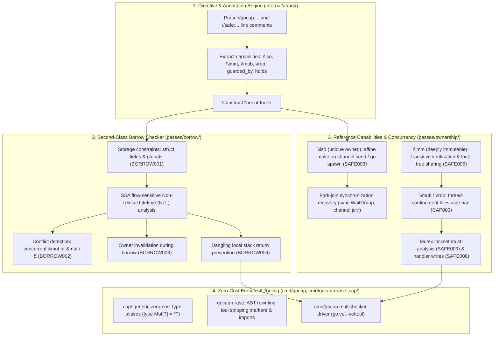

# Project: GoSree (`gosree` / `gocap`) — Rust-Style Safety, Reference Capabilities & Second-Class Borrows

## Architecture & Overview
`gosree` (Go + श्री *Śrī* · **S**tatic **R**ace & **E**scape **E**nforcer, formerly `gocap`) is a static analysis suite for Go built on `golang.org/x/tools/go/analysis` and `golang.org/x/tools/go/ssa`. It enforces Rust-style memory safety, reference capabilities, and borrow checking with zero-cost erasure to standard Go code.

Detailed documentation is available in the [`docs/`](docs/) directory:
- [Architecture & Subsystem Design](docs/ARCHITECTURE.md)
- [Diagnostic Rules & Violations Reference](docs/RULES.md)
- [Directives & Capability Markers Reference](docs/DIRECTIVES.md)
- [Second-Class Borrows & Non-Lexical Lifetimes (NLL)](docs/BORROW_CHECKING_AND_NLL.md)
- [Concurrency Model & Goroutine Boundaries](docs/CONCURRENCY_MODEL.md)
- [Tooling, Erasure & Verification Guide](docs/TOOLING_AND_ERASURE.md)

---

## Architectural Subsystems & Data Flow



---

## Feature Inventory

Every feature identified during development is inventoried and assigned to a milestone:

| # | Feature | Description | Milestone | Status |
|---|---------|-------------|-----------|--------|
| 1 | `//gocap:iso` Parameter Directive | Marks function parameter as uniquely owned; caller transfers ownership | M2 | **DONE** |
| 2 | `//gocap:imm` Type Directive | Marks struct type as deeply immutable | M2 | **DONE** |
| 3 | `//gocap:mub` / `//gocap:mut` Param Directive | Marks parameter as second-class mutable borrow (`&mut T` / `\mub`) | M1 | **DONE** |
| 4 | `//gocap:rob` / `//gocap:ref` Param Directive | Marks parameter as second-class read-only borrow (`&T` / `\rob`) | M1 | **DONE** |
| 5 | `//gocap:mut` Local Binding Directive | Marks local pointer binding as active second-class mutable borrow | M1 | **DONE** |
| 6 | `//gocap:rob` Local Binding Directive | Marks local pointer binding as active second-class read-only borrow | M1 | **DONE** |
| 7 | `//gocap:unsafe <reason>` Escape Hatch | Suppresses diagnostics for attached declaration or statement | M1 | **DONE** |
| 8 | Legacy `//safe:*` Directive Aliases | Backward compatibility alias for `//safe:iso`, `//safe:imm`, `//safe:unsafe` | M1 | **DONE** |
| 9 | Generic Marker Type `cap.Mut[T]` / `Mub[T]` | Type expression representing `&mut T` / `\mub` | M3 | **DONE** |
| 10 | Generic Marker Type `cap.Ref[T]` / `Rob[T]` | Type expression representing `&T` / `\rob` | M3 | **DONE** |
| 11 | Generic Marker Type `cap.Iso[T]` | Type expression representing `\iso` unique ownership | M3 | **DONE** |
| 12 | Generic Marker Type `cap.Imm[T]` | Type expression representing `\imm` deep immutability | M3 | **DONE** |
| 13 | Dummy Expressions `BorrowMut` / `Borrow` / `BorrowRef` / `BorrowMub` / `BorrowRob` | Helper expressions for explicit borrowing | M3 | **DONE** |
| 14 | Dummy Expression `Move(x)` | Helper expression for explicit ownership transfer | M3 | **DONE** |
| 15 | Struct Field Borrow Prohibition | Rejects borrow types/annotations in struct fields (`BORROW001`) | M1 | **DONE** |
| 16 | Package Global Borrow Prohibition | Rejects borrow types/annotations in package globals (`BORROW001`) | M1 | **DONE** |
| 17 | Transient Stack Struct Exception | Permits non-escaping stack tuples to hold stack borrows | M1 | **DONE** |
| 18 | Simultaneous Mutable Borrow Detection | Rejects multiple concurrent mutable borrows of same allocation (`BORROW002`) | M1 | **DONE** |
| 19 | Mutable-Immutable Aliasing Detection | Rejects mutable borrow when read-only borrow is active, or vice-versa (`BORROW002`) | M1 | **DONE** |
| 20 | Owner Invalidation During Borrow | Rejects mutation or move of owner allocation while borrowed (`BORROW003`) | M1 | **DONE** |
| 21 | Local Stack Return Prohibition | Rejects returning reference to local stack allocation (`BORROW004`) | M1 | **DONE** |
| 22 | Non-Lexical Lifetime (NLL) Analysis | Resolves borrow expiry at last SSA use, permitting sequential reuse without lifetimes | M1 | **DONE** |
| 23 | `\iso` Channel Send Move Invalidation | Invalidates sender binding upon channel send; reports use-after-move (`SAFE003`) | M2 | **DONE** |
| 24 | `\iso` Goroutine Move Invalidation | Invalidates sender binding upon `go` spawn; reports use-after-move (`SAFE003`) | M2 | **DONE** |
| 25 | Fork-Join Synchronization Join Point | Restores ownership to parent if goroutine joined via `sync.WaitGroup` or channel | M2 | **DONE** |
| 26 | Deep Immutability Transitive Check | Verifies all struct fields are pointer-free, strings, or pointers to `\imm` (`SAFE005`) | M2 | **DONE** |
| 27 | `\imm` Goroutine Sharing | Permits verified `\imm` pointers to be shared across goroutines without move invalidation | M2 | **DONE** |
| 28 | `\mub` / `\rob` Channel Escape Ban | Rejects sending stack-scoped borrow over a channel (`CAP003`) | M2 | **DONE** |
| 29 | `\mub` / `\rob` Goroutine Escape Ban | Rejects capturing stack-scoped borrow in a `go` closure or argument (`CAP003`) | M2 | **DONE** |
| 30 | Native Comment Erasure Verification | Directives erase natively with 0 bytes and 0 instructions overhead | M3 | **DONE** |
| 31 | AST Stripping Erasure Tool (`gocap-erase`) | Rewrites marker types to standard Go types and strips imports | M3 | **DONE** |
| 32 | Comprehensive Acceptance Test Suite | Dual-track 4-tier E2E acceptance suite covering AC1–AC7 (96 tests) | M4 | **DONE** |

---

## Milestones Summary

| # | Name | Scope | Status |
|---|------|-------|--------|
| **M1** | Second-Class Borrows & Local Borrow Checker | Directive parsing for `mub`/`rob`/`mut`/`ref` in `internal/annot/`; storage checks (`BORROW001`); SSA flow-sensitive borrow checking (`BORROW002`, `BORROW003`, `BORROW004`); NLL analysis | **DONE** (100% test pass) |
| **M2** | Reference Capabilities Across Concurrency Boundaries | `\iso` move invalidation across channel sends and `go` closures (`SAFE003`); fork-join recovery; `\imm` transitive deep immutability (`SAFE005`); stack-scoped borrow escape ban (`CAP003`) | **DONE** (100% test pass) |
| **M3** | Toolchain Compatibility & Zero-Cost Erasure | Native directive zero-cost erasure; `cap/` generic marker types and aliases; `cmd/gocap-erase` AST tool; CLI multi-checker wiring | **DONE** (Bit-for-bit parity, 100% test pass) |
| **M4** | Dual-Track E2E Acceptance & Hardening | Dual-track 4-tier E2E acceptance test suite (96 tests across Tiers 1-4); adversarial hardening | **DONE** (96/96 tests PASS) |

---

## Code Layout

```text
.
├── cmd/
│   ├── gocap/              # Multichecker CLI entrypoint
│   ├── gocap-erase/        # AST zero-cost erasure tool
│   └── gocap-corpus/       # Race corpus & real-world module evaluation engine
├── cap/                    # Zero-cost generic type aliases (type Mut[T] = *T)
├── internal/
│   ├── annot/              # Directive parser (gocap: and safe: prefixes)
│   └── kinds/              # Type classification & immutability helpers
├── passes/
│   ├── unsafeban/          # SAFE001 ban on unsafe operations
│   ├── borrow/             # Second-class borrow checker pass (BORROW001-004)
│   └── ownership/          # Reference capabilities & concurrency pass (SAFE002-009, CAP003)
├── tests/
│   ├── e2e/                # Dual-track 4-tier acceptance test suite (96 tests)
│   └── run_acceptance_tests.sh  # Master acceptance test runner
└── docs/                   # Architectural & user documentation
    ├── ARCHITECTURE.md
    ├── RULES.md
    ├── DIRECTIVES.md
    ├── BORROW_CHECKING_AND_NLL.md
    ├── CONCURRENCY_MODEL.md
    └── TOOLING_AND_ERASURE.md
```
