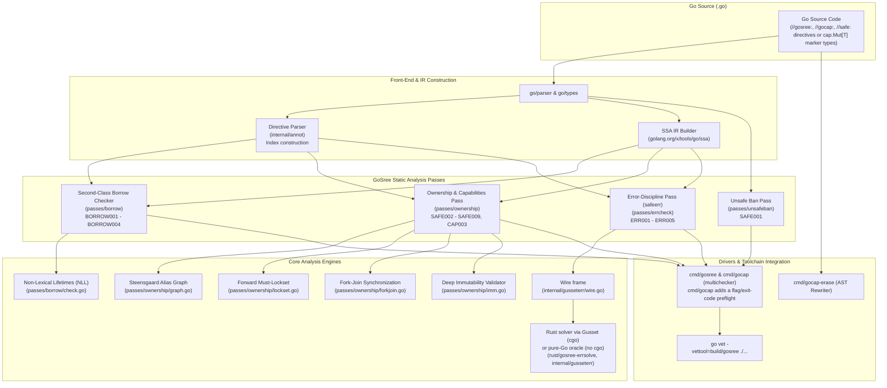
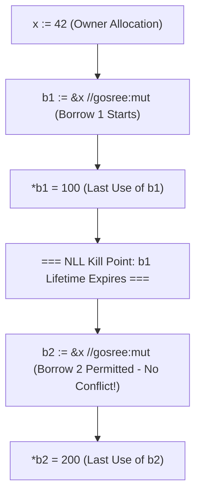
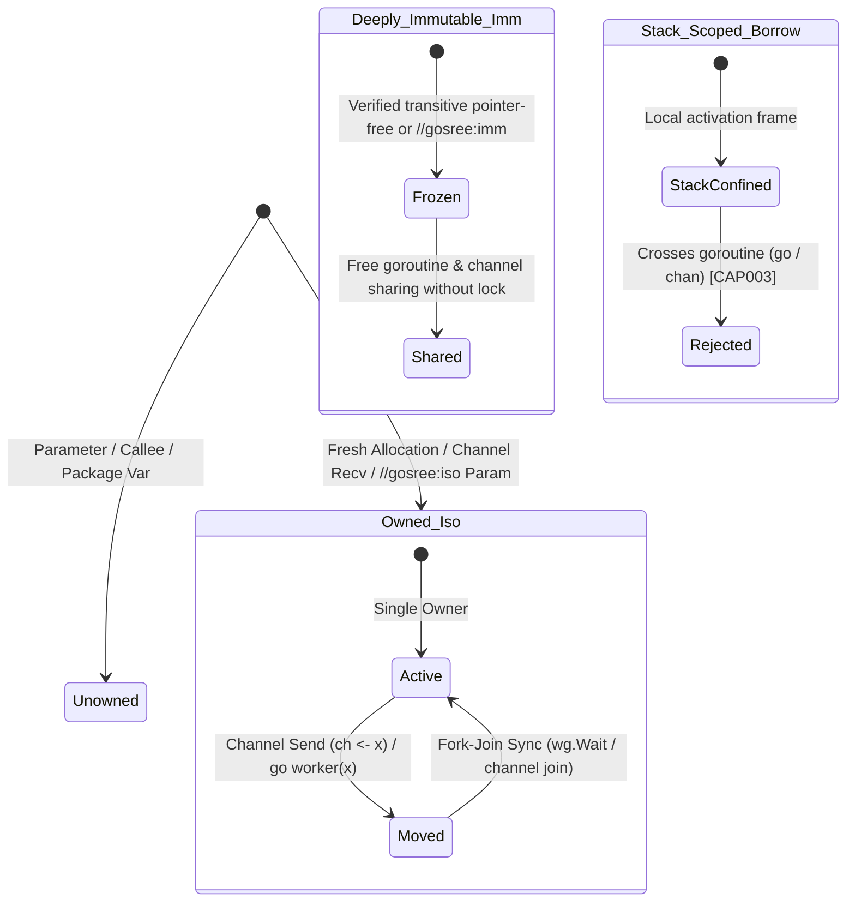
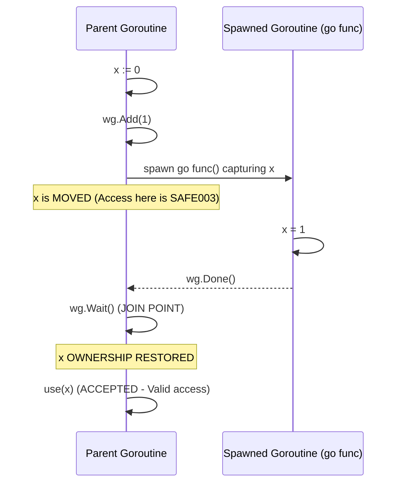

<div align="center">


# GoSree (`gosree`)

**Go + श्री (*Śrī*) · Static Race & Escape Enforcer**  
*Ownership checking, reference capabilities, and second-class borrows for ordinary Go.*

[](go.mod)
[](docs/ARCHITECTURE.md)
[](docs/TOOLING_AND_ERASURE.md)
[-00ADD8?style=flat-square)](#measured-on-the-go-race-detectors-corpus)

[Quick Start](#quick-start) · [Capabilities](#capability--directive-overview) · [Rules (`SAFE` / `BORROW` / `CAP` / `ERR`)](#rules--diagnostics) · [How It Works](#how-it-works) · [Fork-Join](#fork-join) · [Race Corpus](#measured-on-the-go-race-detectors-corpus) · [Docs](docs/)

</div>

---

**GoSree** (`gosree`, formerly `gocap`) is a suite of static analysis passes built on `golang.org/x/tools/go/analysis` and `golang.org/x/tools/go/ssa`—paired with an in-process **Rust CFG/SSA monotone fixpoint engine** (`rust/gosree-errsolve`) hosted via **Gusset** (`internal/gusseterr`)—that brings Rust-style memory safety, reference capabilities (`\iso`, `\imm`, `\mub`, `\rob`), mutex lockset verification (`guarded_by`, `holds`), second-class borrow checking with Non-Lexical Lifetimes (NLL), and `Result<T, E>` error-handling discipline (`ERR001`–`ERR005`) to ordinary Go.

> **Why *GoSree*?**  
> In Sanskrit, **श्री (*śrī*)**—from the verbal root **श्रि (*śri*)**—means *"that on which something safely rests, a foundation or refuge, order and harmony."* In English, **SREE** stands for **S**tatic **R**ace & **E**scape **E**nforcer (and **S**econd-class **R**eferences & **E**xclusive **E**rasure).

The code stays plain, idiomatic Go: annotations are comments (`//gosree:`, `//sree:`, `//gocap:`, or `//safe:`), or zero-cost generic marker type aliases (`cap.Mut[T] = *T`), so `gofmt`, `gopls`, `go vet`, and `go test` compile and test normal Go with **zero runtime overhead**.

---

## Capability & Directive Overview

| Capability / Claim | Comment Directives (`//gosree:` / `//sree:` / `//gocap:` / `//safe:`) | Generic Marker Type | Semantics & Guarantee | Enforced By |
|---|---|---|---|---|
| **Isolated (`\iso`)** | `//gosree:iso p` · `//sree:iso p` · `//gocap:iso p` · `//safe:iso p` | `cap.Iso[T]` + `cap.Move(x)` | Unique ownership root; affine move across goroutines/channels invalidates sender binding until a verified fork-join point | `SAFE002`, `SAFE003`, `SAFE004` |
| **Immutable (`\imm`)** | `//gosree:imm` · `//sree:imm` · `//gocap:imm` · `//safe:imm` | `cap.Imm[T]` | Transitively immutable struct (or guarded fields only); freely shareable across goroutines without locks or moves | `SAFE005` |
| **Mutable Borrow (`\mub`)** | `//gosree:mub p` · `//gosree:mut` · `//gocap:mub p` · `//gocap:mut` | `cap.Mut[T]` / `cap.Mub[T]` | Stack-confined exclusive mutable borrow (`&mut T`); no aliasing borrows, no owner mutation while live, no heap/goroutine escape | `BORROW001`–`004`, `CAP003` |
| **Read-Only Borrow (`\rob`)** | `//gosree:rob p` · `//gosree:ref` · `//gocap:rob p` · `//gocap:ref` | `cap.Ref[T]` / `cap.Rob[T]` | Stack-confined shared read-only borrow (`&T`); multiple readers allowed, no concurrent `\mub`, no heap/goroutine escape | `BORROW001`–`004`, `CAP003` |
| **Guarded Memory** | `//safe:guarded_by mu [x, y]` · `//gosree:guarded_by mu [x, y]` | — | Unexported struct field, package global, or local variable accessed only while mutex `mu` is held (`RLock` for reads, `Lock` for writes) | `SAFE009`, `SAFE006` |
| **Lock Precondition** | `//safe:holds mu` · `//gosree:holds mu` | — | Function or method requires caller to hold `mu` on every incoming CFG path and must not unlock it | `SAFE007`, `SAFE009` |
| **Escape Hatch** | `//gosree:unsafe <reason>` · `//gocap:unsafe <reason>` · `//safe:unsafe <reason>` | — | Audited, reason-mandatory suppression for a declaration, transfer, or statement; counted in the module hatch ratio | `SAFE007`, `ownership.Stats` |

---

## Architecture & Static Analysis Pipeline



### Analyzers

`cmd/gosree` and `cmd/gocap` register the same five analyzers, in this order ([`cmd/gosree/main.go`](cmd/gosree/main.go), [`cmd/gocap/main.go`](cmd/gocap/main.go)):

| Analyzer (`-NAME` flag) | Package | Rules |
|---|---|---|
| `safeannot` | [`internal/annot`](internal/annot/annot.go) | Directive parsing; `SAFE007` |
| `safeunsafe` | [`passes/unsafeban`](passes/unsafeban/unsafeban.go) | `SAFE001` |
| `safeownership` | [`passes/ownership`](passes/ownership/ownership.go) | `SAFE002`–`SAFE006`, `SAFE008`, `SAFE009`, `CAP003` |
| `borrow` | [`passes/borrow`](passes/borrow/borrow.go) | `BORROW001`–`BORROW004` |
| `safeerr` | [`passes/errcheck`](passes/errcheck/errcheck.go) | `ERR001`–`ERR005` |

A sixth analyzer, `safestale` ([`internal/annot/stale`](internal/annot/stale/stale.go)), requires the five above and reports escape hatches that mute nothing. Neither driver registers it; only its own test runs it.

---

## Quick Start

### 1. Build the Analyzer

The error-discipline pass (`safeerr`) solves its dataflow lattice in a Rust engine linked in-process through [Gusset](https://github.com/bharathvbcr/gusset). With cgo on a unix target, build the Rust archive first:

```bash
# Prerequisites: a Rust toolchain, and the gusset checkout as a sibling directory (../gusset)
(cd rust && cargo build --release)     # produces rust/target/release/libgusset.a (gitignored)
go build -o build/gosree ./cmd/gosree
```

- **Sibling checkout:** `go.mod` has `replace github.com/bharathvbcr/gusset => ../gusset`, and `rust/gusset-engine` depends on `../../../gusset/crates/gusset` by path, so gusset must sit next to this repository.
- **Skipping `cargo build` fails at link time:** the cgo directive in [`internal/gusseterr/engine_unix.go`](internal/gusseterr/engine_unix.go) adds `-L rust/target/release` and expects the symbol `gosree_gusset_init`. Without that archive `go build ./cmd/gosree` ends with `Undefined symbols ... _gosree_gusset_init`.
- **Without cgo (`CGO_ENABLED=0`) or on a non-unix target** no Rust is needed: [`engine_other.go`](internal/gusseterr/engine_other.go) solves with the pure-Go reference oracle ([`oracle.go`](internal/gusseterr/oracle.go)), which produces the same results bit for bit. Findings are the same; only speed and heap use differ. `errcheck.Summary.UsedRustGusset` reports which engine ran.

### 2. Run Verification via `go vet` (or Standalone)
```bash
# Via go vet (recommended)
go vet -vettool=$(pwd)/build/gosree ./...

# Or standalone multichecker
./build/gosree ./...
```

### 3. Run the Verification Suites
```bash
# Run all unit and analysis pass tests (needs the Rust archive from step 1 when cgo is on).
# One known failure: passes/ownership TestEscapeOracleNoFreshOrWritesOracle.
go test ./...

# Run the dual-track 4-tier E2E acceptance test suite (12 top-level Go tests in tests/e2e)
bash tests/run_acceptance_tests.sh

# Run the adversarial stress & runtime witness suite
go test ./tests/stress
```

### 4. `cmd/gocap`: exit codes and refused flags

`cmd/gocap` runs the same analyzers as `cmd/gosree`, behind a command-line preflight ([`cmd/gocap/preflight.go`](cmd/gocap/preflight.go)) so that a CI gate cannot pass by accident. `cmd/gosree` is the plain multichecker without it.

| Exit | Meaning |
|---|---|
| `0` | Every package loaded, type-checked and analysed, and nothing was reported |
| `1` | A package could not be loaded or type-checked, or an analyzer failed: no verdict |
| `2` | Usage error: an unsupported flag, or one refused because it would change the verdict |
| `3` | Every package was analysed and at least one finding was reported |

- **`-fix` and `-diff` are refused (exit 2).** GoSree offers no suggested fixes, and the driver exits 0 and prints nothing in those modes.
- **`-tags a,b` is forwarded to the `go` command** through `GOFLAGS`, because the driver itself accepts and ignores it. The list must be comma-separated.
- **`-json`**: the driver exits 0 even with findings, so `gocap` re-runs it as a child process and derives the exit code from the JSON. A failed analysis outranks findings.
- **Warnings on stderr** when a flag makes a run cover less: `-test=false` (test files are not analysed), and `-NAME=false` or `-NAME` for an analyzer, which switches other passes off (exit 0 then does not mean those rules were checked).

### 5. Optional: AST Erasure Tool (`cmd/gocap-erase`)
Strip generic marker types (`cap.Mut[T]` → `*T`), helper intrinsics (`cap.BorrowMut(x)` → `x`), directive comments (`//gosree:`, `//sree:`, `//gocap:`, `//safe:`), and `cap` imports into dependency-free Go source:
```bash
go build -o build/gosree-erase ./cmd/gocap-erase
build/gosree-erase -d ./...   # preview unified diff
build/gosree-erase -w ./...   # rewrite files in place atomically
```

---

## Documentation Index

Comprehensive guides, specifications, and reference manuals are located in [`docs/`](docs/):

- 📘 **[Architecture & Subsystem Design](docs/ARCHITECTURE.md)**: Deep dive into the static analysis pipeline, Steensgaard alias graph with pointer depths, SSA CFG traversal, and module interactions.
- 📋 **[Rules & Diagnostics Reference](docs/RULES.md)**: Complete catalog of all diagnostic codes (`SAFE001`–`SAFE009`, `BORROW001`–`BORROW004`, `CAP003`, `ERR001`–`ERR005`) with failing/passing examples and remediation patterns.
- 🏷️ **[Directives & Capability Markers](docs/DIRECTIVES.md)**: Specification for comment directives (`//gosree:...`, `//sree:...`, `//gocap:...`, `//safe:...`), attachment rules, and `cap.*` marker types.
- ⏳ **[Second-Class Borrows & Non-Lexical Lifetimes (NLL)](docs/BORROW_CHECKING_AND_NLL.md)**: How second-class borrows avoid Rust's explicit lifetime parameters (`'a`), storage constraints, and flow-sensitive SSA conflict resolution.
- 🔀 **[Concurrency Model & Goroutine Boundaries](docs/CONCURRENCY_MODEL.md)**: Goroutine boundary invariants, spawner taxonomy, fork-join join points, HTTP handler self-races, and mutex locksets.
- 🛠️ **[Tooling, Erasure & Verification Guide](docs/TOOLING_AND_ERASURE.md)**: User guide for `cmd/gosree` (`cmd/gocap`), `cmd/gocap-erase`, `cmd/gocap-corpus`, and the 4-tier acceptance test suite.
- 🦀 **[Error Discipline (`safeerr`, `ERR001`–`ERR005`)](docs/ERROR_DISCIPLINE.md)**: The `passes/errcheck` pass, its binary wire format, the Rust solver hosted through Gusset, and the pure-Go reference oracle.
- 🗺️ **[Roadmap & Abandon Criterion](docs/ROADMAP.md)**: Build order with each item's prediction and measured result, and the hatch-ratio criterion for abandoning the project.
- 🧪 **[Adversarial Stress Suite & Findings](tests/stress/FINDINGS.md)**: Locked regression hits, runtime race/panic witnesses, scale bounds, and distance-to-Rust ledger.

---

## Rules & Diagnostics

| Code | Subsystem | Description |
|---|---|---|
| [**SAFE001**](docs/RULES.md#safe001-unsafe-operations-ban) | `passes/unsafeban` | `unsafe.Pointer`/`Add`/`Slice`/`String*` (however `unsafe` is imported, dot imports included), cgo, `//go:linkname`, assembly functions without Go body, `reflect.Value.Set*`/`UnsafeAddr`/`UnsafePointer`, `reflect.NewAt` |
| [**SAFE002**](docs/RULES.md#safe002-unowned-value-crossing-boundary) | `passes/ownership` | A value crossing to another goroutine is not owned: it may alias a parameter, a package variable, or a result the callee may still reference |
| [**SAFE003**](docs/RULES.md#safe003-use-after-move) | `passes/ownership` | A value is used after it was moved; `SAFE003-forkjoin` category marks uses reached only after a channel receive, `select`, `WaitGroup.Wait` or `Lock` that is not a [join](docs/CONCURRENCY_MODEL.md#3-fork-join-synchronization-recovery) for that move |
| [**SAFE004**](docs/RULES.md#safe004-moved-value-escapes-elsewhere) | `passes/ownership` | A moved value also escapes elsewhere (stored in a package variable, kept by a callee, returned) |
| [**SAFE005**](docs/RULES.md#safe005-deep-immutability-violation) | `passes/ownership` | A `//gosree:imm` / `//safe:imm` type is malformed, or is written after its composite literal |
| [**SAFE006**](docs/RULES.md#safe006-package-global-mutation) | `passes/ownership` | A package variable is written outside initialisation and is not `//safe:guarded_by`; reported once at the declaration, with each write as a related position |
| [**SAFE007**](docs/RULES.md#safe007-malformed-directive) | `internal/annot` | A malformed `//gosree:`, `//sree:`, `//gocap:`, or `//safe:` directive |
| [**SAFE008**](docs/RULES.md#safe008-self-racing-handler-writes) | `passes/ownership` | A handler (a callback that runs concurrently with itself) writes memory it shares with its other invocations: what it captured, or its receiver |
| [**SAFE009**](docs/RULES.md#safe009-guarded-memory-access-violation) | `passes/ownership` | `//safe:guarded_by` memory is accessed without its mutex held, a `//safe:holds` function is called without it, or a value read from guarded memory leaves the lock |
| [**BORROW001**](docs/RULES.md#borrow001-second-class-borrow-storage-violation) | `passes/borrow` | Second-class borrow stored in struct field or package global variable (transient stack structs excepted) |
| [**BORROW002**](docs/RULES.md#borrow002-conflicting-borrows) | `passes/borrow` | Conflicting simultaneous mutable borrows or mutable-immutable aliasing (NLL flow-sensitive) |
| [**BORROW003**](docs/RULES.md#borrow003-owner-mutation-during-active-borrow) | `passes/borrow` | Owner variable mutated or moved while an active second-class borrow exists |
| [**BORROW004**](docs/RULES.md#borrow004-dangling-stack-reference-return) | `passes/borrow` | Function returns reference or pointer to local stack-allocated variable |
| [**CAP003**](docs/RULES.md#cap003-stack-scoped-borrow-concurrency-escape) | `passes/ownership` | Stack-scoped borrow (`\mub` or `\rob`) crosses goroutine boundary via channel send, `go` closure capture, or `go` argument |
| [**ERR001**](docs/RULES.md#err001-must-use-error-return-discarded) | `passes/errcheck` + `rust/gosree-errsolve` | Error return silently discarded as statement, `go`, or `defer` (`#[must_use]` discipline) |
| [**ERR002**](docs/RULES.md#err002-unchecked-companion-result-unwrap) | `passes/errcheck` + `rust/gosree-errsolve` | `(T, error)` companion value used after `_` discard or before proving `err == nil` |
| [**ERR003**](docs/RULES.md#err003-shadowed-overwritten-or-inverted-error) | `passes/errcheck` + `rust/gosree-errsolve` | Error lost via inner `err :=` shadow, unread overwrite, or `if err != nil { return nil }` |
| [**ERR004**](docs/RULES.md#err004-typed-nil-concrete-error-interface-boxing) | `passes/errcheck` + `rust/gosree-errsolve` | Concrete `*T` error pointer that may be `nil` boxed into an `error` interface |
| [**ERR005**](docs/RULES.md#err005-writable-resource-close-error-discarded) | `passes/errcheck` + `rust/gosree-errsolve` | `Close()` / `defer f.Close()` on writable or written resource discards flush error |

---

## Second-Class Borrows & Non-Lexical Lifetimes (NLL)

Unlike Rust, where references are first-class and require explicit lifetime annotations on types and functions (`struct View<'a>`, `fn foo<'a>(x: &'a T)`), GoSree models references as **second-class values**:
- They can be passed to functions and used locally.
- They **cannot be stored into heap structs or package globals** (`BORROW001`), with an exception for transient stack structs that never escape the local activation frame.
- Because borrows never escape the stack frame, **all lifetimes are local and inferred automatically** using Non-Lexical Lifetimes (NLL) on the SSA CFG:



```go
func SequentialBorrows() {
    x := 10
    b1 := &x //gosree:mut
    *b1 = 20 // Last use of b1 (lifetime expires here)

    b2 := &x //gosree:mut // OK: b1 is dead under NLL
    *b2 = 30
}
```

| Existing Active Borrow | Attempted New Borrow | Allowed? | Diagnostic |
|---|---|---|---|
| None | `&T` (`\rob`) or `&mut T` (`\mub`) | **Yes** | — |
| `&T` (`\rob`) | `&T` (`\rob`) | **Yes** (Multiple readers) | — |
| `&T` (`\rob`) | `&mut T` (`\mub`) | **No** (Mutable-immutable aliasing) | `BORROW002` |
| `&mut T` (`\mub`) | `&T` (`\rob`) or `&mut T` (`\mub`) | **No** (Exclusive mutable access required) | `BORROW002` |
| `&T` (`\rob`) or `&mut T` (`\mub`) | Direct write or move of owner `x` | **No** (Owner invalidation while borrowed) | `BORROW003` |

---

## Concurrency Boundaries & Capabilities

### Why only goroutine boundaries

In a garbage-collected Go program, use-after-free and out-of-bounds access cannot happen unless memory is corrupted by a **data race**: a torn write to a two-word interface or slice header can pair a type with the wrong pointer. So GoSree checks ownership where a value crosses to another goroutine: a `go` statement (its arguments and the closure it starts), a callback handed to a function that runs it on another goroutine (`time.AfterFunc`, `context.AfterFunc`, `sync.WaitGroup.Go`, `errgroup.Group.Go`/`TryGo`, `net/http` handler registration, or any function whose `FuncFact.Spawns` summary marks a callback parameter as spawned), a channel send, and an argument for a `//gosree:iso` / `//safe:iso` parameter. A closure's captured variables cross only when the closure itself does. Inside one goroutine, ordinary Go aliasing is left alone (unless opted into second-class borrows).

The standard-library callback functions are a curated table in [`passes/ownership/spawn.go`](passes/ownership/spawn.go), an assumption about each callee like the type overrides. A function that runs its callback before returning (`sync.Once.Do`, `testing.T.Run` without `Parallel`, `slices.SortFunc`) is an ordinary call. An HTTP handler runs on every request's goroutine, concurrently with itself, so it never owns what it captured (moving a capture on is `SAFE002`), never hands anything back, and must not write memory it shares with its other invocations (`SAFE008`).



---

### SAFE008: handlers racing with themselves

Two requests can run the same handler at once, and the code that registered it cannot see that race, so the transfer rules do not catch it. `SAFE008` starts from what every invocation shares (a closure's captured variables, a method value's receiver, a `Handler` value's `ServeHTTP` receiver) and follows it through field, index, slice, conversion and load steps to any store, map update, or `delete`/`clear`/`copy`/`append` into it. It follows the shared memory into functions of this package the handler calls and into closures it calls directly. At a static call into another package it reads the callee's summary instead: passing shared memory to a parameter the callee may write (`h.cache.Set(k, v)`, `sort.Ints(s)`) is a finding, worded "passed to `F`, which may write it". When GoSree has no summary for the callee (no Go body), the finding says "(summary unavailable)". Passing shared non-shareable unguarded memory to an interface method (`h.store.Put(...)`) or a dynamic function value is also reported as `SAFE008`. It stops at:
- goroutines the handler starts, which the transfer rules check;
- handler values it cannot resolve to a body.

There is no exemption by type for a direct write: `s.count++` on an `int` races. An argument of a shareable type (a mutex, an atomic, an imm value) is exempt at a call, so `h.mu.Lock()` and `h.count.Add(1)` are never reported, and neither are the functions of `sync/atomic`: atomic accesses are synchronised, not writes. A write under a lock is reported unless the memory is `//safe:guarded_by`; then `SAFE009` checks it instead. A `//safe:unsafe` on the registration mutes every `SAFE008` of that handler and counts as a suppressed transfer. One on a write mutes that line only. One finding is reported per source line.

---

### SAFE009: guarded memory

A field, package variable or local variable annotated `//safe:guarded_by mu` may be read only while `mu` is held (`RLock` is enough for a `sync.RWMutex`), and written only while it is locked. A function marked `//safe:holds mu` may be called only with `mu` held, and must not unlock it (`SAFE007`). Nothing non-shareable read from guarded memory may leave the lock. That covers being returned, sent, stored outside memory the same mutex guards, handed to a goroutine or callback, or passed to a function whose summary says it may keep it.

"Held" is a forward must-analysis over each function's control-flow graph:
- **Identity:** a mutex is identified by its path, a root SSA value plus field steps. A load is a step only from a variable assigned once before the load.
- **Lock operations:** `Lock`/`RLock` add a path and `Unlock`/`RUnlock` remove it. A `TryLock`/`TryRLock` adds it on the branch where it succeeded (including across boolean negations, single-store local boolean variables `ok := mu.TryLock(); if ok`, and boolean constant comparisons). A deferred `Unlock` changes nothing until return.
- **Calls:** a function of this package releases the parameter mutexes it unlocks, and acquires the parameter and captured mutexes it holds at every return after its deferred calls have run (both summarised via `FuncFact.Acquires`). A helper that locks for its caller, `func lock(mu *sync.Mutex) { mu.Lock() }`, leaves `mu` held after the call; one that locks on some paths only acquires nothing. Any call into another package, interface method or dynamic call releases every mutex in what it receives (unless re-established by `FuncFact.Acquires`), including through `fmt.Println(c)`'s variadic slice.
- **Closures:** a closure called in place starts with its caller's locks. Any other function starts with none, plus its `//safe:holds`.
- **Locals:** a guarded local is a cell: its `Alloc` in the declaring function and, in each closure that captures it, the free variable bound to it. Its mutex is found the same way, so a goroutine that locks its captured `mu` holds the guard of its captured `x`. A closure that does not capture `mu` cannot hold it. A guarded local is not moved by the goroutines that capture it (no `SAFE003`), because `SAFE009` checks every access to it instead.

Exempt: package variables during initialisation; a guarded local in its own function until a closure captures it or its address goes anywhere but a direct load or store; and an object this function allocated that nothing else can see yet (a constructor filling it in before it is returned, stored or moved).

---

## Annotations & Marker Types

### Comment Directives (`//gosree:`, `//sree:`, `//gocap:`, `//safe:`)
```go
//gosree:iso j          // on a func: j is owned; passing an argument to it moves the argument
func forward(ch chan *Job, j *Job) { ch <- j }

//gosree:imm            // on a struct: deeply immutable, so it may be shared freely
type Config struct{ name string; port int }

//gosree:mub p          // on a func: parameter p is a mutable second-class borrow (&mut T)
func update(p *int) { *p++ }

//gosree:rob p          // on a func: parameter p is a read-only second-class borrow (&T)
func read(p *int) int { return *p }

//gosree:unsafe <reason> // exempts the next statement, or the whole function from its doc comment

type Server struct {
	mu   sync.Mutex
	hits map[string]int //safe:guarded_by mu   // every access must hold mu
}

//safe:holds mu         // on a func: its callers must hold mu (a receiver field or package variable)
func (s *Server) evictLocked() { clear(s.hits) }
```

### Generic Marker Types (`cap`)
```go
import "github.com/bharathvbcr/gocap/cap"

type Item struct{ Val int }

func Increment(item cap.Mut[Item]) {
    item.Val++
}

func Read(item cap.Ref[Item]) int {
    return item.Val
}

func main() {
    x := Item{Val: 10}
    b := cap.BorrowMut(&x)
    Increment(b)
}
```

`//safe:guarded_by mu` (or `//gosree:guarded_by mu`) goes on an unexported struct field (`mu` is a field of the same struct; an embedded mutex is named `Mutex`), on a package variable (`mu` is a package variable), or on a local variable declared with `var` or `:=` (`mu` is a variable in scope there: a local of this or an enclosing function, or a package variable). By default it guards every name the declaration introduces, or selective names when listed (`//safe:guarded_by mu x, y`); a `:=` that redeclares an existing name is rejected. The mutex is a `sync.Mutex` or `sync.RWMutex` held by value. Pointers to mutexes, `sync.Locker` values and exported fields or package variables are rejected as `SAFE007`. These are checked claims, like `imm` and `iso`, so they count toward neither the hatch ratio nor the override budget. `SAFE009` enforces them, and a write to a guarded package variable, or to a guarded field of one, is exempt from `SAFE006`.

```go
var mu sync.Mutex
x := 0 //safe:guarded_by mu
go func() { mu.Lock(); x++; mu.Unlock() }()
mu.Lock(); x++; mu.Unlock()
```

To share a struct between goroutines, make it `//safe:imm` and guard its mutable fields. An imm type's guarded fields may have any type, and `SAFE005` leaves them to `SAFE009`. Every other field still never changes after the composite literal, so a `*Server` holding a guarded map can be captured by every handler:

```go
//safe:imm
type Server struct {
	name string
	mu   sync.Mutex
	hits map[string]int //safe:guarded_by mu
}
```

Guarding a field of a type that is not imm does not make it shareable: moving it to another goroutine is still `SAFE002`/`003`.

A `//safe:unsafe` (or `//gosree:unsafe`) on a transfer (a `go` statement, a send, a call to a `//safe:iso` parameter) covers everything that transfer causes: the `SAFE002` and `SAFE004` at the transfer, and the `SAFE003` uses after it, wherever they are. One placed on a later use covers only that use.

An owned value is one that starts as a fresh allocation (`&T{}`, `new`, `make`), a value received from a channel, a `//safe:iso` parameter, or the result of a function whose summary says it returns fresh memory. It stays owned while nothing outside its own object graph points into it.

Shareable without ownership: pointer-free values, strings, channels, verified imm types and pointers to them, and a curated override table (`sync` and `sync/atomic` types, `*testing.T`, `context.Context`, `context.CancelFunc`, `error`, `time.Time`, `*regexp.Regexp`, `*log.Logger`, `*slog.Logger`, `net.Listener`, ...). Each override is an **assumption, not a proof**; see [`internal/kinds/kinds.go`](internal/kinds/kinds.go). The `error` entry is the weakest one: it rests on the convention that errors are not mutated after creation.

A second table, [`internal/kinds/funcs.go`](internal/kinds/funcs.go), replaces the summary of a function of another package with an assumption, keyed by `types.Func.FullName`. It holds four entries, each saying its result is fresh: `context.WithCancel` and `context.WithTimeout` (a `CancelFunc` is documented safe to call from any goroutine), `io.ReadAll` and `encoding/json.Marshal`. An entry states every flag and asserts only what its reason supports, so these keep their arguments leaked and written. The call tables (spawners, lock operations, function overrides) are checked by one resolver: when GoSree analyses the package an entry belongs to, the entry must name a function of it with matching arity, or the analysis fails. `TestCallTablesResolve` runs the same check on the current toolchain for every package but `golang.org/x/sync/errgroup`, which this module does not depend on; its entries are checked only when GoSree analyses a program that imports it. `TestOverrideBudget` fails once type overrides, function overrides and spawners together exceed 100 entries; today they hold 42 (29 + 4 + 9). Lock operations and `sync/atomic` define what a lock or a synchronised write is, rather than vouching for a callee, so they are not counted.

---

## How it works

- **Alias analysis:** per-function Steensgaard unification over SSA (`golang.org/x/tools/go/ssa`). It is flow-insensitive and field-insensitive on purpose: it reports too much and never too little. Only the move-kill (a use after a move unless the value is redefined first) is flow-sensitive.
- **Summaries:** each function gets a summary saying which arguments it may retain or share, which it may write, which arguments and results it links, whether it returns fresh memory, which locks it acquires, and which callback parameters it spawns. Summaries are computed to a greatest fixpoint within a package and exported as analysis facts (`FuncFact`) for exported functions, so they cross package boundaries. That includes the standard library: `(*bytes.Buffer).WriteString` is shown not to retain its receiver. Functions without bodies, interface calls, dynamic calls and wrappers are treated as retaining and writing everything.
  - **Writes:** an argument is written when a write lies on its forward pointee chain: the memory it points to, and what that points to. Containers that point into it do not count, so `fmt.Println(p)`, which puts `p` in a variadic slice, does not write `p`. A write to guarded memory is left to `SAFE009`.
  - **Links:** a function that joins two arguments' memory (`root.Add(child)`) or returns memory of one (`root.First()`) links them instead of leaking them. The caller joins the same memory, at the pointer depth where the callee joined it, so two owned arguments stay owned as one region, and a foreign one makes the other foreign. A copy (`cp := *c; return &cp`) is linked one pointer down, so writing the copy is not writing `c`.
- **Error-discipline lattice (`passes/errcheck` + `rust/gosree-errsolve` via Gusset):** `safeerr` lowers package SSA CFGs into a compact binary wire frame and solves a product of five monotone lattices (`Origin`, `NilVal`, `ErrVar`, `Writable`, `ErrLink`; see [docs/ERROR_DISCIPLINE.md](docs/ERROR_DISCIPLINE.md#23-what-the-solver-tracks)) + intra-package concrete-error callgraph fixpoint in Rust (`#![forbid(unsafe_code)]` inside `rust/gosree-errsolve`, linked into Go via `rust/gusset-engine` and `github.com/bharathvbcr/gusset` with panic-firewall isolation, `Counting<System>` Rust heap telemetry, and a bit-exact pure-Go reference oracle in `internal/gusseterr`). On 200-function cyclic packages (`BenchmarkSolvePackageAB`), the in-process Rust/Gusset solver runs in **1.140 ms** vs **2.867 ms** for the pure-Go oracle (**2.51× faster**, **266× less Go heap**: `18.8 KB` / `8 allocs` vs `4.99 MB` / `72,624 allocs`).
- **Change from the design advice:** the original plan took standard-library escape information from the compiler (`go build -gcflags=-m`). The MVP uses the same summary facts for every package instead, which gives one mechanism and no parsing of compiler output. An escape oracle test in [`passes/ownership/escape_oracle_test.go`](passes/ownership/escape_oracle_test.go) checks summary alignment against `-gcflags=-m`.

External dependencies are `golang.org/x/tools` and `github.com/bharathvbcr/gusset` (in-process Go↔Rust bridge).

---

## Fork-join

A goroutine can hand back what it was given. A move made by `go F(...)` ends at a **join**: a parent instruction after which `F` provably no longer touches the moved memory. A use the parent reaches only through joins is not a use after the move ([`passes/ownership/forkjoin.go`](passes/ownership/forkjoin.go)).



```go
x := 0
var wg sync.WaitGroup
wg.Add(1)
go func() { x = 1; wg.Done() }()
wg.Wait()
use(x) // accepted: the goroutine joined at Wait
```

A join needs all of these:

- **The goroutine is started once.** `F` is a function literal whose closure value only that `go` statement uses, and the `go` statement is not inside a loop.
- **The release follows the last use.** No instruction of `F` that touches the moved memory can run after any of `F`'s releases. Deferred calls count as running at exit: after every plain release, and after a deferred release when they were registered before it (defers run last-in, first-out). "Touches" uses `F`'s own alias graph, so a closure over the memory built before the release and called after it counts.
- **Nothing else keeps it.** `F` does not move the memory on (no `go`, send or `//safe:iso` argument) and does not let it escape. Escape comes from the callee summaries, so this is only as precise as they are. A callback over the memory handed to `time.AfterFunc` is itself a move, and one handed to `runtime.SetFinalizer` is caught because its summary marks it as retained (a case covers `AfterFunc`; `TestRaceFin` in the corpus covers `SetFinalizer`).
- **The sync object is local and fully visible.** It is one of:
  - **A channel the parent makes**, captured by `F`, whose only sends and closes anywhere are in `F` (a send, a `select` send case, `close`, `defer close`). Everything else may only receive from it or take `len`/`cap`. The join is a plain receive in the parent: `<-c`, `v, ok := <-c` or the exit of `for range c`. By the Go memory model, a send or close is synchronised before the receive that observes it, and `F` is the only sender.
  - **A `sync.WaitGroup` local to the parent**, used only through `Add`, `Done` and `Wait`. Every `Add` is in the parent, adds a positive constant, is not in a loop, and dominates every `go` statement whose goroutine calls `Done`. Each such goroutine is started once and calls `Done` at most once on any path. The `Add`s sum to the number of those goroutines. The join is `Wait` in the parent. Under those conditions `Wait` returns only after every `Done`, `F`'s included.
  - **The receiver of `WaitGroup.Go` or `errgroup.Group.Go`/`TryGo`** that started `F`. The join is `Wait` on that same value in the parent, since `Wait` returns only after every function started on it has returned. No release check is needed (`F` returns after its last touch), and the join holds in a loop too, since one `Wait` covers every function started before it.

`F` is started by a `go` statement or by a one-shot callback function (`time.AfterFunc`, `WaitGroup.Go` and the others in `spawn.go`). An HTTP handler never joins.

Accepted shapes (each has an `analysistest` case in `testdata/src/moves/forkjoin.go`): `Done` after the last write, `defer wg.Done()`, one `Add(2)` covering two goroutines, send handshake, `close` with a comma-ok receive, `for range c`, `x = <-c` with the goroutine doing `c <- x`, a `select` send as the release, and a pointer passed as a `go` argument rather than captured. In `testdata/src/callbacks/callbacks.go`: `Wait` after `WaitGroup.Go` and after `errgroup.Group.Go`, and a `time.AfterFunc` callback that closes a channel the parent receives from. Rejected there: `Wait` on a different WaitGroup, and a callback that keeps the memory in a package variable.

Still reported as `SAFE003-forkjoin`. Every item has a case, except `sync.Cond` and channels or WaitGroups held in struct fields:

- `Done` before the goroutine's last write, or a write in a defer registered before `defer wg.Done()`
- `Wait` on a different WaitGroup, `Add` inside the goroutine, `Add` totals that do not match the number of `Done` goroutines, and WaitGroup reuse across several `Add`/`Wait` rounds
- several goroutines sending on one channel, or a parent that also sends on it
- a channel that is a parameter or is passed to a function. Fields, conversions and any other use of the channel or WaitGroup are rejected the same way: the rule accepts only the operations listed above.
- a goroutine that moves the memory on, calls a closure over it after its release, or hands such a closure to a callback API (`time.AfterFunc`)
- `go` statements and callbacks in a loop, except for the `Wait` join above, and closure values started twice (these are also plain `SAFE003`)
- `select` receive cases as joins, mutex and `sync.Cond` hand-offs, and `go f(x)` with a named function

Two assumptions remain. The memory-model facts above are taken from the Go specification, not re-derived. And a deferred use registered *before* a move is still reported even when every path joins, because a panic between the move and the join would run it early.

---

## Measured on the Go race detector's corpus

`go run ./cmd/gocap-corpus -out build` copies `$GOROOT/src/runtime/race/testdata` into `build/` (never committed), runs the analyzer unannotated, and writes `build/corpus-report.json`. It then scores a second copy carrying the `//safe:guarded_by` directives listed in [`annotations.go`](cmd/gocap-corpus/annotations.go) and writes `build/corpus-report-annotated.json` ([below](#the-annotated-copy)). A test function counts as flagged if the analyzer reports anything in it or in a same-package function it calls. A finding also counts where its related positions are, so a declaration-site `SAFE006` counts for the functions whose writes make the variable mutable.

go1.27.3, 22 of 24 files. Skipped: `cgo_test.go` imports `internal/testenv` and `synctest_test.go` imports `internal/synctest`; neither can build outside GOROOT.

| | Writes, overrides, links | Predicted before that run | SAFE006 at the declaration | Predicted before that run | With callbacks | Predicted before that run | With fork-join | Predicted before that run | MVP (`b42b26c`) | Predicted before the MVP run |
|---|---|---|---|---|---|---|---|---|---|---|
| `TestRace*` flagged | 229 / 234 (97.9%) | 229, unchanged | 229 / 234 (97.9%) | 229 (needs related positions) | 229 / 234 (97.9%) | 229 | 228 / 234 (97.4%) | 228, unchanged | 228 / 234 (97.4%) | at least 85% |
| `TestNoRace*` clean | 36 / 129 (27.9%) | 36, unchanged | 36 / 129 (27.9%) | at most 38; the design review said 38 | 38 / 129 (29.5%) | 38 | 40 / 129 (31.0%) | 40 | 30 / 129 (23.3%) | 15 to 40% |
| `TestNoRace*` flagged only for fork-join | 7 | 7 | 7 | 7 | 7 | 7 | 7 | 7 | 17 | expected to dominate the misses; **it did not** |

The writes bit, the function overrides and argument linking left the counts where they were, as predicted, but six tests changed categories, which the prediction (unchanged) did not foresee:
- `net.Listener` became a type override, so `TestNoRaceIOHttp` lost its `SAFE002`, `SAFE003` and `SAFE004`. It stays flagged by `SAFE006`.
- Linking ties `reflect.ValueOf`'s result to its argument, so `TestRaceReflectRW`, `ReflectWW` and `ReflectCopyWW` lost a `SAFE002`.
- `TestRaceIssue5567` and `TestRaceIssue51618` gained `SAFE002` and `SAFE004` through a link Steensgaard unification makes inside the race build of `internal/poll` (see [Known limits](#known-limits)).

All five race tests were already flagged by `SAFE003`.

Moving `SAFE006` to the declaration would have dropped five races caught only by it (`TestRaceIssue12664`…`_4`, `TestRaceIntRWGlobalFuncs`): the finding left the test functions. Scoring related positions keeps them. Two race-free tests became flagged because they write a package variable outside init: `TestNoRaceFinGlobal` (its mutex-guarded counter needs `//safe:guarded_by Mutex`) and `TestNoRaceRpcChan` (a counter reset on one goroutine).

The callbacks run moved exactly the three predicted tests. `TestRaceAfterFunc3` is now flagged: two `time.AfterFunc` callbacks capture one variable. Two `TestNoRace*` tests became flagged. `TestNoRaceAfterFuncReset` writes after `Timer.Stop`, which that run did not model: in general `Stop` returning false means the callback already started. `TestNoRaceAfterFunc1` is a closure stored in a variable that respawns itself, so it does not own its own captured variable (`SAFE002`). It is not a goroutine body by the rule above, since its closure value reaches the spawn through a variable. `TestNoRaceAfterFunc` stayed clean: its callback hands the memory back through a channel it alone sends on, which is the [fork-join](#fork-join) rule applied to a callback.

The fork-join run cleared exactly the ten predicted tests: `TestNoRaceChanSync`, `ChanAsync`, `ChanAsyncCloseRecv2`/`3`, `ChanSyncCloseRecv2`/`3`, `ChanReadWriteAsync`, `Select3`, `WaitGroup2` and `WaitGroupTransitive`. No `TestRace*` test became unflagged. The nine `TestRace*` tests flagged only for fork-join stay flagged, each for the reason the rule gives. For example, `TestRaceChanWrongSend` has two senders on one channel, and `TestRaceChanReadWriteAsync` receives from a channel the parent itself sent on. `SAFE003-forkjoin` inside `TestRace*` fell from 17 to 11 because of `TestRaceBlockCall1`–`6`. There the reads after `<-done` are race-free and are no longer reported, while the racing read before `<-done` is still plain `SAFE003`. The seven remaining fork-join-only `TestNoRace*` tests use `select` receives, mutexes, `sync.Cond`, or two goroutines taking turns on one channel (`TestNoRaceIntRWClosures`).

Read these numbers with care:

- **Weak discrimination.** GoSree flags nearly every test that shares a mutable captured variable, whether or not the sharing is synchronised. Rust's borrow checker would reject most of these `TestNoRace*` programs too, until they were rewritten with `Mutex` or `Arc`. That makes the 97% catch rate partly a consequence of how strict the rule is, not of precision.
- **"Flagged" means a diagnostic in the test or its callees**, not a check that the diagnostic points at the racing access.
- **What makes `TestNoRace*` tests fail, by sampling** (not an exhaustive classification):
  - atomics on plain variables (`TestNoRaceAtomic*`)
  - mutex-guarded sharing (`TestNoRaceMutex`, `TestNoRaceRWMutex*`)
  - different elements or fields of one object, which a field- and index-insensitive analysis cannot tell apart (`TestNoRaceSlice*`, `TestNoRaceStructField*`)
  - branches that never run (`TestNoRaceAnd`)
  - fork-join shapes outside the [join rule](#fork-join) (`select` receives, mutex and cond hand-offs)

**Five missed races**, each an unmodelled class:
- send-or-close races on a channel: `TestRaceChanCloseSend`, `TestRaceChanSendClose`, `TestRaceChanSendSelectClose`
- reassigning a mutex variable: `TestRaceMutexOverwrite`
- WaitGroup misuse: `TestRaceWaitGroupWrongAdd`

---

### The annotated copy

The unannotated numbers measure GoSree with no claims, and lock discipline is a claim the programmer makes. The annotated copy adds the comment a programmer would write who believes each test's locking protects a variable. That is 11 `//safe:guarded_by` directives: comments only, no code changes. Every corpus test whose sharing is a lock discipline is annotated, together with the race tests of the same shape, so the run also shows whether an annotation hides a race. Each directive anchors on one exact line inside one function or declaration, and the run fails if any anchor does not match.

| | With lock-acquire summaries | Predicted before that run | Annotated (11 directives) | Predicted before that run | Unannotated, same run |
|---|---|---|---|---|---|
| `TestRace*` flagged | 229 / 234 (97.9%) | 229 | 229 / 234 (97.9%) | 229 | 229 / 234 (97.9%) |
| `TestNoRace*` clean | 42 / 129 (32.6%) | 42 (`FuncUnlock` and `AsFunc4` clear, `AsFunc3` stays flagged) | 40 / 129 (31.0%) | 40 (the design review said 42: its base of 38 plus Mutex, RWMutex, RWMutexMultipleReaders and RWMutexTransitive) | 36 / 129 (27.9%) |
| `TestNoRace*` flagged only for fork-join | 6 | not predicted | 6 | not predicted | 7 |

Per annotated test, the categories without the directives and with them, as predicted:

| Test | Without | With | With lock-acquire summaries |
|---|---|---|---|
| `TestNoRaceMutex` | SAFE003 | clean | clean |
| `TestNoRaceRWMutexMultipleReaders` | SAFE003 | clean | clean |
| `TestNoRaceRWMutexTransitive` | SAFE003, SAFE003-forkjoin | clean | clean |
| `TestNoRaceFinGlobal` | SAFE006 | clean | clean |
| `TestNoRaceFuncUnlock` | SAFE003 | SAFE009 | clean |
| `TestNoRaceAsFunc4` | SAFE003-forkjoin | SAFE009 | clean |
| `TestRaceMutex`, `TestRaceMutex2`, `TestRaceMutexRWMutex`, `TestRaceAsFunc3` | SAFE003 or SAFE003-forkjoin | SAFE009 | SAFE009 |
| `TestRaceRWMutexMultipleReaders` | SAFE003, SAFE003-forkjoin | SAFE009 | SAFE009 |

- **No race was hidden.** Every annotated race test is still flagged, now by `SAFE009`, not by a move. The scorer records categories only, so the lines were checked separately (`go vet -vettool` on `build/racecorpus-annotated`). Each `SAFE009` sits on an unlocked or wrongly locked access.
- **Locks taken in a callee.** `TestNoRaceFuncUnlock` and `TestNoRaceAsFunc4` take the lock inside a function they call and release it in the caller. Before lock-acquire summaries they stayed flagged by `SAFE009`; with them both are clean. `TestRaceAsFunc3` is still flagged: its argument is read before the call that locks.
- **`TestNoRaceRWMutex` is not annotated.** It declares `var x, y int64 = 0, 1` and writes `y` under `RLock`. A directive on that line without a variable filter guards both names.
- **`TestNoRaceCond` is not annotated.** Its `x` is handed over through a `sync.Cond` signal, not accessed under the mutex.

---

## Measuring the escape hatch on a module

```bash
go run ./cmd/gocap-corpus -module ~/src/service [-tests] [packages]
```

This analyses any module (patterns default to `./...`) and prints, per package and in total, the transfers GoSree checked, how many needed `//safe:unsafe` (a transfer counts once, and only if the directive actually muted a finding), the findings muted by any rule, and the findings that remain. The JSON goes to `build/module-report.json`. With `-tests`, each package is counted once through its test variant, so no file is counted twice. It reads `ownership.Stats`, which the analyzer returns for every package, so a driver never parses diagnostic text.

The hatch ratio, suppressed transfers over transfers, is the measurand of the [abandon criterion](docs/ROADMAP.md). Callbacks count as transfers, so a `net/http` service's handlers are in the denominator. Goroutines started by a library function missing from the spawner table are not. Beside the ratio the report counts:
- flagged transfers (any finding, muted or not) and clean ones;
- `//safe:unsafe` directives that muted nothing (`unsafe_stale`);
- the checked claims: `guarded_by`, `holds`, valid imm types and iso parameters.

A reference service is measured on an archived commit, not on a checkout:

```bash
go run ./cmd/gocap-corpus -git ~/src/repo -rev <sha> -subdir backend/svc \
    -annotate cmd/gocap-corpus/refservice/<table>.tsv -list -out build/ref/<run> [-tests]
```

`-git` extracts the subdirectory at that commit with `git archive`, reading only the repository's object store, and records the full SHA. `-annotate` adds the `//safe` directives of a ledger table (one row per directive, with the finding it answers and its verdict) to the archived copy. A row that does not anchor, a directive that does not parse, or a count of parsed directives that differs from the table stops the run. `-list` writes every finding to `module-findings.json`, each with the transfer that caused it: `SAFE003` and `SAFE008` findings carry the transfer as a related position.

---

## Known limits

- **Fork-join covers channel, `sync.WaitGroup`, `errgroup.Group`, and `Timer.Stop`/`context.AfterFunc` stop-branch joins.** Shapes outside these recognised join patterns keep what they were given for good.
- **Publication without spawning is not yet modelled as a transfer.** Sharing mutable memory by storing a pointer into `atomic.Pointer[T]`, `sync.Map`, or `sync.Pool` without a goroutine spawn or channel send is not yet checked; see [`tests/stress/FINDINGS.md`](tests/stress/FINDINGS.md).
- **Lock discipline is declared, not inferred.** `SAFE009` checks memory annotated `//safe:guarded_by` (either guarding all names on a declaration, or selective names via `//safe:guarded_by mu x, y`). A struct with guarded fields crosses goroutines only if it is also `//safe:imm`.
- **SAFE009 tracks lock acquisitions across packages and in-place closures.** Callee lock-acquisition summaries are exported via `FuncFact.Acquires`, and in-place closures inherit locks held by enclosing scopes even without capturing the mutex directly.
- **Callback goroutine boundaries combine listed standard-library spawners and summary-inferred spawners.** Functions that spawn or transfer a callback parameter (`FuncFact.Spawns`) are treated as goroutine boundaries alongside `spawn.go` entries. External functions whose source is unavailable without `FuncFact` summaries fall back to `spawn.go`.
- **SAFE008 reports interface and dynamic calls on shared handler state.** Passing shared non-shareable memory to an interface method (`h.store.Put(...)`) or dynamic function value inside a concurrent handler is reported as `SAFE008`. Static calls into other packages are checked through the callee's `writes` summary bit.
- **Tuple results track per-element links and freshness.** Static multi-return calls create per-index `*ssa.Extract` nodes and per-result freshness bits (`FreshResult`), though Steensgaard unification inside a single equivalence class remains flow-insensitive.
- **SAFE009 resolves single-store local pointer aliases and stable struct pointer fields to their canonical mutex path.** `TryLock`/`TryRLock` conditions are recognised across boolean negations, single-store local boolean variables (`ok := mu.TryLock(); if ok`), and boolean constant comparisons. Dynamic pointer chains mutated after initialization remain distinct paths.
- **SAFE009 treats unknown cross-package calls as a possible unlock** of mutexes they receive unless the callee's `FuncFact.Acquires` summary re-establishes the lock. Its "leaves the lock" check uses callee summaries, so passing guarded memory to a function that retains it (`fmt` included) is a finding.
- **`Timer.Stop` and `context.AfterFunc`'s stop function restore ownership only on the `true` branch.** Ignoring the boolean return value of `Stop()` does not restore ownership, since `false` means the callback may already be running.
- **SAFE006 checks direct writes and helper/method mutations of package variables.** Stores, map updates, `copy`/`delete`/`clear`, and passing a package variable (or its address) to a mutating function, method, or interface call outside `init` are reported.
- **Imm types require deep transitively immutable or guarded fields.** Struct types marked `//safe:imm` (or wrapped in `cap.Imm[T]`) must have unexported fields that are transitively shareable, `//safe:imm`, or `//safe:guarded_by`, and cannot be mutated through method calls on value fields.
- **Trailing directives on the closing line of a multi-line statement attach to that statement.** A `//safe:unsafe`, `//gosree:unsafe`, or `//gocap:unsafe` on the closing `}` or `)` line of a multi-line call, assignment, or `go func() { ... }()` statement attaches to the statement ending on that line.
- **Range-over-func iterators preserve ownership for both static and dynamic iterator values.** Loop body closures passed to a `for ... range iter` call propagate only the loop body's own leaks and writes without treating the `yield` closure as escaping into `iter`.

---

## Tests & Verification

### 1. Acceptance Test Suite (Dual-Track 4-Tier Suite)
```bash
# Run the acceptance suite (12 top-level Go tests, tiers 1-4)
bash tests/run_acceptance_tests.sh

# Or run tier-filtered
bash tests/run_acceptance_tests.sh --tier 1
bash tests/run_acceptance_tests.sh --tier 2
bash tests/run_acceptance_tests.sh --tier 3
bash tests/run_acceptance_tests.sh --tier 4
```

### 2. Unit & Analysis Pass Tests
```bash
go test ./...
```

The full run takes several minutes. On the current working tree every package passes except one pre-existing failure: `passes/ownership` `TestEscapeOracleNoFreshOrWritesOracle` (`--- FAIL`). The suite is not all green.

### 3. Adversarial Stress & Runtime Witness Suite
```bash
go test ./tests/stress                      # markers, determinism, runtime witnesses, scale, vet parity
go test ./tests/stress -short               # markers only
go test ./tests/stress -run TestStress -v   # print the per-rule HIT / MISS / FP ledger
```

Each rule has `analysistest` cases with `// want` expectations, so a disabled rule fails its test:
- [`cmd/gosree/`](cmd/gosree/main.go) & [`cmd/gocap/`](cmd/gocap/main.go): Multichecker CLI drivers for standalone and `go vet -vettool` execution; `cmd/gocap` adds the exit-code and flag preflight ([`preflight.go`](cmd/gocap/preflight.go), tested in `cmd/gocap/main_test.go`).
- [`passes/errcheck/`](passes/errcheck/errcheck.go) & [`internal/gusseterr/`](internal/gusseterr/wire.go): Error-discipline pass (`safeerr`), the wire frame, the cgo engine, and the pure-Go oracle (`parity_test.go` checks them against each other when the native engine is active; `bench_test.go`).
- [`tests/e2e/`](tests/e2e/): Dual-track 4-tier E2E acceptance suite: 12 top-level Go tests over 12 `analysistest` packages (64 lines carrying `// want`). Tier 1 is organised by acceptance criteria AC1–AC7 (see the comments in `tier1_feature_test.go`); no total case count is asserted here.
- [`tests/stress/`](tests/stress/README.md): Adversarial fixtures (`HIT`, `MISS`, `FP`, `WITNESS: race`, `WITNESS: panic`), scaling bounds, and standalone vs. `go vet -vettool` parity checks.
- [`passes/borrow/`](passes/borrow/borrow.go): Second-class borrow storage checks (`storage.go`), SSA NLL conflict detection, owner invalidation, and dangling returns (`check.go`).
- [`passes/ownership/`](passes/ownership/ownership.go): Reference capabilities (`imm.go`, `check.go`), alias graph unification (`graph.go`), mutex locksets (`lockset.go`), HTTP handler writes (`handlerwrite.go`), and fork-join recovery (`forkjoin.go`).
- [`cmd/gocap-erase/`](cmd/gocap-erase/main.go): AST rewriting verification ensuring machine-instruction parity against unannotated Go.
- [`cmd/gocap-corpus/`](cmd/gocap-corpus/main.go): Race detector test corpus validation and reference microservice triage tracking.
