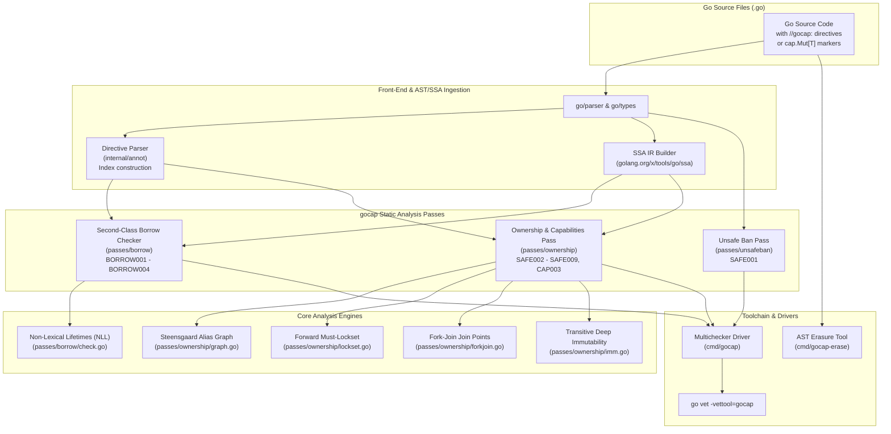
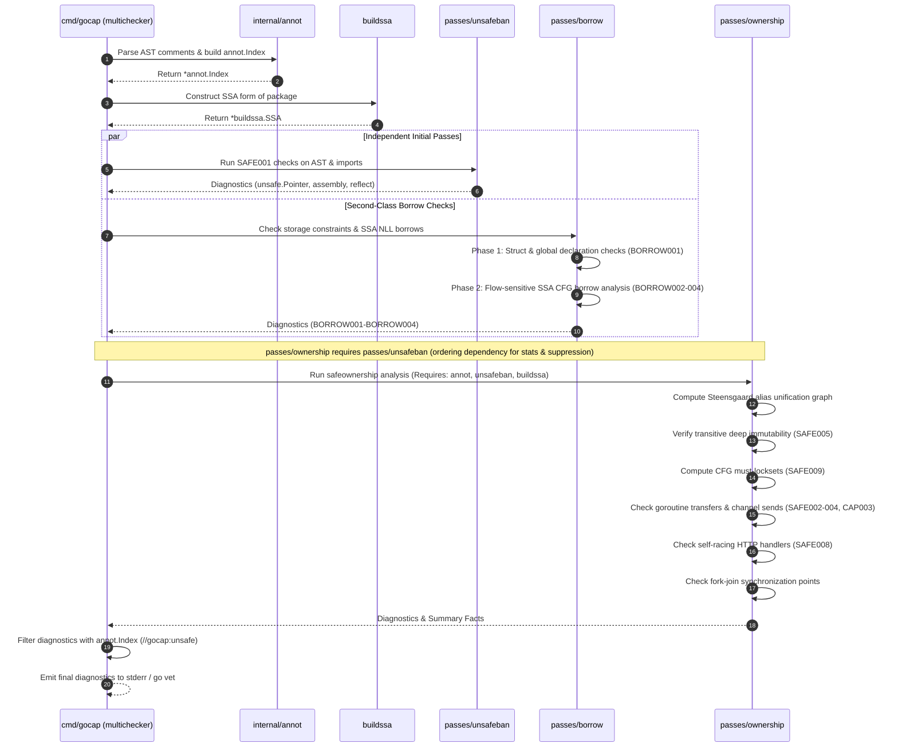
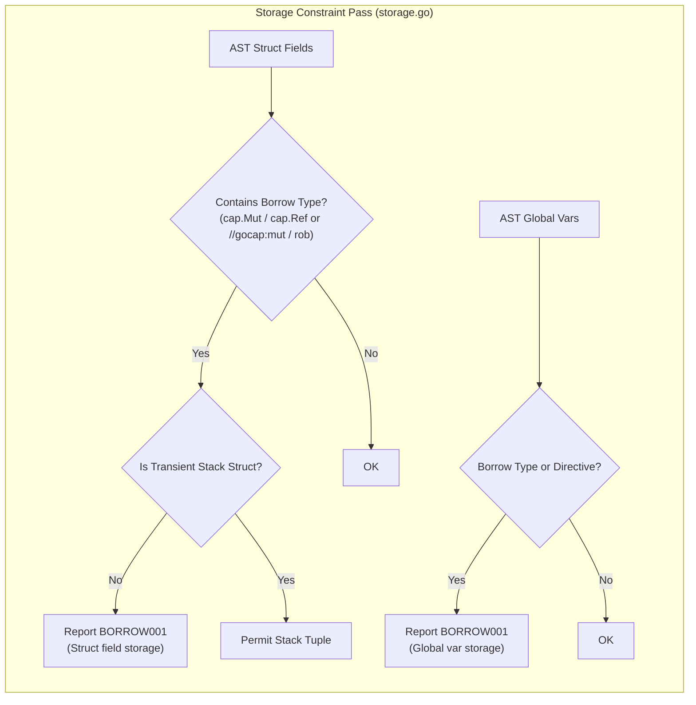
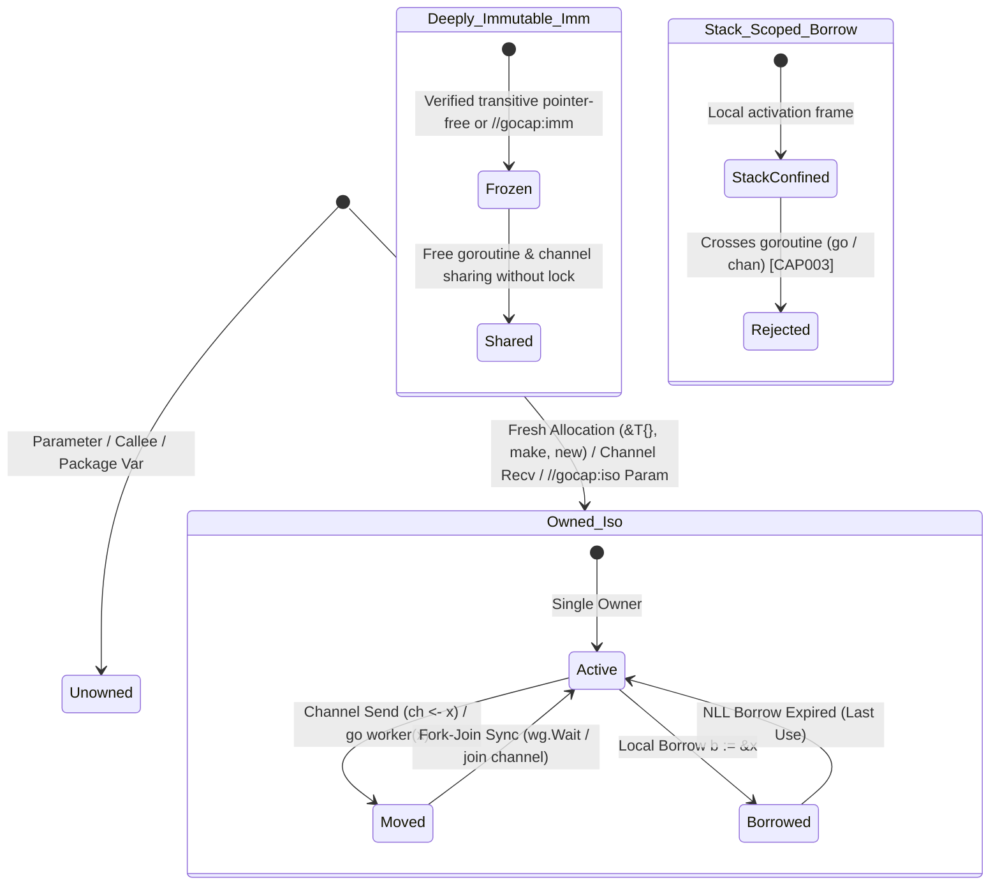
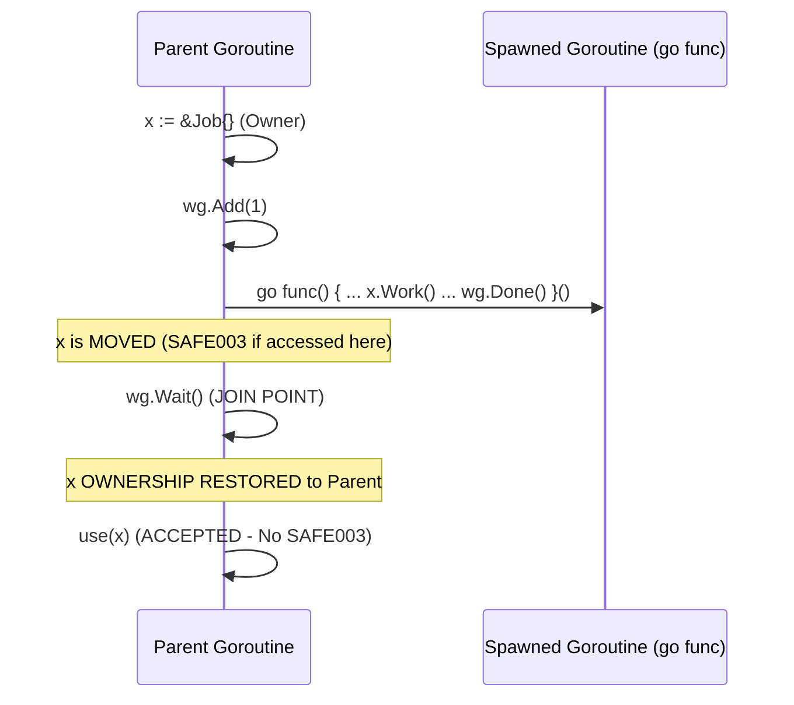
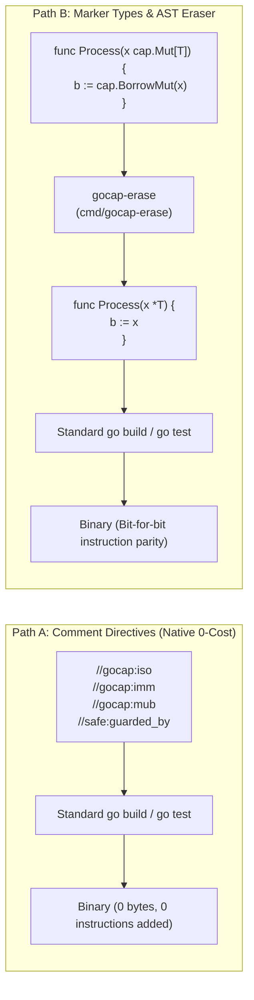
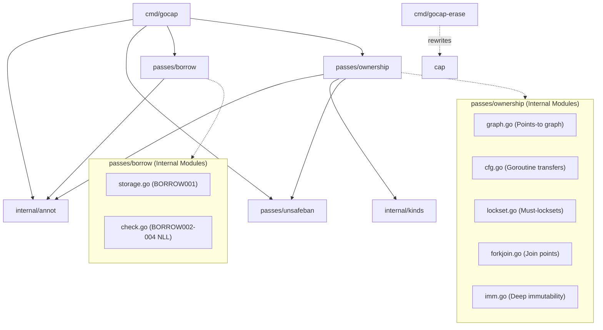

# GoSree (`gosree` / `gocap`) Architecture Specification

[← README](../README.md) | [Architecture](ARCHITECTURE.md) | [Rules](RULES.md) | [Directives](DIRECTIVES.md) | [Borrow & NLL](BORROW_CHECKING_AND_NLL.md) | [Concurrency](CONCURRENCY_MODEL.md) | [Tooling](TOOLING_AND_ERASURE.md)

---

**GoSree** (`gosree`, formerly `gocap`) is a static analysis suite for ordinary Go that enforces Rust-style memory safety, reference capabilities, second-class borrow checking with Non-Lexical Lifetimes (NLL), and mutex lock discipline, with zero runtime cost and clean erasure to standard Go code.

This document describes the architectural subsystems, static analysis pipelines, mathematical formulations, and data structures implemented in `gocap`.

---

## 1. High-Level System Architecture

`gocap` operates as a set of modular analyzers built on the official Go analysis framework ([`golang.org/x/tools/go/analysis`](file:///Users/bharath/Code/devtools/gocap/go.mod#L5)) and SSA intermediate representation ([`golang.org/x/tools/go/ssa`](file:///Users/bharath/Code/devtools/gocap/passes/borrow/check.go#L11)).



---

## 2. Pipeline Execution Sequence

When `gocap` analyzes a package, execution proceeds across strict dependency boundaries:



---

## 3. Subsystem Breakdown

### 3.1 Directive & Annotation Engine ([`internal/annot`](file:///Users/bharath/Code/devtools/gocap/internal/annot/annot.go#L1-L75))

The directive engine extracts safety claims, capabilities, and suppression scopes without altering Go syntax or semantics.

- **Comment Group Parsing:** Traverses [`ast.File.Comments`](file:///Users/bharath/Code/devtools/gocap/internal/annot/annot.go#L198), mapping comment tokens to AST declarations, statements, and fields.
- **Prefix Support:**
  - Modern canonical prefix: `//gocap:...`
  - Legacy backward-compatible prefix: `//safe:...`
  - Inline comment annotations: `/*gocap:mut*/`, `/*gocap:rob*/`
- **Parsed Directives:**
  - Capability parameters: `//gocap:iso p, q`, `//gocap:mub p`, `//gocap:rob p`
  - Deep immutability: `//gocap:imm`
  - Concurrency locks: `//safe:guarded_by <mu>`, `//safe:holds <mu>`
  - Local borrow bindings: `//gocap:mut`, `//gocap:rob`
  - Scoped suppressions: `//gocap:unsafe <reason>`, `//safe:unsafe <reason>`
- **Output Data Structure:** Produces an [`*annot.Index`](file:///Users/bharath/Code/devtools/gocap/internal/annot/annot.go#L71-L96) exported as an `analysis.Pass` result.

### 3.2 Second-Class Borrow Checker ([`passes/borrow`](file:///Users/bharath/Code/devtools/gocap/passes/borrow/borrow.go#L1-L36))

Implements second-class references inspired by academic formulations of second-class values (references that cannot be stored into first-class heap memory).



- **`BORROW001` (Storage Violation):** Second-class borrows cannot be placed in struct fields or package globals ([`passes/borrow/storage.go`](file:///Users/bharath/Code/devtools/gocap/passes/borrow/storage.go#L17-L77)).
  - *Transient Stack Struct Exception:* Local structs allocated on the stack that never escape the current activation frame may hold second-class borrows as lightweight tuples.
- **`BORROW002` (Conflicting Borrows):** Simultaneous mutable borrows of the same memory allocation or mutable-immutable aliasing within overlapping live ranges ([`passes/borrow/check.go`](file:///Users/bharath/Code/devtools/gocap/passes/borrow/check.go#L17-L22)).
- **`BORROW003` (Owner Invalidation):** Mutation or moving of the underlying owner while an active borrow is in scope.
- **`BORROW004` (Dangling Stack Return):** Returning a pointer or borrow to a local stack-allocated variable beyond the enclosing activation frame.

### 3.3 Reference Capabilities & Concurrency Boundaries ([`passes/ownership`](file:///Users/bharath/Code/devtools/gocap/passes/ownership/ownership.go#L1-L65))

Tracks memory crossing goroutine boundaries and enforces strict reference capability invariants.



- **Reference Capabilities:**
  - `\iso` (Isolated): Unique ownership root. Cannot alias foreign memory. Moving an `\iso` value over a channel or to a goroutine invalidates the sender's binding. Subsequent access is flagged as `SAFE003`.
  - `\imm` (Immutable): Transitive immutability. Structs whose fields are pointer-free, strings, channels, or pointers to `\imm` types. Can be shared freely across goroutines without invalidation (`SAFE005`).
  - `\mub` / `\rob` (Mutable / Read-Only Second-Class Borrows): Confined to the stack frame. Cannot cross goroutine boundaries via channel sends or `go` statements (`CAP003`).
- **Mutex Lockset Forward Must-Analysis (`SAFE009`):**
  - Path-sensitive forward flow analysis tracking the set of held mutexes along CFG edges ([`passes/ownership/lockset.go`](file:///Users/bharath/Code/devtools/gocap/passes/ownership/lockset.go)).
  - Enforces that memory marked `//safe:guarded_by mu` is never accessed unless `mu` is held.
  - Verifies that functions annotated `//safe:holds mu` are invoked with `mu` locked.
- **Self-Racing Handler Analysis (`SAFE008`):**
  - HTTP handlers registered with `net/http` execute concurrently across requests ([`passes/ownership/handlerwrite.go`](file:///Users/bharath/Code/devtools/gocap/passes/ownership/handlerwrite.go)).
  - Flags writes to shared receiver state or captured variables unless protected by `//safe:guarded_by`.

---

## 4. Algorithmic Formulations

### 4.1 Steensgaard Points-To & Alias Analysis

In [`passes/ownership/graph.go`](file:///Users/bharath/Code/devtools/gocap/passes/ownership/graph.go), alias relationships within each function are computed using a Steensgaard-style unification algorithm:

- Equivalence classes are represented as disjoint union-find sets with path compression:
  $$\text{find}(n) = \begin{cases} n & \text{if } n.\text{parent} = \text{nil} \\ \text{find}(n.\text{parent}) & \text{otherwise} \end{cases}$$
- For an assignment $x = y$, their pointee nodes are unified:
  $$\text{unify}(\text{pointee}(x), \text{pointee}(y))$$
- **Pointer Depths & Region Linking:** To prevent false positives when values are copied by value (e.g. `cp := *c; return &cp`), `gocap` tracks the relative pointer depth of alias links. Two regions meet at a specific pointer depth rather than unifying the entire parent structure.

### 4.2 Non-Lexical Lifetimes (NLL) on SSA CFGs

In [`passes/borrow/check.go`](file:///Users/bharath/Code/devtools/gocap/passes/borrow/check.go), lifetimes are not lexical scopes. Instead, they are defined by the forward reachability of the last SSA instruction that reads or writes the borrow:


1. **Borrow Live Range:** $\mathcal{L}(b) = \{ \text{inst} \in \text{CFG} \mid b \text{ is live at inst} \}$.
2. **Conflict Rule:** Two borrows $b_1, b_2$ of the same memory allocation conflict if $\mathcal{L}(b_1) \cap \mathcal{L}(b_2) \neq \emptyset$ and at least one is mutable (`\mub`).
3. **Owner Invalidation Rule:** If an instruction mutates or moves the owner $x$ while $\text{inst} \in \mathcal{L}(b)$, `BORROW003` is emitted.

### 4.3 Mutex Lockset Forward Must-Analysis

In [`passes/ownership/lockset.go`](file:///Users/bharath/Code/devtools/gocap/passes/ownership/lockset.go), lock tracking is a forward dataflow must-analysis:

$$\mathcal{In}(B) = \bigcap_{P \in \text{pred}(B)} \mathcal{Out}(P)$$

$$\mathcal{Out}(B) = (\mathcal{In}(B) \setminus \text{Unlocked}(B)) \cup \text{Locked}(B)$$

- Mutex identity is represented by canonical SSA root paths (e.g., `s.mu`).
- `Lock()` / `RLock()` add the path to the held set.
- `Unlock()` / `RUnlock()` remove the path from the held set.
- Calls to functions in other packages are assumed to potentially release any mutexes passed to them, unless explicitly proven otherwise.

---

## 5. Concurrency Model & Fork-Join Recovery

When a goroutine is launched with moved ownership, standard Rust-style semantics would permanently transfer the value. Go programs, however, commonly employ fork-join concurrency patterns (`sync.WaitGroup` or rendezvous channels).

In [`passes/ownership/forkjoin.go`](file:///Users/bharath/Code/devtools/gocap/passes/ownership/forkjoin.go), `gocap` models fork-join recovery:



### 5.1 Join Point Invariants
A join point safely restores ownership to the parent if and only if:
1. **Single Start:** The goroutine closure is started exactly once (not in a loop).
2. **Release Follows Use:** The release (`wg.Done()` or channel send/close) strictly follows the last access of the moved memory in the child.
3. **No Secondary Escape:** The child does not leak the memory into globals, return values, or secondary goroutines.
4. **Local Synchronization Object:** The `sync.WaitGroup` or channel is locally created and controlled within the parent function scope.

---

## 6. Zero-Cost Erasure Architecture

`gocap` offers two zero-cost paths to standard Go compatibility:



- **Comment Directives:** Directives are parsed as standard Go comments. The official compiler (`go build`) ignores them completely.
- **Generic Marker Types ([`cap/cap.go`](file:///Users/bharath/Code/devtools/gocap/cap/cap.go)):**
  ```go
  type Mut[T any] = *T
  type Ref[T any] = *T
  type Iso[T any] = *T
  type Imm[T any] = *T
  ```
  Type aliases are resolved at compile time with zero indirection. Helper functions (`BorrowMut`, `Move`) are trivial identity operations that inline completely.
- **AST Eraser ([`cmd/gocap-erase`](file:///Users/bharath/Code/devtools/gocap/cmd/gocap-erase/main.go)):** Automatically transforms code using `cap.*` markers back into idiomatic raw Go pointers and removes unnecessary imports.

---

## 7. Package Dependency Structure

The following diagram illustrates internal package imports across `gocap`:


