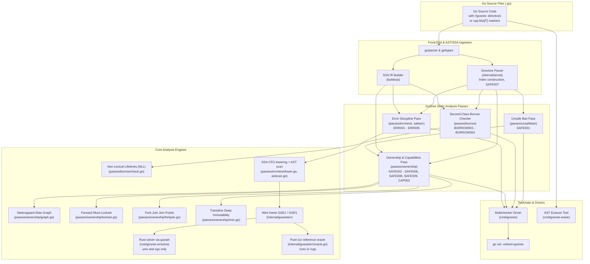
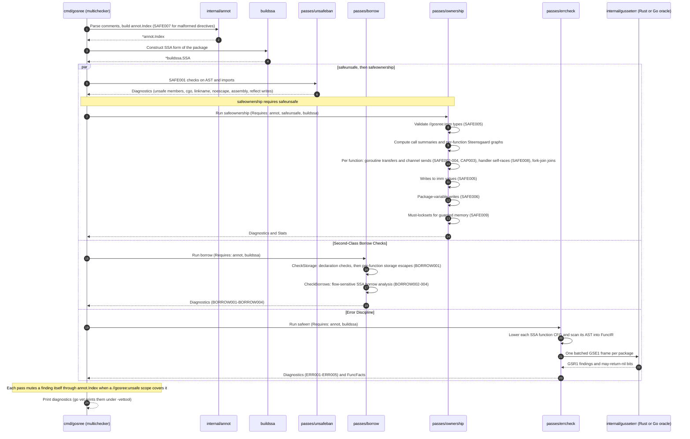
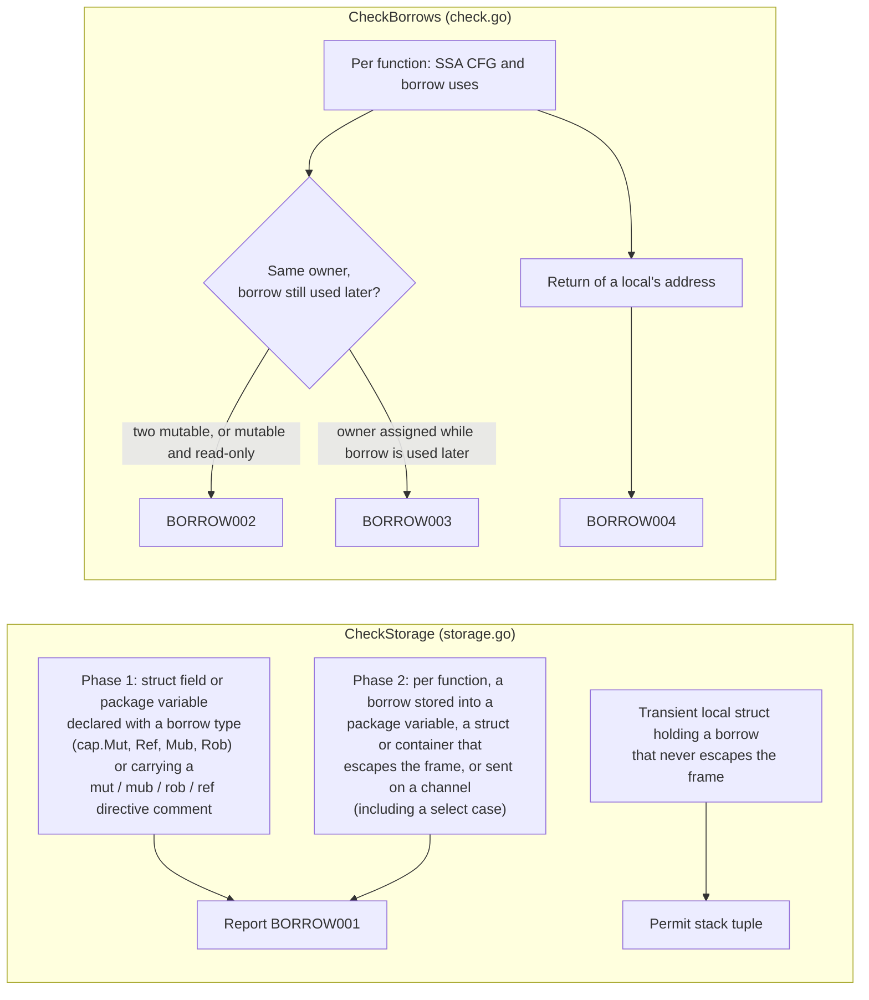
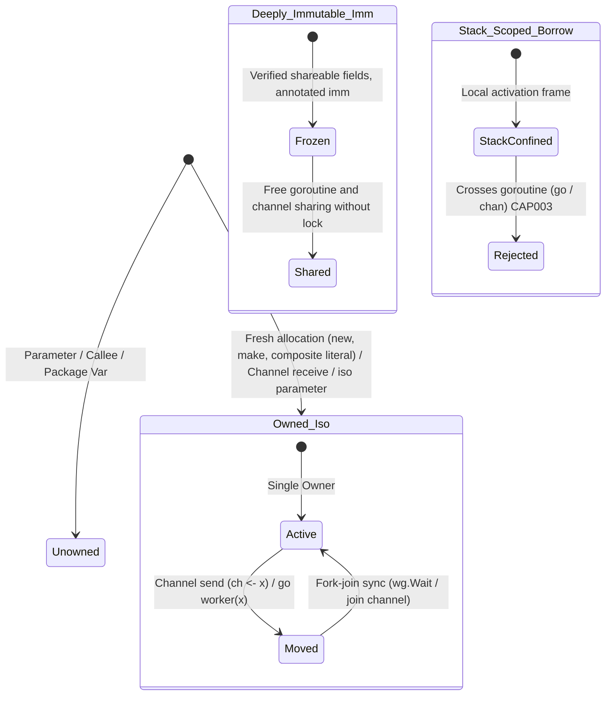
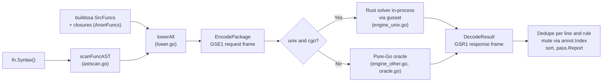
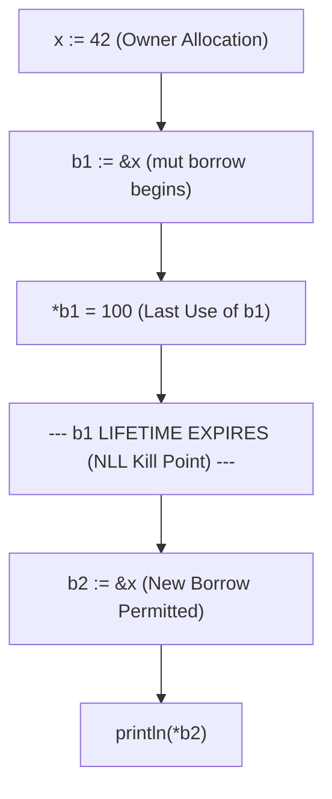
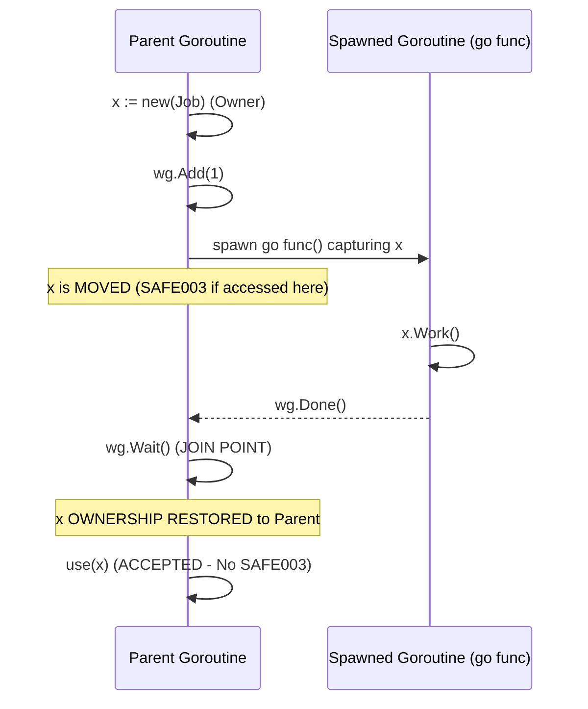
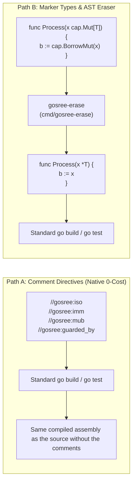
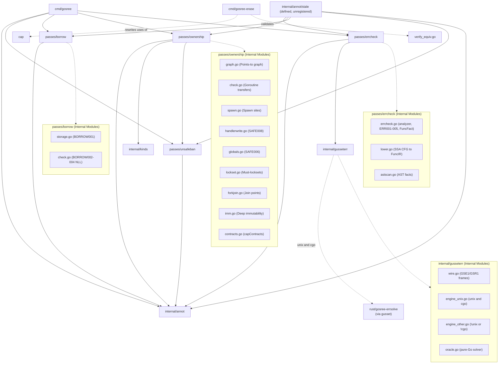

# GoSree Architecture Specification

[← README](../README.md) | [Architecture](ARCHITECTURE.md) | [Rules](RULES.md) | [Directives](DIRECTIVES.md) | [Borrow & NLL](BORROW_CHECKING_AND_NLL.md) | [Concurrency](CONCURRENCY_MODEL.md) | [Error Discipline](ERROR_DISCIPLINE.md) | [Tooling](TOOLING_AND_ERASURE.md)

---

**GoSree** (`gosree`) is a static analysis suite for ordinary Go that enforces Rust-style memory safety, reference capabilities, second-class borrow checking with Non-Lexical Lifetimes (NLL), mutex lock discipline, and Rust-style error discipline (`ERR001`-`ERR005`). Its directives are ordinary Go comments, and its marker types erase to standard Go.

This document describes the architectural subsystems, static analysis pipelines, mathematical formulations, and data structures implemented in GoSree. The error-discipline subsystem is summarized in [section 3.5](#35-error-discipline-passeserrcheck-and-internalgusseterr); its rules and engine internals are in [ERROR_DISCIPLINE.md](ERROR_DISCIPLINE.md).

---

## 1. High-Level System Architecture

`gosree` operates as a set of modular analyzers built on the official Go analysis framework (`golang.org/x/tools/go/analysis`, pinned in [`go.mod`](../go.mod)) and the SSA intermediate representation (`golang.org/x/tools/go/ssa`). The driver is `cmd/gosree`, a `multichecker` that registers five analyzers: `annot`, `safeunsafe`, `safeownership`, `borrow` and `safeerr`.



---

## 2. Pipeline Execution Sequence

When `gosree` analyzes a package, the analysis framework orders the analyzers by their `Requires` lists. `annot` and `buildssa` require nothing among them. `safeunsafe` requires `annot`; `safeownership` requires `annot`, `safeunsafe` and `buildssa`; `borrow` and `safeerr` each require `annot` and `buildssa`. Nothing orders `borrow` and `safeerr` relative to the `safeunsafe`-then-`safeownership` chain, so the diagram shows them as independent branches.



---

## 3. Subsystem Breakdown

### 3.1 Directive & Annotation Engine ([`internal/annot`](../internal/annot/annot.go))

The directive engine extracts safety claims, capabilities, and suppression scopes without altering Go syntax or semantics.

- **Comment Group Parsing:** Traverses `ast.File.Comments` (`annot.go`), mapping comment tokens to AST declarations, statements, and fields.
- **One directive prefix:** a directive is `//gosree:verb args`, or the block form `/*gosree:verb args*/` (`Prefix` and `parseDirective` in `annot.go`). No other comment is a directive.
- **Near misses (`SAFE007`):** a comment whose text, after the comment marker and optional white space, starts with `gosree:` in any letter case but is not a valid directive is reported rather than silently ignored. The rule is at the top of `internal/annot/nearmiss.go`.
- **Verbs:** `unsafe`, `iso`, `imm`, `guarded_by`, `holds`, `mub`, `rob`, `mut`, `ref` (`verbs` in `nearmiss.go`).
- **Parsed Directives:**
  - Capability parameters on a function: `//gosree:iso p, q`, `//gosree:mub p`, `//gosree:rob p`
  - Deep immutability on a type: `//gosree:imm`
  - Concurrency locks: `//gosree:guarded_by <mu>` on a field, package variable or local, and `//gosree:holds <mu>` on a function
  - Local borrow bindings on an assignment: `//gosree:mut`, `//gosree:rob`, or inline `/*gosree:mut*/`, `/*gosree:rob*/`
  - Scoped suppressions: `//gosree:unsafe <reason>`
- **Output Data Structure:** Produces an [`*annot.Index`](../internal/annot/annot.go) exported as the `analysis.Pass` result. It holds the `//gosree:unsafe` scopes (with a record of which ones muted a finding), `IsoVars`, `ImmTypes`, `Guarded`, `Holds`, `MubVars`, `RobVars` and `Borrows`.

### 3.2 Second-Class Borrow Checker ([`passes/borrow`](../passes/borrow/borrow.go))

Implements second-class references inspired by academic formulations of second-class values (references that cannot be stored into first-class heap memory). The analyzer's `run` calls `CheckStorage` (`BORROW001`) and then `CheckBorrows` (`BORROW002`-`BORROW004`).



- **`BORROW001` (Storage Violation):** Second-class borrows cannot be placed in struct fields or package globals, and cannot be sent on a channel ([`passes/borrow/storage.go`](../passes/borrow/storage.go)). Storage checks also walk all package-level functions and anonymous function literals (`allPackageFuncs`), preventing borrows from leaking through package-level closures.
  - *Transient Stack Struct Exception:* a local struct that holds a borrow and never escapes the current activation frame is accepted as a lightweight tuple. The same struct used as a map key is reported (`BORROW001: borrow stored in struct field 'p' escapes stack frame`).
  - A field or package variable that carries a `//gosree:mut` or `//gosree:rob` comment is reported by `BORROW001`; `annot` additionally reports such a comment as `SAFE007`, because a field is not a valid place to attach it.
- **`BORROW002` (Conflicting Borrows):** Two borrows of the same owner conflict when one is still in use where the other is created and at least one is mutable ([`passes/borrow/check.go`](../passes/borrow/check.go)). Two read-only borrows never conflict. NLL flow analysis correctly tracks lifetimes across same-line statements, loop iterations (back-edges), and backward-`goto` jumps.
- **`BORROW003` (Owner Invalidation):** Assignment to (or increment, decrement or compound assignment of) the owner while a borrow of it is used later.
- **`BORROW004` (Dangling Stack Return):** Returning a pointer to a local stack variable beyond the enclosing activation frame. Position reporting preserves valid source tokens even through deferred recover blocks.
- **Interprocedural identity helpers:** Both phases look through same-package callees that return one of their parameters or store it in a package global (`calleeReturnsParam`, `calleeStoresParamInGlobal` in [`storage.go`](../passes/borrow/storage.go); `calleeReturnedParamIndex`, `calleeMutatesParam` in [`check.go`](../passes/borrow/check.go)), so a borrow laundered through an identity-style helper is still tracked. `BORROW001` also covers sends in a `select` and calls to instantiated generic `cap.Borrow*` helpers.

### 3.3 Reference Capabilities & Concurrency Boundaries ([`passes/ownership`](../passes/ownership/ownership.go))

Tracks memory crossing goroutine boundaries and enforces strict reference capability invariants. The boundaries it recognises are `go` statements, callbacks handed to known spawners (`spawners` in [`spawn.go`](../passes/ownership/spawn.go): `time.AfterFunc`, `context.AfterFunc`, `sync.WaitGroup.Go`, `errgroup.Group.Go` and `TryGo`, and the `net/http` and `ServeMux` `Handle` and `HandleFunc` registrations), channel sends, arguments for `//gosree:iso` parameters, and **standard-library concurrent container publication** (`capContracts` in [`contracts.go`](../passes/ownership/contracts.go)). [CONCURRENCY_MODEL.md](CONCURRENCY_MODEL.md) describes each.



- **Reference Capabilities:**
  - `\iso` (Isolated): Unique ownership root. Moving an `\iso` value over a channel or to a goroutine invalidates the sender's binding. Subsequent access is flagged as `SAFE003`; a pointer that is not owned (a parameter, a package variable, memory a callee kept) crossing to a goroutine is `SAFE002`.
  - `\imm` (Immutable): a struct type annotated `//gosree:imm`. Every field must be unexported and shareable: pointer-free values, strings, channels of shareable elements, or pointers to other `\imm` types (a `//gosree:guarded_by` field may have any type). A type that fails is reported as `SAFE005`, and so is a write to an `\imm` value after its construction. A valid `\imm` value can be shared freely across goroutines without invalidation.
  - `\mub` / `\rob` (Mutable / Read-Only Second-Class Borrows): Confined to the stack frame. Cannot cross goroutine boundaries via channel sends or `go` statements (`CAP003`).
- **Mutex Lockset Forward Must-Analysis (`SAFE009`):**
  - Path-sensitive forward flow analysis tracking the set of held mutexes along CFG edges ([`passes/ownership/lockset.go`](../passes/ownership/lockset.go)).
  - Enforces that memory marked `//gosree:guarded_by mu` is never accessed unless `mu` is held.
  - Verifies that functions annotated `//gosree:holds mu` are invoked with `mu` locked. A `go` call to such a function never counts as holding the lock, and a `defer` counts only if the lock is held at every reachable return and no later-registered `defer` releases it first (`checkGuardedFunc`). A `//gosree:holds` helper that unlocks the mutex directly or through a callee that releases it is reported as malformed (`SAFE007`).
  - Lock and unlock calls made through a bound method value (`f := mu.Lock; f()`) are recognised (`lockOp`).
- **Self-Racing Handler Analysis (`SAFE008`):**
  - HTTP handlers registered with `net/http` execute concurrently across requests ([`passes/ownership/handlerwrite.go`](../passes/ownership/handlerwrite.go)).
  - Flags writes to shared receiver state or captured variables unless protected by `//gosree:guarded_by`.
  - Handler roots are resolved through factory and middleware calls (`handlerRoots` follows a call to its single returned value or to a spawned-function argument), and closures passed as arguments to a followed callee have their captured bindings tracked.
- **Package-variable writes (`SAFE006`):** [`globals.go`](../passes/ownership/globals.go) (`checkGlobals`) reports a package variable written outside initialisation. "Initialisation" is `init`, the package initialiser, and functions or closures whose every caller is a synchronous call or `defer` from initialisation and whose value is never spawned or stored (`initFuncs`).
- **Deep immutability writes (`SAFE005`):** [`imm.go`](../passes/ownership/imm.go) treats a struct or array that contains an `\imm` value (`immInValueType`) as immutable memory, and traces writes through calls that return a pointer into it. Values returned by `Load()` from concurrent containers (`sync/atomic.Pointer`, `sync.Map`) are treated as `\imm` capabilities.
- **Concurrent Container Contracts (`capContracts`):** [`contracts.go`](../passes/ownership/contracts.go) hooks standard-library concurrent containers (`sync/atomic.Pointer[T]`, `sync/atomic.Value`, `sync.Map`, `sync.Pool`, `context.WithValue`). Storing non-shareable memory into these containers consumes unique `\iso` ownership (`SAFE003`), while loading memory out yields shared `\imm` read-only capabilities (`SAFE005`), preventing torn slice/interface writes without manual annotations.

### 3.4 Unsafe Ban ([`passes/unsafeban`](../passes/unsafeban/unsafeban.go))

`safeunsafe` (`SAFE001`) is AST-only: it needs `annot.Analyzer` and nothing else, and `safeownership` requires it. It reports the `unsafe` members that create or reinterpret pointers (`Pointer`, `Add`, `Slice`, `SliceData`, `String`, `StringData`; `Sizeof`, `Alignof` and `Offsetof` stay allowed), cross-package `unsafe.Pointer` laundering via exported type aliases, function signatures, variables, maps, and interface methods, cgo (`import "C"`), `//go:linkname`, `//go:noescape`, functions declared without a Go body (assembly), and reflection that writes or exposes memory. Method calls on an interface-typed receiver count as `reflect.Value` writes only when `reflect.Value` implements that interface (`reflectValueImplements`); the method set it matches includes `Set`, `Pointer`, `Addr`, `Send` and `TrySend` (`isReflectValueInterfaceMethod`).

### 3.5 Error Discipline ([`passes/errcheck`](../passes/errcheck/errcheck.go) and [`internal/gusseterr`](../internal/gusseterr/wire.go))

`safeerr` enforces `ERR001`-`ERR005` (discarded errors, unchecked companion values, lost or shadowed errors, typed-nil errors, dropped `Close()` on writable resources). Rule semantics and engine internals are in [ERROR_DISCIPLINE.md](ERROR_DISCIPLINE.md); this section covers only where it sits in the system.

**Ordering.** `safeerr` requires `annot.Analyzer` and `buildssa.Analyzer` only (`Analyzer.Requires` in `errcheck.go`). It does not depend on `unsafeban`, `ownership` or `borrow`, so it is independent of them; the multichecker lists it last (`analyzers` in `cmd/gosree/main.go`). The `safestale` analyzer (`internal/annot/stale`) requires all five analyzers, so that a `//gosree:unsafe` is judged stale only after every rule, including `ERR*`, has had the chance to mute against it. It is defined but unregistered: only `annot`, `unsafeban`, `ownership`, `borrow` and `errcheck` run in `cmd/gosree`, and `safestale` is exercised only by its own test.



**Data flow.**
1. `run` collects every source function and its anonymous closures (`collectPackageFuncs`, `errcheck.go`).
2. Each function's SSA CFG is lowered to a `gusseterr.FuncIR`, with facts the AST supplies (shadowing, blanked tuple assignments, discarded calls) merged in (`lowerFunc` in `lower.go`; `scanFuncAST` in `astscan.go`).
3. `gusseterr.Solve` encodes the whole package as one batched request frame, crosses into the solver once, and decodes the response (`engine_unix.go`). On `unix && cgo` the solver is the Rust crate `rust/gosree-errsolve`, linked in-process through gusset (`rust/gusset-engine` builds the `gusset` static library). On `!unix || !cgo` the same call runs the pure-Go oracle (`engine_other.go`), which is documented as bit-exact; `internal/gusseterr/parity_test.go` compares the two.
4. A solver error fails the package analysis (`run` returns it as `safeerr solver failed`); it is not reported as a clean result.

**Where results surface.**
- Diagnostics: `pass.Report` with `Category` set to the `ERR00n` code, de-duplicated per (file, line, rule, sub-kind), sorted by position, and suppressed by `//gosree:unsafe` through `annot.Index` (`run` in `errcheck.go`).
- Facts: an exported function returning a concrete pointer type that implements `error` exports a `FuncFact{MayReturnNilConcrete}`, so downstream packages can judge typed-nil boxing across package boundaries (`run` in `errcheck.go`).
- Result: the analyzer returns a `*errcheck.Summary` (`FunctionsAnalyzed`, `FindingsReported`, `FindingsMuted`, `UsedRustGusset`) for harnesses and tests.

---

## 4. Algorithmic Formulations

### 4.1 Steensgaard Points-To & Alias Analysis

In [`passes/ownership/graph.go`](../passes/ownership/graph.go), alias relationships within each function are computed using a Steensgaard-style unification algorithm. It is flow-insensitive and field-insensitive on purpose: coarse aliasing over-reports and never under-reports. Only the move kill in `check.go` is flow-sensitive.

- Equivalence classes are represented as disjoint union-find sets with path compression and **union-by-size** (`a.size < b.size { a, b = b, a }`), guaranteeing $O(\alpha(N))$ operations and logarithmic tree depth:
  $$\text{find}(n) = \begin{cases} n & \text{if } n.\text{parent} = \text{nil} \\ \text{find}(n.\text{parent}) & \text{otherwise} \end{cases}$$
- Derivations (field and index addresses, slicing, conversions, phis) join their operand's class, a load yields a member of the base class's pointee, and a store joins the stored value into the address's pointee:
  $$\text{unify}(\text{pointee}(x), \text{pointee}(y))$$
- **Pointer Depths at Call Sites:** a call summary records which arguments and results the callee linked (stored one into another, or returned memory of one). `link` joins the classes at the pointer depths where the callee's own graph joined them, instead of unifying the whole structure.
- **Deterministic Diagnostic Tie-Breaking:** SSA value iteration and region traversal are deterministically sorted via `compareSSAValOrder` in `passes/ownership/check.go`, ordering by source position, SSA instruction kind rank, basic block index, instruction index, and name to guarantee reproducible findings across architectures and runs.

### 4.2 Non-Lexical Lifetimes (NLL) on SSA CFGs

In [`passes/borrow/check.go`](../passes/borrow/check.go), lifetimes are not lexical scopes. A borrow records its uses (the SSA instructions on source lines that use the borrow variable), and it is active at an instruction when one of those uses is reachable from that instruction along the CFG (`isBorrowActiveAt`):



1. **Borrow Live Range:** $\mathcal{L}(b) = \{ \text{inst} \in \text{CFG} \mid \text{a use of } b \text{ is reachable from inst} \}$.
2. **Conflict Rule:** When borrow $b_2$ of an owner is created, any earlier borrow $b_1$ of the same owner with $b_2\text{.site} \in \mathcal{L}(b_1)$ conflicts if at least one of the two is mutable (`\mub`); `BORROW002` is emitted.
3. **Owner Invalidation Rule:** If an instruction assigns to the owner $x$ while $\text{inst} \in \mathcal{L}(b)$, `BORROW003` is emitted.

### 4.3 Mutex Lockset Forward Must-Analysis

In [`passes/ownership/lockset.go`](../passes/ownership/lockset.go), lock tracking is a forward dataflow must-analysis:

$$\mathcal{In}(B) = \bigcap_{P \in \text{pred}(B)} \mathcal{Out}(P)$$

$$\mathcal{Out}(B) = (\mathcal{In}(B) \setminus \text{Unlocked}(B)) \cup \text{Locked}(B)$$

- Mutex identity is represented by canonical SSA root paths (e.g., `s.mu`).
- `Lock()` / `RLock()` add the path to the held set.
- `Unlock()` / `RUnlock()` remove the path from the held set.
- A call to a function of another package that is passed a held mutex is assumed to release it. A call that is not passed the mutex leaves it held.
- **Path-Prefix Widening & Post-Order Worklist:** To prevent exponential state space explosions or infinite loops during whole-repo self-hosting, release summaries soundly widen recursive paths beyond a bounded step limit (`maxReleaseSteps = 8`, `maxReleasesPerFn = 32`) to prefix paths. Functions are analyzed bottom-up in DAG post-order so non-recursive call hierarchies converge in one pass, while recursive SCC cycles iterate with bounded worklist rounds (`maxAcquireRounds = 16`).

---

## 5. Concurrency Model & Fork-Join Recovery

When a goroutine is launched with moved ownership, standard Rust-style semantics would permanently transfer the value. Go programs, however, commonly employ fork-join concurrency patterns (`sync.WaitGroup` or rendezvous channels).

In [`passes/ownership/forkjoin.go`](../passes/ownership/forkjoin.go), `gosree` models fork-join recovery:



### 5.1 Join Point Invariants
A join point restores ownership to the parent only when all of these hold for a `go F(...)` whose `F` is a function literal:
1. **Single Start:** The closure is started by that one `go` statement and by nothing else, and the statement is not inside a loop.
2. **Release Follows Use:** In the child, no instruction that touches the moved memory can run after a release of the synchronisation object (a channel send or close, or `wg.Done()`); deferred calls count as running at function exit.
3. **No Secondary Escape:** The child neither moves the memory on to another goroutine or owned parameter nor lets it escape (stored, returned, retained by a callee).
4. **Local Synchronization Object:** The synchronisation object is a channel made in the parent whose only sender or closer is the child, or a `sync.WaitGroup` local to the parent whose `Add` and `Done` calls are balanced.

The join itself is a plain receive from that channel, or `Wait()` on that `WaitGroup`, in the parent. Two spawner forms have their own joins: a callback started by `sync.WaitGroup.Go` or `errgroup.Group.Go`/`TryGo` is joined by `Wait()` on the same receiver, and a `time.AfterFunc` or `context.AfterFunc` callback is also joined on the branch where `Stop()` (or the `stop` function) returned true. A use reached only through a synchronisation point that is not a join is reported with category `SAFE003-forkjoin`.

---

## 6. Zero-Cost Erasure Architecture

`gosree` offers two zero-cost paths to standard Go compatibility:



- **Comment Directives:** Directives are parsed as standard Go comments. The official compiler (`go build`) ignores them completely. `TestTier1_DirectivesErasure` in `tests/e2e/tier1_feature_test.go` compiles a fixture with and without its directive comments and requires identical `go tool compile -S` output.
- **Generic Marker Types ([`cap/cap.go`](../cap/cap.go)):**
  ```go
  type Mut[T any] = *T
  type Ref[T any] = *T
  type Iso[T any] = *T
  type Imm[T any] = *T
  ```
  Type aliases are resolved at compile time with zero indirection. Helper functions (`BorrowMut`, `Move`) are trivial identity functions; `go build -gcflags=-m` reports `can inline cap.BorrowMut`. Instruction-level parity of marker-type code against its erased form is not measured here.
- **AST Eraser ([`cmd/gosree-erase`](../cmd/gosree-erase/main.go)):** Automatically transforms code using `cap.*` markers back into idiomatic raw Go pointers, removes the `//gosree:` directive comments, and removes the `cap` import.
- **Translation Validation (`gosree-erase -verify`):** Formally validates semantic equivalence between annotated and erased packages ([`cmd/gosree-erase/verify_equiv.go`](../cmd/gosree-erase/verify_equiv.go)). It confirms:
  1. *Exported API Type Equivalence:* All exported types, struct fields, method signatures, and constants possess identical `types.Type` structures under `go/types`.
  2. *Compiled `.text` Instruction Equivalence:* Packages are compiled into archive objects and disassembled via `go tool objdump`; instructions, mnemonics, and control-flow targets are verified identical after offset/symbol normalization without executing target code.

---

## 7. Package Dependency Structure

The following diagram illustrates internal package imports across GoSree:



---

## 8. Formal Foundations & Featherweight GoSree

GoSree's reference capability system, contracted standard-library function hooks, and second-class borrow invariants are formalized in two complementary specifications:

1. **Lean 4 Calculus ([`specs/FeatherweightGoSree.lean`](../specs/FeatherweightGoSree.lean)):**
   Defines the capability permission lattice ($\mathcal{L} = \{ \text{Iso}, \text{Mub}, \text{Rob}, \text{Imm}, \text{MutexGuarded}(id) \}$), value type classifications, and contracted function hook preconditions (HookAtomicStoreOK and HookAtomicLoadCap), proving that torn-header memory corruption (`rs_torn_slice`, `rs_torn_iface`, `rs_w_mapwrites`) is impossible when concurrent container boundaries enforce affine move consumption and deep immutability.
2. **Executable Model Checker ([`internal/formal/featherweight_gosree.go`](../internal/formal/featherweight_gosree.go)):**
   Provides an executable small-step operational semantics with vector-clock happens-before race analysis, multi-word tearing detectors, and static capability checking. Tested via [`internal/formal/featherweight_gosree_test.go`](../internal/formal/featherweight_gosree_test.go), confirming that all runtime memory corruption witness shapes are convicted by operational execution and caught statically under contracted hooks.
