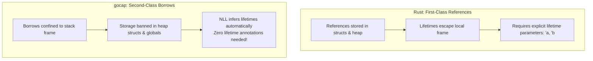
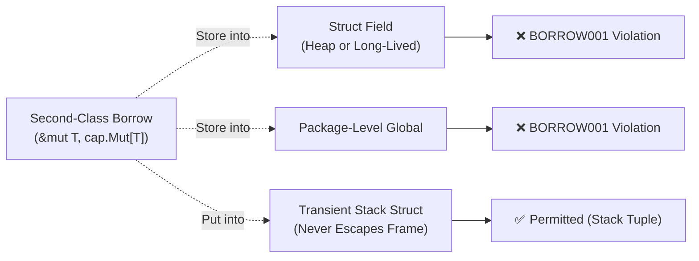
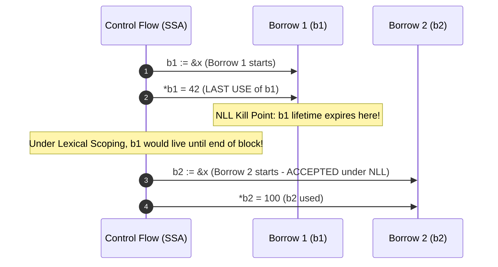
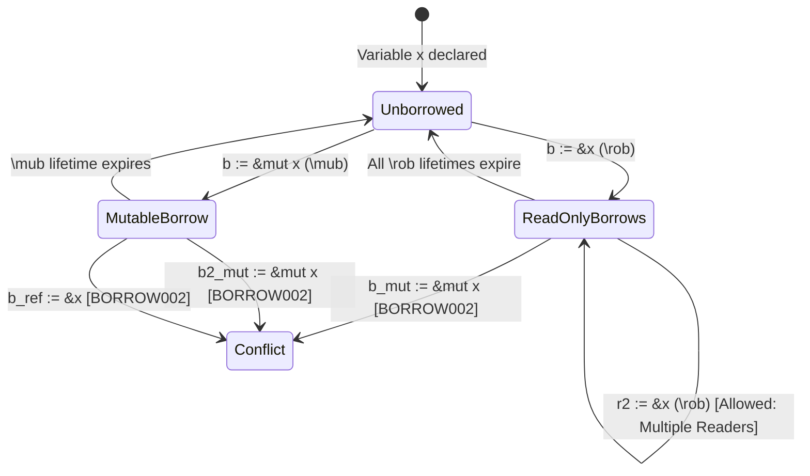
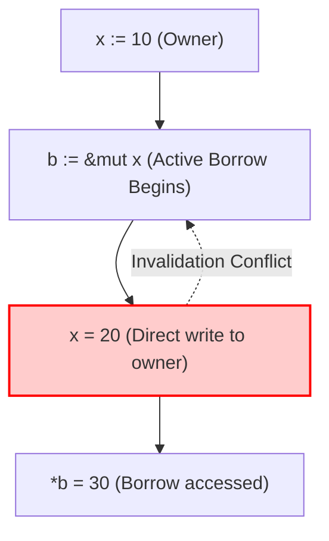
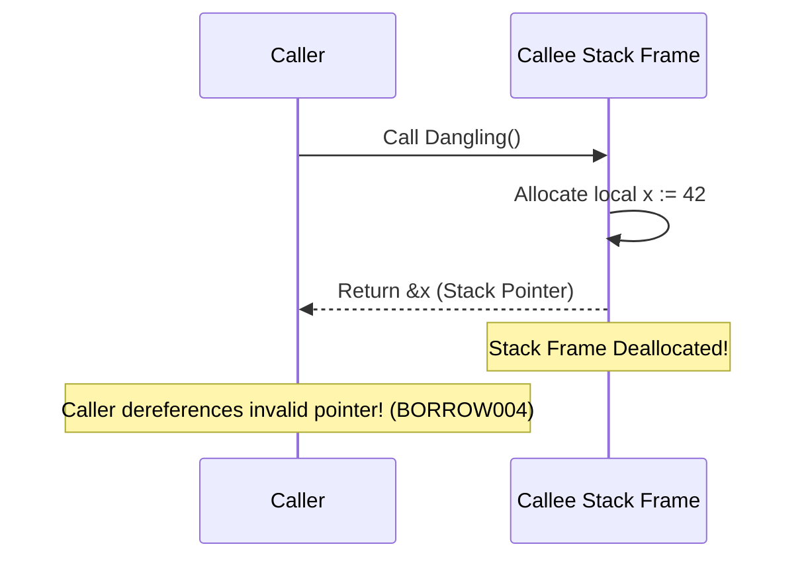

# GoSree (`gosree` / `gocap`) — Second-Class Borrows & Non-Lexical Lifetimes (NLL)

[← README](../README.md) | [Architecture](ARCHITECTURE.md) | [Rules](RULES.md) | [Directives](DIRECTIVES.md) | [Borrow & NLL](BORROW_CHECKING_AND_NLL.md) | [Concurrency](CONCURRENCY_MODEL.md) | [Tooling](TOOLING_AND_ERASURE.md)

---

A central innovation in **GoSree** (`gosree`) is bringing Rust-grade memory safety and borrow checking to Go **without requiring explicit lifetime parameters** (such as `'a`, `'b`, or `T: 'a`). 

This document explains the theory of second-class borrows, the Non-Lexical Lifetime (NLL) analysis on SSA intermediate representation, storage constraints, and the transient stack struct exception.

---

## 1. Why Second-Class Borrows?

In Rust, references (`&T` and `&mut T`) are **first-class values**: they can be placed in struct fields, returned across function boundaries, and stored in collections. However, to guarantee memory safety without a garbage collector, Rust requires every struct, function signature, and trait holding a reference to declare explicit lifetime parameters:

```rust
// Rust: explicit lifetime annotations required
struct BufferView<'a> {
    data: &'a [u8],
}

fn longest<'a>(x: &'a str, y: &'a str) -> &'a str { ... }
```

In Go, garbage collection already guarantees that memory is never accessed after being freed (no use-after-free or dangling heap pointers). Go programmers do not want or need complex lifetime syntax.

`gocap` solves this by treating borrowed references as **second-class values**:
- A second-class borrow may be passed into functions and used across local operations.
- A second-class borrow **cannot be stored into first-class heap memory** (struct fields on the heap, package globals, or sent across channels).
- Because borrows never escape the stack frame, **all lifetimes are local**. The compiler can infer all borrow expirations automatically with zero syntactic annotations!



---

## 2. Storage Constraints (`BORROW001`)

The storage checker in [`passes/borrow/storage.go`](file:///Users/bharath/Code/devtools/gocap/passes/borrow/storage.go) enforces that second-class borrows never outlive their activation frame.



### The Transient Stack Struct Exception
Often in Go, developers package multiple values or pointers into a temporary struct on the stack (for instance, to pass a pair of values or iterate):

```go
type StackTuple struct {
    p *int
}

func Process() {
    x := 10
    // b is an active second-class mutable borrow
    b := &x //gocap:mut
    
    // Storing a borrow into a struct field would normally trigger BORROW001.
    // However, StackTuple is allocated on the stack and never escapes:
    t := StackTuple{p: b}
    *t.p = 20 // OK: Transient stack struct exception
}
```

`gocap`'s storage checker performs escape analysis on local structs. If a struct containing borrow-like pointers never leaves the current activation frame, it is treated as a safe transient stack tuple.

---

## 3. Non-Lexical Lifetimes (NLL) in SSA

In early versions of Rust, a borrow's lifetime lasted until the end of its enclosing syntactic block (`{ ... }`). This frequently caused false positive errors when two sequential operations touched the same variable.

`gocap` implements **Non-Lexical Lifetimes (NLL)** directly on Go's Static Single Assignment (SSA) form ([`passes/borrow/check.go`](file:///Users/bharath/Code/devtools/gocap/passes/borrow/check.go)).

### Lexical Scope vs. Non-Lexical Lifetime



In `gocap`, a borrow's live range is computed as the set of SSA instructions from which the borrow (or any value derived from it) can reach a future read or write:

$$\mathcal{Live}(b) = \{ i \in \text{SSA Instructions} \mid \exists \text{ path from } i \text{ to a read/write of } b \}$$

Once the last instruction in $\mathcal{Live}(b)$ executes, $b$ is dead, and the underlying allocation may be borrowed again immediately.

---

## 4. Borrow Conflict Matrix (`BORROW002`)

Within overlapping live ranges, `gocap` enforces the fundamental aliasing XOR mutability invariant:

$$\text{Active}(x) \implies (\text{Read-Only}^N) \oplus (\text{Mutable}^1)$$



| Existing Active Borrow | Attempted New Borrow | Allowed? | Diagnostic |
|---|---|---|---|
| None | `&T` (`\rob`) | **Yes** | — |
| None | `&mut T` (`\mub`) | **Yes** | — |
| `&T` (`\rob`) | `&T` (`\rob`) | **Yes** (Multiple simultaneous readers) | — |
| `&T` (`\rob`) | `&mut T` (`\mub`) | **No** (Cannot mutate while read-only borrow active) | `BORROW002` |
| `&mut T` (`\mub`) | `&T` (`\rob`) | **No** (Cannot alias active mutable borrow) | `BORROW002` |
| `&mut T` (`\mub`) | `&mut T` (`\mub`) | **No** (Exclusive mutable ownership required) | `BORROW002` |

---

## 5. Owner Invalidation (`BORROW003`)

While a borrow is active, the original owner cannot be modified or moved:

```go
func InvalidationDemo() {
    x := 10
    b := &x //gocap:mut
    
    // Direct mutation of owner while borrow b is active
    x = 20  // BORROW003: cannot assign to 'x' because it is borrowed at line 154
    
    *b = 30 // Use of borrow b
}
```



Because `b` is live across the assignment `x = 20`, modifying `x` invalidates the assumptions of `b`. Reordering the code so that the assignment happens after `b`'s last use resolves the diagnostic cleanly:

```go
func ValidSequence() {
    x := 10
    b := &x //gocap:mut
    *b = 30 // b's lifetime ends here
    
    x = 20  // OK: no active borrow
}
```

---

## 6. Dangling Stack Reference Detection (`BORROW004`)

When a function executes, local variables declared inside it are allocated on its stack frame. Returning a reference or pointer to a local variable means the pointer will point to deallocated or overwritten stack memory once the frame unwinds.



In [`passes/borrow/check.go`](file:///Users/bharath/Code/devtools/gocap/passes/borrow/check.go), `gocap` tracks the allocation origin of all returned SSA values:
```go
func Dangling() *int {
    x := 42
    return &x // BORROW004: cannot return reference to local stack variable 'x'
}
```
If the allocation is rooted in a local stack variable, `BORROW004` is reported immediately. Heap-allocated memory (`new(T)` or `&T{}` in an escaping context) is recognized as safe.
