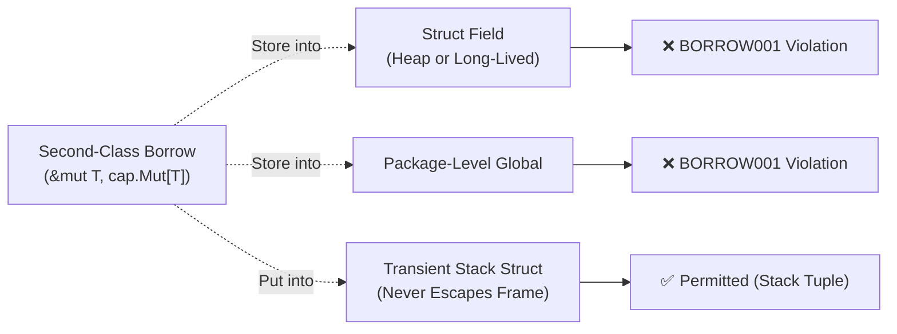
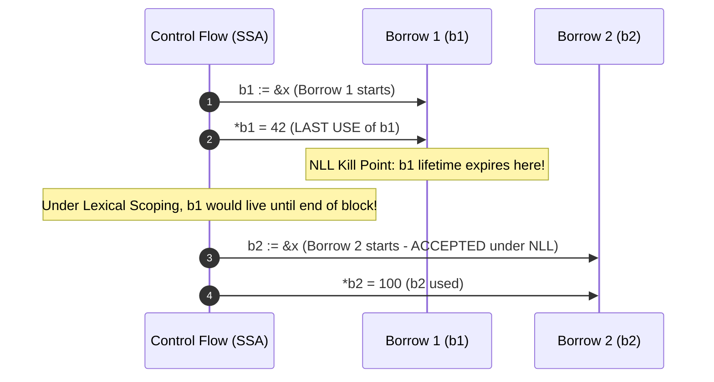
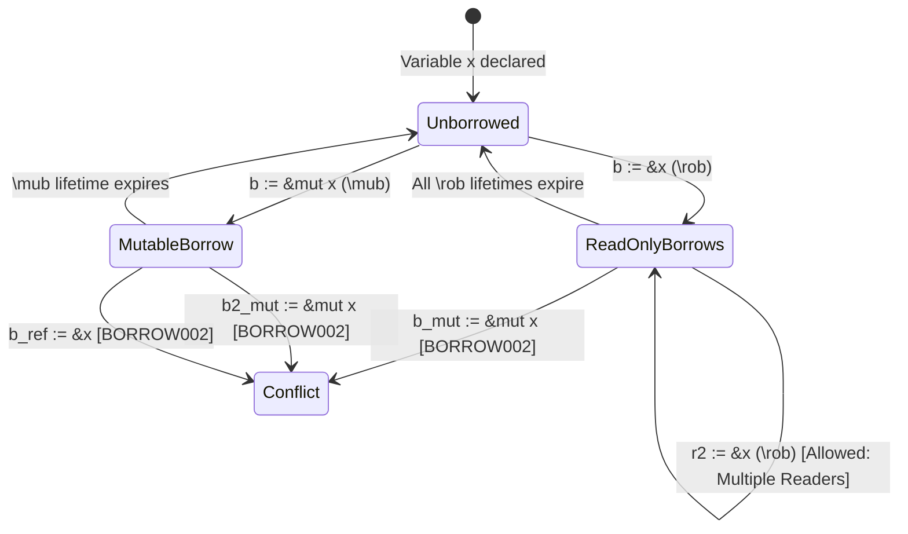
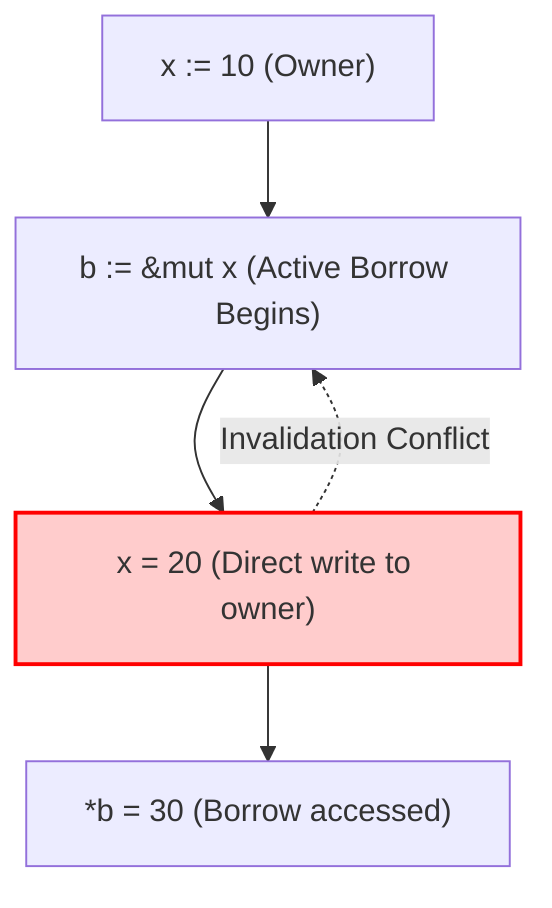
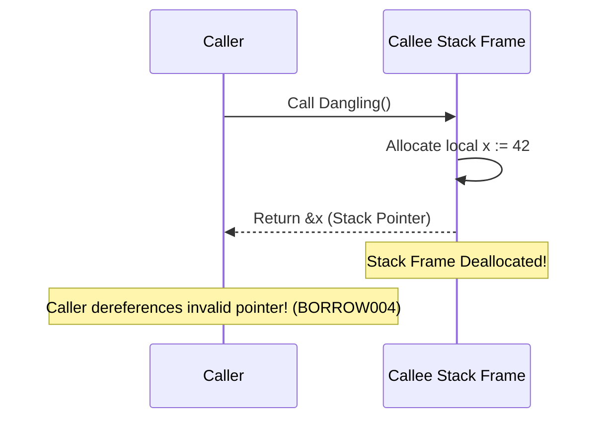

# GoSree: Second-Class Borrows & Non-Lexical Lifetimes (NLL)

[← README](../README.md) | [Architecture](ARCHITECTURE.md) | [Rules](RULES.md) | [Directives](DIRECTIVES.md) | [Borrow & NLL](BORROW_CHECKING_AND_NLL.md) | [Concurrency](CONCURRENCY_MODEL.md) | [Error Discipline](ERROR_DISCIPLINE.md) | [Tooling](TOOLING_AND_ERASURE.md)

---

A central innovation in **GoSree** (`gosree`) is bringing Rust-grade memory safety and borrow checking to Go **without requiring explicit lifetime parameters** (such as `'a`, `'b`, or `T: 'a`). 

This document explains the theory of second-class borrows, the Non-Lexical Lifetime (NLL) analysis on SSA intermediate representation, storage constraints, and the transient stack struct exception.

---

## 1. Why Second-Class Borrows?

In Rust, references (`&T` and `&mut T`) are **first-class values**: they can be placed in struct fields, returned across function boundaries, and stored in collections. However, to guarantee memory safety without a garbage collector, Rust requires every struct, function signature, and trait holding a reference to declare explicit lifetime parameters:

```rust
// Rust: explicit lifetime annotations required
struct BufferView<'a> {
    data: &'a [u8],
}

fn longest<'a>(x: &'a str, y: &'a str) -> &'a str { ... }
```

In Go, garbage collection already guarantees that memory is never accessed after being freed (no use-after-free or dangling heap pointers). Go programmers do not want or need complex lifetime syntax.

GoSree treats borrowed references as **second-class values**:
- A second-class borrow may be passed into functions and used across local operations.
- A second-class borrow **cannot be stored into first-class heap memory** (struct fields on the heap, package globals, or sent across channels).
- Because borrows never escape the stack frame, **all lifetimes are local**. The checker infers every borrow expiry itself, so no lifetime parameters exist anywhere in the source. A borrow is marked with a directive (`//gosree:mut`, `//gosree:ref`, and so on) or created with a `cap.Borrow*` helper.


---

## 2. Storage Constraints (`BORROW001`)

The storage checker in [`passes/borrow/storage.go`](../passes/borrow/storage.go) enforces that second-class borrows never outlive their activation frame. (The diagnostics below print the borrow kinds as `\mub` and `\rob`; they are the `mub` and `rob` directive verbs and the `cap.Mub` and `cap.Rob` marker types. A mutable borrow written `cap.BorrowMut(&x)` or `//gosree:mut` is also a `\mub` borrow.)



### The Transient Stack Struct Exception
Often in Go, developers package multiple values or pointers into a temporary struct on the stack (for instance, to pass a pair of values or iterate):

```go
type StackTuple struct {
    p *int
}

func Process() {
    x := 10
    // b is an active second-class mutable borrow
    b := &x //gosree:mut
    
    // Storing a borrow into a struct field would normally trigger BORROW001.
    // However, StackTuple is allocated on the stack and never escapes:
    t := StackTuple{p: b}
    *t.p = 20 // OK: Transient stack struct exception
}
```

The storage checker performs escape analysis on local structs. If a struct containing borrow-like pointers never leaves the current activation frame, it is treated as a safe transient stack tuple (`isStackLocalAddr` in `passes/borrow/storage.go`). The same struct is rejected as soon as it is heap-allocated or leaves the frame, for example `h := new(StackTuple); h.p = b` reports `BORROW001: borrow stored in struct field 'p' escapes stack frame` (`passes/borrow/testdata/src/challenger_m4_coverage/coverage.go`, the `h.p = b` line).

### What else counts as storage
Beyond direct stores, the checker follows a borrow through calls, so these are also `BORROW001` (`passes/borrow/testdata/src/marker_soundness/marker_soundness.go`, Tests 32 and 35):
- passing a borrow to an unannotated helper whose body stores that parameter in a package variable (`calleeStoresParamInGlobal` in `storage.go`);
- laundering a borrow through a helper that returns its parameter: `globalIntPtr = idIntPtr(b)` still reports `package variable 'globalIntPtr' cannot store second-class borrow` (`calleeReturnsParam` in `storage.go`);
- sending a borrow, or a value derived from one through a phi, on a channel inside a `select` case, which reports `channel send cannot store second-class borrow` (the ownership pass also reports the send as `CAP003`, a goroutine-boundary crossing);
- calling the generic `cap.Borrow*` helpers: instantiated names such as `BorrowMut[int]` are matched by their base name;
- storing a borrow into a package variable inside a package-level anonymous function literal (`var lit = func(b *int /*gosree:mub*/) { global = b }`), which `allPackageFuncs` discovers and checks.

A callee parameter that is itself annotated `mub`/`rob` is exempt from the callee-body checks at the call site, since the callee is bound by the same rules: a store of that parameter is reported inside the callee, not at each caller.

---

## 3. Non-Lexical Lifetimes (NLL) in SSA

Under a lexical rule, a borrow's lifetime would last until the end of its enclosing syntactic block (`{ ... }`), which rejects sequential operations that touch the same variable even when the first borrow is already dead.

GoSree implements **Non-Lexical Lifetimes (NLL)** on Go's Static Single Assignment (SSA) form ([`passes/borrow/check.go`](../passes/borrow/check.go)).

### Lexical Scope vs. Non-Lexical Lifetime



A borrow's live range is the set of SSA instructions from which a later use of the borrow (or of a variable aliasing it) is reachable along the control-flow graph (`isBorrowActiveAt` in `check.go`). Uses are collected by source identifier, mapped to SSA instructions by source position and instruction index, and propagated across control-flow edges:

$$\mathcal{Live}(b) = \{ i \in \text{SSA Instructions} \mid \exists \text{ path from } i \text{ to a use of } b \}$$

NLL analysis handles three critical flow patterns:
1. **Same-Line Precision:** In multi-statement lines, SSA instruction order distinguishes dead loans from live ones without over-reporting false conflicts.
2. **Loop-Carried Borrows:** Active borrows carried across loop iterations and back-edges (`for` loop bodies and cyclic CFG edges) are preserved until their true last use.
3. **Backward-`goto` Jumps:** Control-flow reachability properly tracks live loans across backward label jumps without leaking state outside the jump domain.

Once execution passes the last use of $b$, $b$ is dead, and the underlying allocation may be borrowed again immediately.

---

## 4. Borrow Conflict Matrix (`BORROW002`)

Within overlapping live ranges, GoSree enforces the fundamental aliasing XOR mutability invariant:

$$\text{Active}(x) \implies (\text{Read-Only}^N) \oplus (\text{Mutable}^1)$$



| Existing Active Borrow | Attempted New Borrow | Allowed? | Diagnostic |
|---|---|---|---|
| None | `&T` (`\rob`) | **Yes** | — |
| None | `&mut T` (`\mub`) | **Yes** | — |
| `&T` (`\rob`) | `&T` (`\rob`) | **Yes** (Multiple simultaneous readers) | — |
| `&T` (`\rob`) | `&mut T` (`\mub`) | **No** (Cannot mutate while read-only borrow active) | `BORROW002` |
| `&mut T` (`\mub`) | `&T` (`\rob`) | **No** (Cannot alias active mutable borrow) | `BORROW002` |
| `&mut T` (`\mub`) | `&mut T` (`\mub`) | **No** (Exclusive mutable ownership required) | `BORROW002` |

The owner of a borrow is resolved through aliases, so a conflict is not hidden by an intermediate name. The resolver (`resolveOwner` in `check.go`) follows up to 8 hops of pointer copies (`q := p`), sub-slices (`t := s[1:]`) and type assertions (`c := i.(*T)`), and also looks through `*p`, `s[i:j]` and composite literals:

```go
x := 10
p := &x
q := p
b1 := cap.BorrowMut(p)
b2 := cap.BorrowMut(q) // BORROW002: cannot borrow 'x' as mutable more than once at a time
```
(`passes/borrow/testdata/src/marker_soundness/marker_soundness.go`, Test 28.) Parameters are also matched by annotation: passing an existing read-only borrow, or an alias of an owner that has a live read-only borrow, to a `mub` parameter is reported as `cannot borrow 'x' as mutable because it is also borrowed as read-only`, and the reverse for `rob` parameters (Tests 29 and 33 in the same file).

---

## 5. Owner Invalidation (`BORROW003`)

While a borrow is active, the original owner cannot be modified or moved:

```go
func InvalidationDemo() {
    x := 10
    b := &x //gosree:mut
    
    // Direct mutation of owner while borrow b is active
    x = 20  // BORROW003: cannot assign to 'x' because it is borrowed at line N (the `b := &x` line)
    
    *b = 30 // Use of borrow b
}
```



The same rule covers more than plain assignment. Each of these while a borrow of `x` or `s` is live is `BORROW003` (`passes/borrow/testdata/src/marker_soundness/marker_soundness.go`, Tests 30 and 31):
- `(*p)++` where `p` is an earlier alias of `x`, and `for x = range 3`;
- the built-ins `copy(s[:], src)`, `clear(s[:])`, `delete`, and `append(s[:1], v)` (`append` only when its first argument is a slice expression; `s = append(s, v)` is an ordinary assignment to `s`);
- calling a closure that mutates the owner, whether it was bound to a variable (`m := func() { *p = 77 }`), stored in a struct field (`box.f()`), or passed on (`callClosureHelper(m)`), reported as `cannot assign to 'x' (via closure 'm') because it is borrowed`;
- passing the owner to an `//gosree:iso` parameter (`cannot move 'x' because it is borrowed`), or passing an alias of the owner to a function that is not `mub`/`rob`-annotated (`cannot borrow or take address of 'x' while it is borrowed`).

### Writing Through a Read-Only Borrow
A read-only borrow cannot be used to mutate its target. Assigning through it is also `BORROW003`, with a distinct message (`check.go`, Test 34 of `marker_soundness.go`):

```go
x := 10
r := cap.Borrow(&x)
*r = 99      // BORROW003: cannot assign through read-only borrow 'r' (borrowed at line N)
(*r)++       // same
mutatePtr(r) // same, because mutatePtr stores through its parameter (`calleeMutatesParam` in `check.go`)

c := CounterVal{n: 1}
cr := cap.Borrow(&c)
cr.n = 2     // same
```

Because `b` is live across the assignment `x = 20`, modifying `x` invalidates the assumptions of `b`. Reordering the code so that the assignment happens after `b`'s last use resolves the diagnostic cleanly:

```go
func ValidSequence() {
    x := 10
    b := &x //gosree:mut
    *b = 30 // b's lifetime ends here
    
    x = 20  // OK: no active borrow
}
```

---

## 6. Dangling Stack Reference Detection (`BORROW004`)

When a function executes, local variables declared inside it are allocated on its stack frame. Returning a reference or pointer to a local variable means the pointer will point to deallocated or overwritten stack memory once the frame unwinds.



In [`passes/borrow/check.go`](../passes/borrow/check.go), GoSree tracks the allocation origin of all returned SSA values:
```go
func Dangling() *int {
    x := 42
    return &x // BORROW004: cannot return reference to local stack variable 'x'
}
```
If the allocation is rooted in a local stack variable, `BORROW004` is reported immediately. Heap-allocated memory (`new(T)` or `&T{}` in an escaping context) is recognized as safe.

The origin trace sees through `cap.Borrow*`/`cap.Move` and through user helpers that simply return one of their parameters (`calleeReturnedParamIndex` in `check.go`; helpers in package `cap` are excluded). So laundering a local address through an identity function is still caught:

```go
func idIntPtr(p *int) *int { return p }

func Laundered() *int {
    localVar := 42
    return idIntPtr(&localVar) // BORROW004: cannot return reference to local stack variable 'localVar'
}
```
(`passes/borrow/testdata/src/marker_soundness/marker_soundness.go`, Test 35.) A pointer-chasing loop (`p = p.next` on a cycle) does not hang or overflow the trace and still reports the returned `&root` (Test 27 in the same file).
