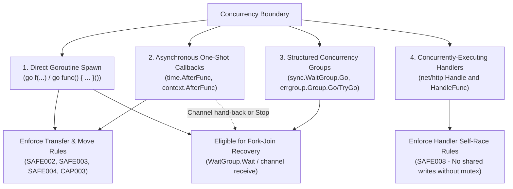
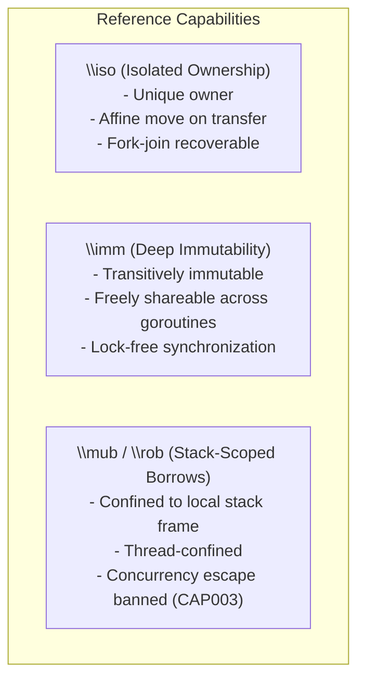
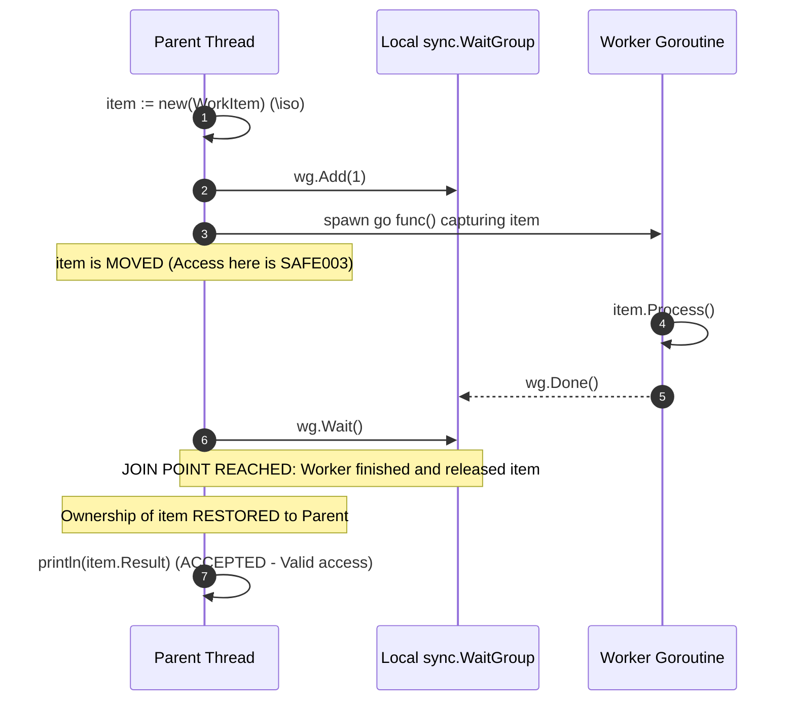
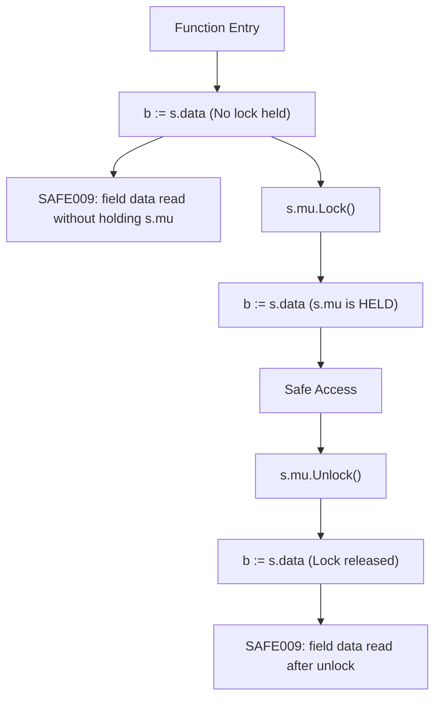
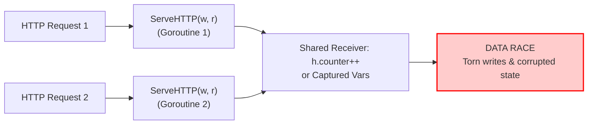

# GoSree Concurrency Model & Capability Guarantees

[← README](../README.md) | [Architecture](ARCHITECTURE.md) | [Rules](RULES.md) | [Directives](DIRECTIVES.md) | [Borrow & NLL](BORROW_CHECKING_AND_NLL.md) | [Concurrency](CONCURRENCY_MODEL.md) | [Error Discipline](ERROR_DISCIPLINE.md) | [Tooling](TOOLING_AND_ERASURE.md)

---

In garbage-collected languages like Go, traditional memory bugs like use-after-free and double-free cannot occur. The primary remaining category of catastrophic memory corruption is the **data race**: concurrent unsynchronized reads and writes that cause torn interface pointers, corrupt slice headers, or broken application invariants.

**GoSree** (`gosree`) focuses its ownership and capability checking specifically where memory crosses **goroutine boundaries**. Within a single goroutine, ordinary Go aliasing is permitted.

---

## 1. Concurrency Boundary Taxonomy

`gosree` defines four distinct categories of concurrency boundaries. Every rule that cares where a goroutine starts reads the same table of spawn sites (`spawners` in [`passes/ownership/spawn.go`](../passes/ownership/spawn.go)), so a callback is a boundary everywhere a `go` statement is:

### 1.1 Direct Goroutine Statements (`go`)
When a `go` statement executes, any value passed as an argument or captured by a function literal crosses a concurrency boundary:
- Unowned pointers trigger `SAFE002`.
- Owned pointers (`\iso`) are moved; sender access afterwards triggers `SAFE003`.
- Stack-scoped borrows (`\mub`, `\rob`) captured or passed trigger `CAP003`.

### 1.2 Asynchronous One-Shot Callbacks
Functions like `time.AfterFunc(d, fn)` and `context.AfterFunc(ctx, fn)` execute their callback on an independent runtime-managed goroutine. Memory captured by `fn` crosses a boundary under the same rules as `go`.

### 1.3 Structured Concurrency
`sync.WaitGroup.Go` and `golang.org/x/sync/errgroup.Group.Go` / `TryGo` run a callback on another goroutine. Memory moved into these tasks is restored to the parent when it joins at `Wait()` on the same receiver; a use before that `Wait()` is `SAFE003`.

### 1.4 Concurrently-Executing Handlers (`net/http`)
HTTP handlers registered with `http.HandleFunc` or `http.Handle`, or with the same methods on a `*http.ServeMux`, run concurrently with themselves on every incoming HTTP request. They never own what they capture, and writing shared state without a lock triggers `SAFE008`. The handler is found even when it is built indirectly: a registration whose argument is the result of a factory or middleware call is followed to the function that call returns, or to a handler passed through it (`handlerRoots` in [`passes/ownership/handlerwrite.go`](../passes/ownership/handlerwrite.go)). Closures the handler hands to a callee are followed too, so a write made inside such a closure to memory the handler shares is still reported (`checkHandlerWrites`). Routers outside `net/http` are not in the spawner table.

---

## 2. Reference Capabilities Across Goroutines

### 2.1 `\iso` (Isolated / Unique Ownership)
- **Origin:** Fresh memory allocations (`&T{}`, `new(T)`, `make(...)`), channel receives (`<-ch`), or parameters declared `//gosree:iso`.
- **Transfer Rule:** Moving an `\iso` reference to another goroutine permanently transfers ownership. The sender's reference is invalidated.
- **Affine Property:** At most one goroutine may possess an active pointer to the isolated allocation tree at any time.

### 2.2 `\imm` (Transitive Deep Immutability)
- **Origin:** Struct types declared `//gosree:imm`.
- **Invariants:** Every field must be unexported and deeply immutable: pointer-free values, strings, channels of shareable elements, or pointers to other `\imm` types. A field annotated `//gosree:guarded_by` may have any type, because `SAFE009` checks each access under the struct's own mutex. A type that breaks this is reported as `SAFE005`.
- **Containers count:** A struct or array that holds an `\imm` value by value is treated as immutable memory, so a store through a pointer to it is reported (`immInValueType` in [`imm.go`](../passes/ownership/imm.go)); so is a write to an element of a `[]T` whose element type is or contains an `\imm` value. Fields that are `//gosree:guarded_by` are skipped when looking inside. Writes are also traced through a same-package call that returns a pointer into the `\imm` value.
- **Sharing Rule:** Pointers to verified `\imm` types may be read concurrently by unlimited goroutines without locks, channels, or move invalidations. Writing one after construction is `SAFE005`.

### 2.3 `\mub` / `\rob` (Stack-Scoped Borrows)
- **Origin:** Parameters declared `//gosree:mub` or `//gosree:rob` on the function, or local bindings marked `//gosree:mut` or `//gosree:rob` on the assignment.
- **Confinement:** Confined strictly to the calling goroutine's stack frame.
- **Escape Ban (`CAP003`):** Any attempt to send a borrow over a channel, pass it to a `go` statement, or capture it in a `go` closure is rejected. A local borrow that is moved by `cap.Move` or passed to an owned (`iso`) parameter is rejected as well. A borrow used inside a closure nested in the spawned closure is found too (`findBorrowsInLitInSyntax` in [`check.go`](../passes/ownership/check.go)).

---

## 3. Fork-Join Synchronization Recovery

In Go, it is common to hand off a data structure to a background goroutine for processing, and then reclaim it after waiting for completion. `gosree` models this via **Fork-Join Join Points** ([`passes/ownership/forkjoin.go`](../passes/ownership/forkjoin.go)).

### 3.1 Formal Join Invariants
A join point restores ownership to the parent only when all of the following conditions hold for a `go F(...)` whose `F` is a function literal:

1. **Single Invocation:** The closure is started by that one `go` statement and by nothing else, and the statement is not inside a loop.
2. **Release Follows Access:** In the child goroutine, no instruction that touches the moved memory can run after a release of the synchronization object (a send on or close of the channel, or `wg.Done()`). Deferred calls count as running at function exit.
3. **No Secondary Leaks:** The child neither moves the memory on to another goroutine or owned parameter nor lets it escape (stored in a global, returned, retained by a callee).
4. **Locally Visible Sync Object:** The synchronization object is a channel made in the parent whose only sender or closer is the child, or a `sync.WaitGroup` local to the parent whose `Add` and `Done` calls are balanced.

The join is then a plain receive from that channel, or `Wait()` on that `WaitGroup`, in the parent. A callback started by `sync.WaitGroup.Go` or `errgroup.Group.Go` / `TryGo` is joined by `Wait()` on the same receiver. A `time.AfterFunc` or `context.AfterFunc` callback is also joined on the branch where `Stop()` (or the `stop` function) returned true, because the callback then never runs. A use reached only through a synchronization point that is not a join is reported with category `SAFE003-forkjoin`.

---

## 4. Mutex Lockset Forward Must-Analysis (`SAFE009`)

For shared mutable state across goroutines, `gosree` enforces strict lock discipline via `//gosree:guarded_by <mu>` and `//gosree:holds <mu>` ([`passes/ownership/lockset.go`](../passes/ownership/lockset.go)).

### 4.1 Analysis Properties
- **Path-Sensitive Must-Analysis:** A mutex is considered held at an instruction if and only if it is acquired on **every possible execution path** leading to that instruction.
- **RWMutex Support:** `RLock()` satisfies read access requirements; `Lock()` satisfies both read and write access requirements. A write under only `RLock()` is reported.
- **TryLock Handling:** `TryLock()` adds the mutex to the lockset only within the branch where the return value was checked and proven `true`.
- **Callee Summaries:** Intra-package helper functions that acquire or release locks are summarized. A call to a function of another package that is passed a held mutex is assumed to release it; a call that is not passed the mutex leaves it held.
- **Bound Method Values:** A lock operation through a method value, such as `f := mu.Lock; f()`, is recognised as that operation on `mu` (`lockOp` in `lockset.go`). A method value that is never called does not lock.

### 4.2 `//gosree:holds` Helpers
A function marked `//gosree:holds mu` starts with `mu` held and must be called with it held (`checkGuardedFunc` in `lockset.go`):
- **Plain call:** `mu` must be held on every path to the call.
- **`go` call:** never satisfies the requirement, because the new goroutine does not run under the caller's lock.
- **`defer` call:** satisfies it only if `mu` is held at every reachable return and no later-registered `defer` releases it before this one runs. A function with no reachable return does not.
- **Releasing inside the helper:** if the helper unlocks `mu` itself, or calls a function of this package that releases it (through a parameter or a package variable), the helper is reported as malformed (`SAFE007`).

---

## 5. Self-Racing HTTP Handlers (`SAFE008`)

`net/http` handlers run concurrently on distinct goroutines for each HTTP request:

Under `gosree`:
- Any write to shared receiver fields or captured closure variables inside a handler registration is flagged as `SAFE008`. A handler that only reads is not.
- To fix the issue, the field must be declared `//gosree:guarded_by mu` and accessed under `mu.Lock()`.

---

## 6. Package Variables (`SAFE006`)

A package variable is touched in place by whichever goroutine reads or writes it, so a write after initialisation is shared mutable state whatever the variable's type. `SAFE006` is reported at the variable's declaration, with each write attached as related information, unless the variable is `//gosree:guarded_by` (then `SAFE009` checks every access) or the declaration carries `//gosree:unsafe` ([`passes/ownership/globals.go`](../passes/ownership/globals.go), `checkGlobals`).

What counts as initialisation is deliberately narrow (`initFuncs` in `globals.go`):
- top-level `init` functions (not methods named `init`) and the package initialiser;
- functions and closures whose every caller is a synchronous call or `defer` inside initialisation, and whose value is never spawned or stored.

A closure created inside `init` and started with `go`, or stored for later, is not initialisation, so its writes to package variables are reported. Writes made through a helper that returns a pointer derived from its argument are traced back to the global it came from (`paramRootIndex` in `globals.go`).
