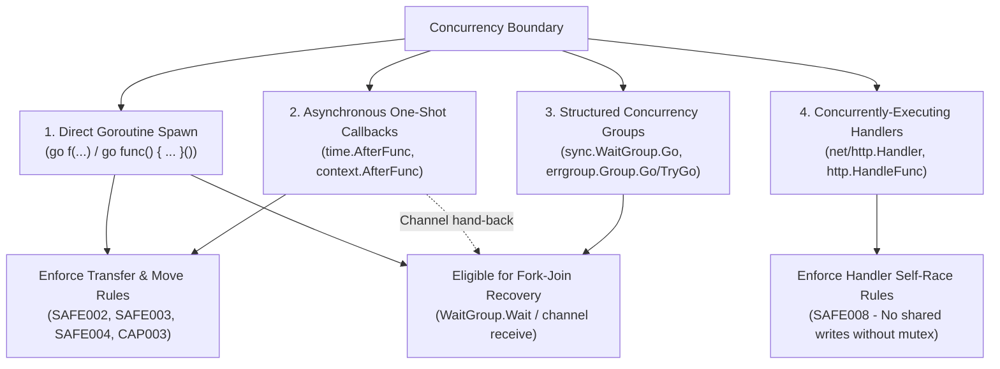
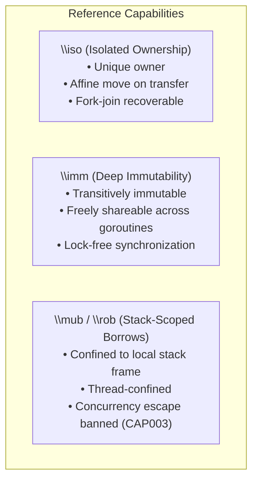
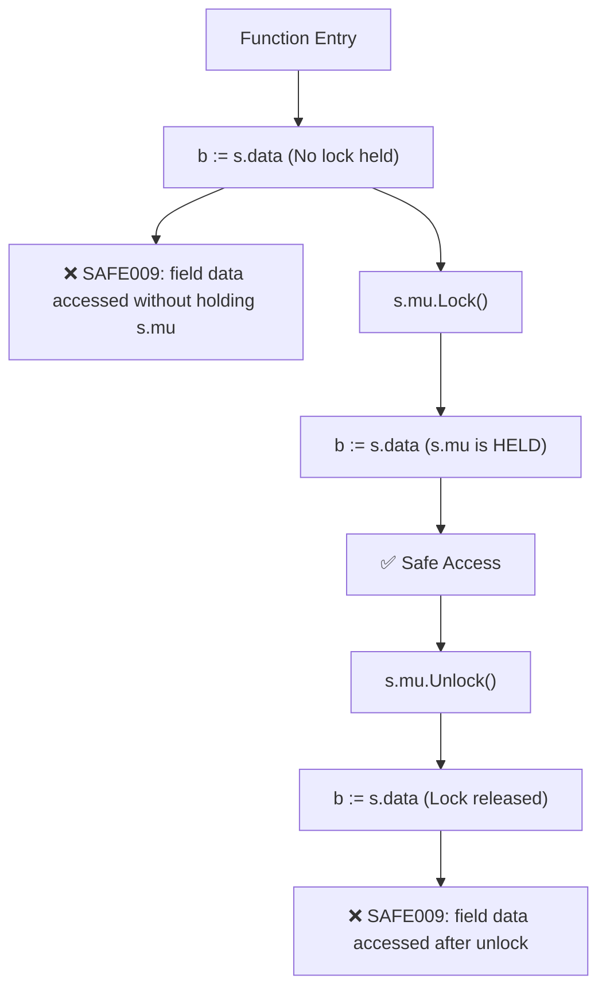
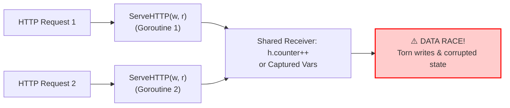

# GoSree (`gosree` / `gocap`) Concurrency Model & Capability Guarantees

[← README](../README.md) | [Architecture](ARCHITECTURE.md) | [Rules](RULES.md) | [Directives](DIRECTIVES.md) | [Borrow & NLL](BORROW_CHECKING_AND_NLL.md) | [Concurrency](CONCURRENCY_MODEL.md) | [Tooling](TOOLING_AND_ERASURE.md)

---

In garbage-collected languages like Go, traditional memory bugs like use-after-free and double-free cannot occur. The primary remaining category of catastrophic memory corruption is the **data race**: concurrent unsynchronized reads and writes that cause torn interface pointers, corrupt slice headers, or broken application invariants.

**GoSree** (`gosree`) focuses its ownership and capability checking specifically where memory crosses **goroutine boundaries**. Within a single goroutine, ordinary Go aliasing is permitted.

---

## 1. Concurrency Boundary Taxonomy

`gocap` defines four distinct categories of concurrency boundaries ([`passes/ownership/spawn.go`](file:///Users/bharath/Code/devtools/gocap/passes/ownership/spawn.go)):



### 1.1 Direct Goroutine Statements (`go`)
When a `go` statement executes, any value passed as an argument or captured by a function literal crosses a concurrency boundary:
- Unowned pointers trigger `SAFE002`.
- Owned pointers (`\iso`) are moved; sender access afterwards triggers `SAFE003`.
- Stack-scoped borrows (`\mub`, `\rob`) captured or passed trigger `CAP003`.

### 1.2 Asynchronous One-Shot Callbacks
Functions like `time.AfterFunc(d, fn)` and `context.AfterFunc(ctx, fn)` execute their callback on an independent runtime-managed goroutine. Memory captured by `fn` crosses a boundary under the same rules as `go`.

### 1.3 Structured Concurrency
`sync.WaitGroup.Go` and `golang.org/x/sync/errgroup.Group.Go` manage pools of tasks. Memory moved into these tasks can be safely reclaimed when the parent joins at `Wait()`.

### 1.4 Concurrently-Executing Handlers (`net/http`)
HTTP handlers registered via `http.HandleFunc` or router frameworks run concurrently with themselves on every incoming HTTP request. They never own what they capture, and writing shared state without a lock triggers `SAFE008`.

---

## 2. Reference Capabilities Across Goroutines



### 2.1 `\iso` (Isolated / Unique Ownership)
- **Origin:** Fresh memory allocations (`&T{}`, `new(T)`, `make(...)`), channel receives (`<-ch`), or parameters declared `//gocap:iso`.
- **Transfer Rule:** Moving an `\iso` reference to another goroutine permanently transfers ownership. The sender's reference is invalidated.
- **Affine Property:** At most one goroutine may possess an active pointer to the isolated allocation tree at any time.

### 2.2 `\imm` (Transitive Deep Immutability)
- **Origin:** Struct types declared `//gocap:imm`.
- **Invariants:** Every field must be deeply immutable (pointer-free, strings, channels, or pointers to other `\imm` structs).
- **Sharing Rule:** Pointers to verified `\imm` types may be read concurrently by unlimited goroutines without locks, channels, or move invalidations (`SAFE005`).

### 2.3 `\mub` / `\rob` (Stack-Scoped Borrows)
- **Origin:** Parameters or local bindings declared `//gocap:mub` or `//gocap:rob`.
- **Confinement:** Confined strictly to the calling goroutine's stack frame.
- **Escape Ban (`CAP003`):** Any attempt to send a borrow over a channel or capture it in a `go` closure is rejected.

---

## 3. Fork-Join Synchronization Recovery

In Go, it is common to hand off a data structure to a background goroutine for processing, and then reclaim it after waiting for completion. `gocap` models this via **Fork-Join Join Points** ([`passes/ownership/forkjoin.go`](file:///Users/bharath/Code/devtools/gocap/passes/ownership/forkjoin.go)).

```mermaid
sequenceDiagram
    autonumber
    participant Parent as Parent Thread
    participant Sync as Local sync.WaitGroup
    participant Worker as Worker Goroutine

    Parent->>Parent: item := &WorkItem{Data: 100} (\iso)
    Parent->>Sync: wg.Add(1)
    Parent->>Worker: go func() { item.Process(); wg.Done() }()
    Note over Parent: item is MOVED (Access here is SAFE003)
    Parent->>Sync: wg.Wait()
    Note over Parent,Sync: JOIN POINT REACHED: Worker finished and released item
    Note over Parent: Ownership of item RESTORED to Parent
    Parent->>Parent: println(item.Result) (ACCEPTED - Valid access)
```

### 3.1 Formal Join Invariants
A join point restores ownership to the parent if and only if all of the following conditions hold:

1. **Single Invocation:** The goroutine is spawned once (not in a loop or dynamic recursion).
2. **Release Follows Access:** In the child goroutine, the synchronization release (`wg.Done()` or channel send/close) happens strictly *after* the last access to the moved memory.
3. **No Secondary Leaks:** The child does not leak the memory into globals, return values, or third-party goroutines.
4. **Locally Visible Sync Object:** The `sync.WaitGroup` or channel is locally declared in the parent scope and used exclusively for synchronizing this work.

---

## 4. Mutex Lockset Forward Must-Analysis (`SAFE009`)

For shared mutable state across goroutines, `gocap` enforces strict lock discipline via `//safe:guarded_by <mu>` and `//safe:holds <mu>` ([`passes/ownership/lockset.go`](file:///Users/bharath/Code/devtools/gocap/passes/ownership/lockset.go)).



### 4.1 Analysis Properties
- **Path-Sensitive Must-Analysis:** A mutex is considered held at an instruction if and only if it is acquired on **every possible execution path** leading to that instruction.
- **RWMutex Support:** `RLock()` satisfies read access requirements; `Lock()` satisfies both read and write access requirements.
- **TryLock Handling:** `TryLock()` adds the mutex to the lockset only within the branch where the return value was checked and proven `true`.
- **Callee Summaries:** Intra-package helper functions that acquire or release locks are summarized; inter-package calls are treated as potentially releasing all passed mutexes.

---

## 5. Self-Racing HTTP Handlers (`SAFE008`)

`net/http` handlers run concurrently on distinct goroutines for each HTTP request:



Under `gocap`:
- Any write to shared receiver fields or captured closure variables inside a handler registration is flagged as `SAFE008`.
- To fix the issue, the field must be declared `//safe:guarded_by mu` and accessed under `mu.Lock()`.
