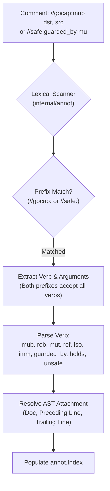
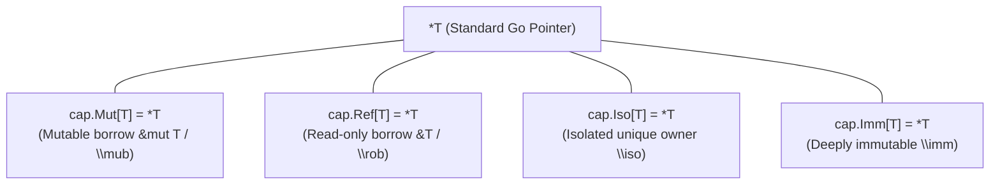

# GoSree (`gosree` / `gocap`) Directives & Capability Markers Reference

[← README](../README.md) | [Architecture](ARCHITECTURE.md) | [Rules](RULES.md) | [Directives](DIRECTIVES.md) | [Borrow & NLL](BORROW_CHECKING_AND_NLL.md) | [Concurrency](CONCURRENCY_MODEL.md) | [Tooling](TOOLING_AND_ERASURE.md)

---

**GoSree** (`gosree`) offers two syntactic mechanisms for expressing safety capabilities and second-class borrows in Go code:
1. **Comment Directives (`//gosree:...`, `//sree:...`, `//gocap:...`, and `//safe:...`)**: Native zero-cost annotations embedded directly in comments. Recognized by GoSree analyzers, invisible to the Go compiler.
2. **Generic Marker Types (`cap.Mut[T]`, `cap.Ref[T]`, `cap.Iso[T]`, `cap.Imm[T]`)**: Type-level expressions provided by package `github.com/bharathvbcr/gocap/cap` (and `github.com/bharathvbcr/gosree/cap`).

---

## 1. Syntax & Lexing Rules

All GoSree comment directives adhere to standard Go comment conventions:
- **No whitespace** between the leading slashes and the directive prefix (`//gosree:`, `//sree:`, `//gocap:`, or `//safe:`).
- Directives may appear as line comments (`//gosree:...`) or inline block comments (`/*gosree:...*/`).



### 1.1 Attachment Resolution
A directive attaches to AST nodes based on its position:
1. **Doc Comments:** Comments in a `FuncDecl` or `TypeDecl` doc comment attach to that declaration.
2. **Preceding Line:** A comment placed on the line immediately preceding a statement, variable specification, or struct field attaches to it.
3. **Trailing Same Line:** A comment placed at the end of the line attaches to the statement, field, or specification on that same line.

---

## 2. Capability Directives Reference

### 2.1 `//gocap:iso` / `//safe:iso` (Isolated Ownership)

Declares that a function parameter receives **isolated, unique ownership** (`\iso`).

```go
//gocap:iso job
func Worker(job *Job) {
    // Worker now holds exclusive ownership of job.
    // Caller cannot access job after this call.
}
```

- **Scope:** Function declarations.
- **Multiple Arguments:** `//gocap:iso p, q` marks multiple parameters.
- **Caller Effect:** The caller's argument binding is moved; subsequent caller access triggers `SAFE003`.
- **Callee Effect:** The callee can move the value onto a channel or into a spawned goroutine without triggering `SAFE002`.

---

### 2.2 `//gocap:imm` / `//safe:imm` (Deep Immutability)

Declares that a struct type is **deeply immutable** (`\imm`).

```go
//gocap:imm
type ServerConfig struct {
    Host string
    Port int
}
```

- **Scope:** Struct `type` declarations.
- **Verification (`SAFE005`):**
  - All struct fields must be pointer-free types, strings, channels, or pointers to other verified `//gocap:imm` types.
  - Slices, maps, and untyped interfaces are forbidden unless guarded.
- **Effect:** Pointers to `\imm` types can be shared across arbitrary goroutines and channels without triggering ownership moves (`SAFE003`) or invalidations.

---

### 2.3 `//gocap:mub` / `//gocap:mut` (Mutable Second-Class Borrow)

Declares a **mutable second-class borrow** (`\mub` / `&mut T`).

#### On Function Parameters:
```go
//gocap:mub val
func Increment(val *int) {
    *val++
}
```
*Inline form:*
```go
func Increment(val *int /*gocap:mub*/) {
    *val++
}
```

#### On Local Variable Bindings:
```go
x := 10
b := &x //gocap:mut
*b = 20
```

- **Invariants:**
  - Cannot be stored in struct fields or globals (`BORROW001`).
  - Cannot coexist with active mutable or read-only borrows of the same memory (`BORROW002`).
  - Cannot escape across channels or goroutines (`CAP003`).

---

### 2.4 `//gocap:rob` / `//gocap:ref` (Read-Only Second-Class Borrow)

Declares a **read-only second-class borrow** (`\rob` / `&T`).

#### On Function Parameters:
```go
//gocap:rob val
func Read(val *int) int {
    return *val
}
```
*Inline form:*
```go
func Read(val *int /*gocap:rob*/) int {
    return *val
}
```

#### On Local Variable Bindings:
```go
x := 10
r := &x //gocap:rob
println(*r)
```

- **Invariants:**
  - Multiple simultaneous `\rob` borrows are permitted.
  - No `\mub` borrow can be active simultaneously (`BORROW002`).
  - Cannot escape across goroutines or channels (`CAP003`).

---

### 2.5 `//safe:guarded_by <mu>` (Mutex-Protected Memory)

Declares that a field, package global, or local variable is protected by a named mutex (`sync.Mutex` or `sync.RWMutex`).

```go
type SafeCounter struct {
    mu    sync.Mutex
    count int //safe:guarded_by mu
}
```

- **Scope:** Unexported struct fields, package globals, local variables.
- **Access Discipline (`SAFE009`):**
  - Read access requires `mu.Lock()` or `mu.RLock()`.
  - Write access requires `mu.Lock()`.
  - Global variable writes protected by `guarded_by` are exempt from `SAFE006`.

---

### 2.6 `//safe:holds <mu>` (Callee Mutex Precondition)

Declares that callers of a method or function must already hold the specified mutex upon invocation. The argument must be a single identifier naming a field of the receiver's struct (or a package-level mutex), not a selector path.

```go
//safe:holds mu
func (s *SafeCounter) incrementLocked() {
    s.count++ // OK: s.mu verified held by caller
}
```

- **Scope:** Method and function declarations.
- **Enforcement (`SAFE009`):** Forward must-analysis ensures all call sites hold `mu` along all incoming CFG paths.

---

### 2.7 `//gocap:unsafe <reason>` (Scoped Escape Hatch)

Selectively suppresses diagnostics for the attached statement, spec, or function declaration.

```go
//gocap:unsafe legacy interop with external library
externalLibrary.UnsafeCall(ptr)
```

- **Requirement:** A non-empty reason string must be provided.
- **Auditability:** Tracked by `cmd/gocap-corpus` to compute the repository escape hatch ratio.
- **Stale Detection:** If an attached `//gocap:unsafe` directive suppresses zero diagnostics, it is flagged as stale.

---

## 3. Generic Marker Types (`github.com/bharathvbcr/gocap/cap`)

For developers who prefer explicit type annotations over comment directives, `gocap` provides the `cap` package:



### 3.1 Type Definitions
```go
package cap

// Mut represents a second-class mutable borrow (&mut T / \mub)
type Mut[T any] = *T

// Ref represents a second-class read-only borrow (&T / \rob)
type Ref[T any] = *T

// Iso represents an isolated, uniquely-owned pointer reference (\iso *T)
type Iso[T any] = *T

// Imm represents a deeply immutable pointer reference (\imm *T)
type Imm[T any] = *T
```

### 3.2 Intrinsics & Helper Expressions
```go
// Explicitly transfers ownership of an isolated value
func Move[T any](x T) T { return x }

// Explicitly constructs a mutable borrow (BorrowMub is an alias)
func BorrowMut[T any](x *T) Mut[T] { return x }
func BorrowMub[T any](x *T) Mub[T] { return x }

// Explicitly constructs a read-only borrow (BorrowRef and BorrowRob are aliases)
func Borrow[T any](x *T) Ref[T]    { return x }
func BorrowRef[T any](x *T) Ref[T] { return x }
func BorrowRob[T any](x *T) Rob[T] { return x }
```

### 3.3 Usage Example
```go
package main

import "github.com/bharathvbcr/gocap/cap"

type Item struct{ Count int }

func Update(item cap.Mut[Item]) {
    item.Count++
}

func main() {
    x := Item{Count: 1}
    b := cap.BorrowMut(&x)
    Update(b)
}
```

### 3.4 Automatic Erasure
When targeting toolchains without generic type alias support or legacy Go versions, `cmd/gocap-erase` converts `cap.Mut[Item]` back to `*Item` and strips the import:

```bash
gocap-erase -w ./...
```
