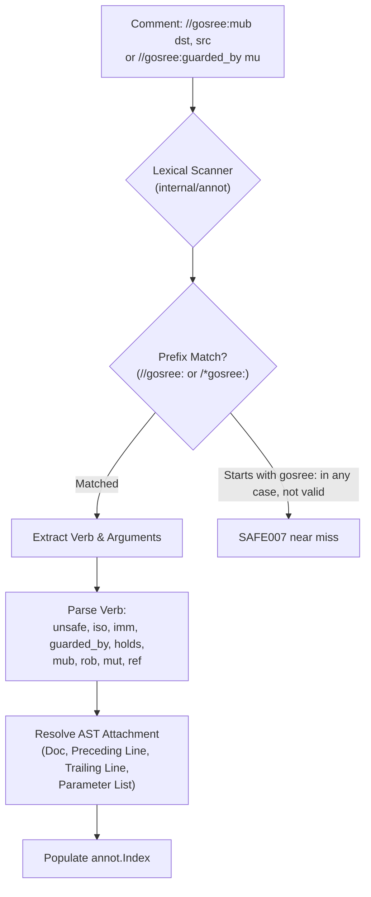
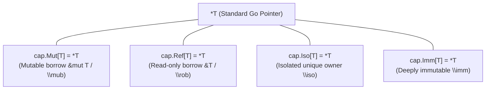

# GoSree (`gosree`) Directives & Capability Markers Reference

[← README](../README.md) | [Architecture](ARCHITECTURE.md) | [Rules](RULES.md) | [Directives](DIRECTIVES.md) | [Borrow & NLL](BORROW_CHECKING_AND_NLL.md) | [Concurrency](CONCURRENCY_MODEL.md) | [Error Discipline](ERROR_DISCIPLINE.md) | [Tooling](TOOLING_AND_ERASURE.md)

---

**GoSree** (`gosree`) offers two syntactic mechanisms for expressing safety capabilities and second-class borrows in Go code:
1. **Comment Directives (`//gosree:...`)**: Native zero-cost annotations embedded directly in comments. Recognized by GoSree analyzers, invisible to the Go compiler.
2. **Generic Marker Types (`cap.Mut[T]`, `cap.Ref[T]`, `cap.Iso[T]`, `cap.Imm[T]`)**: Type-level expressions provided by package `github.com/bharathvbcr/gosree/cap` (source: `cap/cap.go`). The marker scanner (`internal/annot`, functions `isCapPkg` and `capSymbol`) recognizes the path `github.com/bharathvbcr/gosree/cap` and also any package named `cap` or whose path ends in `/cap`.

---

## 1. Syntax & Lexing Rules

All GoSree comment directives adhere to standard Go comment conventions:
- **`//gosree:` is the only directive prefix** (`const Prefix` in `internal/annot/annot.go`). A comment that begins with any other prefix (`//safe:iso p`, `//sree:iso p`) is a plain comment: it is not a directive and is not reported.
- **No whitespace** between the leading slashes and `gosree:`.
- Directives may appear as line comments (`//gosree:...`) or inline block comments (`/*gosree:...*/`).
- A trailing `// note` after a directive is commentary, not arguments. The verb ends at any whitespace.
- The verbs are `unsafe`, `iso`, `imm`, `guarded_by`, `holds`, `mub`, `rob`, `mut` and `ref` (`internal/annot/nearmiss.go`, `verbs`).
- An unknown verb is reported as `SAFE007`: `unknown directive //gosree:frobnicate (known: unsafe, iso, imm, guarded_by, holds, mub, rob, mut, ref)`.
- A **near miss** is reported as `SAFE007` too. It is a comment whose text, after the comment marker and optional white space, starts with `gosree:` in any letter case but that is not a valid directive: `// gosree:iso p`, `//Gosree:holds mu`, `/* gosree:mut */`. `gofmt` rewrites a bare `//gosree:` to `// gosree:`, which is why the no-space spelling is the one that works. The rule (`internal/annot/nearmiss.go`) is that when a space follows the colon the word must be a verb exactly, so prose such as `// gosree: this lock is held` is left alone. When the word follows the colon directly (`//Gosree:guardedby`) it is a near miss if it is within edit distance 2 of `guarded_by`, 1 of `unsafe` or `holds`, or 0 of the three-letter verbs, ignoring case.



### 1.1 Attachment Resolution
A directive attaches to AST nodes based on its position (`attach` in `internal/annot/annot.go`):
1. **Doc Comments:** Comments in a `FuncDecl` or `TypeDecl` doc comment attach to that declaration. `iso`, `holds` and the parameter form of `mub`/`rob`/`mut`/`ref` need a function's doc comment; `imm` needs a type declaration's doc comment. A blank line between the comment and the declaration breaks the attachment, and the directive is then reported as `SAFE007` (`//gosree:iso must be in a function's doc comment`).
2. **Preceding Line:** A comment placed on the line immediately preceding a statement, variable specification, or struct field attaches to it.
3. **Trailing Same Line:** A comment placed at the end of the line attaches to the statement, field, or specification on that same line.
4. **Parameter List:** Inside a function's parameter or receiver list, a borrow or `iso` directive goes directly after a parameter's type, `func f(p *T /*gosree:mub*/)`, and applies to every name declared with that type (`internal/annot/params.go`).

---

## 2. Capability Directives Reference

### 2.1 `//gosree:iso` (Isolated Ownership)

Declares that a function parameter receives **isolated, unique ownership** (`\iso`).

```go
//gosree:iso job
func Worker(job *Job) {
    // Worker now holds exclusive ownership of job.
    // Caller cannot access job after this call.
}
```

- **Scope:** Function and method declarations (receiver included); parameters may also be typed `cap.Iso[T]`, or carry the inline form `p *T /*gosree:iso*/`.
- **Multiple Arguments:** `//gosree:iso p, q` marks multiple parameters. Naming something that is not a parameter, or a parameter that already has a different capability, is `SAFE007`.
- **Caller Effect:** The caller's argument binding is moved; subsequent caller access triggers `SAFE003`.
- **Callee Effect:** The callee can move the value onto a channel or into a spawned goroutine without triggering `SAFE002`.

---

### 2.2 `//gosree:imm` (Deep Immutability)

Declares that a struct type is **deeply immutable** (`\imm`).

```go
//gosree:imm
type ServerConfig struct {
    host string
    port int
}
```

- **Scope:** A defined struct `type` declaration, with no arguments (`//gosree:imm` takes none; repeating it is `SAFE007`). `type X cap.Imm[...]` is also recorded as an imm candidate, but it is not a struct, so it is reported as `SAFE005` (`it must be a struct type`).
- **Verification (`SAFE005`):**
  - Every field must be unexported.
  - Fields must be pointer-free types, strings, channels of shareable types, or pointers to other verified `//gosree:imm` types.
  - Slices, maps, and interfaces are forbidden unless the field is `//gosree:guarded_by`.
- **Effect:** Pointers to `\imm` types can be shared across arbitrary goroutines and channels without triggering ownership moves (`SAFE003`) or invalidations.

---

### 2.3 `//gosree:mub` / `//gosree:mut` (Mutable Second-Class Borrow)

Declares a **mutable second-class borrow** (`\mub` / `&mut T`). The two verbs are the same.

#### On Function Parameters:
```go
//gosree:mub val
func Increment(val *int) {
    *val++
}
```
*Inline form:*
```go
func Increment(val *int /*gosree:mub*/) {
    *val++
}
```

#### On Local Variable Bindings:
```go
x := 10
b := &x //gosree:mut
*b = 20
```

- **Invariants:**
  - Cannot be stored in struct fields or globals (`BORROW001`).
  - Cannot coexist with active mutable or read-only borrows of the same memory (`BORROW002`).
  - Cannot escape across channels or goroutines (`CAP003`).
- **Where it attaches:** A function declaration (named parameters), a parameter's type in the parameter list, or an assignment or `var` statement in a function body. Anywhere else, including a struct field or a package variable, is `SAFE007`. A binding takes one borrow directive: two on one statement, or a conflicting `//gosree:rob`, are `SAFE007`.

---

### 2.4 `//gosree:rob` / `//gosree:ref` (Read-Only Second-Class Borrow)

Declares a **read-only second-class borrow** (`\rob` / `&T`). The two verbs are the same.

#### On Function Parameters:
```go
//gosree:rob val
func Read(val *int) int {
    return *val
}
```
*Inline form:*
```go
func Read(val *int /*gosree:rob*/) int {
    return *val
}
```

#### On Local Variable Bindings:
```go
x := 10
r := &x //gosree:rob
println(*r)
```

- **Invariants:**
  - Multiple simultaneous `\rob` borrows are permitted.
  - No `\mub` borrow can be active simultaneously (`BORROW002`).
  - Cannot escape across goroutines or channels (`CAP003`).

---

### 2.5 `//gosree:guarded_by <mu>` (Mutex-Protected Memory)

Declares that a field, package global, or local variable is protected by a named mutex (`sync.Mutex` or `sync.RWMutex`).

```go
type SafeCounter struct {
    mu    sync.Mutex
    count int //gosree:guarded_by mu
}
```

- **Scope:** Unexported struct fields, unexported package variables, local variables. The mutex must be a sibling field, a package variable, or a local in scope, of type `sync.Mutex`/`sync.RWMutex`. Guarding an exported name, guarding the mutex itself, an embedded field, or a second guard on one variable is `SAFE007`.
- **Several names on one declaration:** extra names after the mutex (`//gosree:guarded_by mu a`) restrict the guard to those names.
- **Access Discipline (`SAFE009`):**
  - Read access requires `mu.Lock()` or `mu.RLock()`.
  - Write access requires `mu.Lock()`.
  - Global variable writes protected by `guarded_by` are exempt from `SAFE006`.
  - A guarded local is checked where a closure captures it (`passes/ownership/localguard.go`); a local that no closure captures is not checked.

---

### 2.6 `//gosree:holds <mu>` (Callee Mutex Precondition)

Declares that callers of a method or function must already hold the specified mutex upon invocation. The argument must be a single identifier naming a field of the receiver's struct (or a package-level mutex), not a selector path (`//gosree:holds in.mu` is `SAFE007`: `needs one mutex name`).

```go
//gosree:holds mu
func (s *SafeCounter) incrementLocked() {
    s.count++ // OK: s.mu verified held by caller
}
```

- **Scope:** Method and function declarations.
- **Enforcement (`SAFE009`):** Forward must-analysis ensures all call sites hold `mu` along all incoming CFG paths.

---

### 2.7 `//gosree:unsafe <reason>` (Scoped Escape Hatch)

Selectively suppresses diagnostics for the attached statement, spec, or function declaration.

```go
//gosree:unsafe legacy interop with external library
externalLibrary.UnsafeCall(ptr)
```

- **Requirement:** A reason with at least one letter or digit. A missing or invisible-only reason, an unattached hatch, a hatch on the line of a multi-line block's opening brace, or an exact duplicate scope is `SAFE007`.
- **Coverage:** On its own line above a statement, or in a declaration's doc comment, it covers the whole statement or declaration. At the end of a code line it covers that line's statement except the bodies of multi-line blocks in it.
- **Which passes honor it:** `unsafeban`, `ownership`, `borrow` (`passes/borrow/check.go`, `passes/borrow/storage.go`) and `errcheck` (mutes `ERR001`-`ERR005`, `passes/errcheck/errcheck.go`). Each pass reports a muted finding through `Index.Mute`, which is what marks the hatch as used.
- **Auditability:** `cmd/gosree-corpus` reports a hatch ratio (suppressed transfers over all transfers, `hatch_ratio` in its JSON).
- **Stale Detection:** The `safestale` analyzer (`internal/annot/stale`) reports a hatch that mutes nothing as `SAFE007` (`stale escape hatch: this //gosree:unsafe mutes no finding of any rule; remove it`), but `cmd/gosree` does not register it, so the shipped binary does not emit that diagnostic. The ownership pass still counts such scopes in its stats (`UnsafeStale`).

---

## 3. Generic Marker Types (`github.com/bharathvbcr/gosree/cap`)

For developers who prefer explicit type annotations over comment directives, GoSree provides the `cap` package:



### 3.1 Type Definitions
```go
package cap

// Mut represents a second-class mutable borrow (&mut T / \mub)
type Mut[T any] = *T

// Ref represents a second-class read-only borrow (&T / \rob)
type Ref[T any] = *T

// Mub is an alias for Mut, matching the \mub capability notation.
type Mub[T any] = *T

// Rob is an alias for Ref, matching the \rob capability notation.
type Rob[T any] = *T

// Iso represents an isolated, uniquely-owned pointer reference (\iso *T)
type Iso[T any] = *T

// Imm represents a deeply immutable pointer reference (\imm *T)
type Imm[T any] = *T
```

### 3.2 Intrinsics & Helper Expressions
```go
// Explicitly transfers ownership of an isolated value
func Move[T any](x T) T { return x }

// Explicitly constructs a mutable borrow (BorrowMub is an alias)
func BorrowMut[T any](x *T) Mut[T] { return x }
func BorrowMub[T any](x *T) Mub[T] { return x }

// Explicitly constructs a read-only borrow (BorrowRef and BorrowRob are aliases)
func Borrow[T any](x *T) Ref[T]    { return x }
func BorrowRef[T any](x *T) Ref[T] { return x }
func BorrowRob[T any](x *T) Rob[T] { return x }
```

### 3.3 Usage Example
```go
package main

import "github.com/bharathvbcr/gosree/cap"

type Item struct{ Count int }

func Update(item cap.Mut[Item]) {
    item.Count++
}

func main() {
    x := Item{Count: 1}
    b := cap.BorrowMut(&x)
    Update(b)
}
```

### 3.4 Automatic Erasure
To produce plain Go with no marker types and no directives, `cmd/gosree-erase` rewrites `cap.Mut[Item]` to `*Item`, replaces `cap.BorrowMut(&x)` with `&x`, strips the `github.com/bharathvbcr/gosree/cap` import, and removes `//gosree:` and `/*gosree:` comments. Without flags it prints the result to stdout; `-w` writes the files in place, all or nothing:

```bash
gosree-erase -w ./...
```
