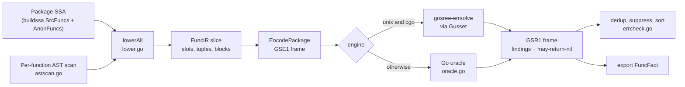

# GoSree Error Discipline: `Result<T, E>` and `#[must_use]` for Go

[← README](../README.md) | [Architecture](ARCHITECTURE.md) | [Rules](RULES.md) | [Directives](DIRECTIVES.md) | [Borrow & NLL](BORROW_CHECKING_AND_NLL.md) | [Concurrency](CONCURRENCY_MODEL.md) | [Error Discipline](ERROR_DISCIPLINE.md) | [Tooling](TOOLING_AND_ERASURE.md)

---

In Rust, a fallible function returns `Result<T, E>`, the type is `#[must_use]`, and the only way to reach the `T` is to go through a match or `?` that handles the `E`. Go has the same shape by convention (`(T, error)`) but enforces none of it: a call statement can drop the error, the companion `T` can be read when `err` was never checked, and an inner `err :=` can silently shadow the one that matters.

The **error-discipline subsystem** (analyzer name `safeerr`, package [`passes/errcheck`](../passes/errcheck/errcheck.go)) models a Go `(T, error)` return as a virtual `Result` and checks five rules, `ERR001`–`ERR005`, over SSA control-flow graphs. The dataflow runs in a Rust solver ([`rust/gosree-errsolve`](../rust/gosree-errsolve/src/lib.rs)) hosted in-process through [Gusset](https://github.com/bharathvbcr/gusset), with a pure-Go reference oracle ([`internal/gusseterr/oracle.go`](../internal/gusseterr/oracle.go)) that must agree with it byte for byte.

This document covers the pipeline end to end. For the user-facing rule text and examples, see [RULES.md](RULES.md).

---

## 1. Motivation: One Rust Idea per Rule

The rule codes are constants in [`passes/errcheck/errcheck.go`](../passes/errcheck/errcheck.go) (the `Rule identifiers` constants), with matching wire codes in `internal/gusseterr/wire.go` and `rust/gosree-errsolve/src/lib.rs`.

| Rule | Rust analogue | Go hazard |
|------|---------------|-----------|
| ERR001 | `#[must_use]` on `Result` | error result dropped by a bare call, `go`, or `defer` |
| ERR002 | `.unwrap()` without a match | companion `T` used before `err == nil` is proven, or after `err` was assigned to `_` |
| ERR003 | an `Err` that is overwritten or never matched | error lost to shadowing, overwriting, or `if err != nil { return nil }` |
| ERR004 | no analogue (Go's typed-nil trap) | a possibly-nil `*T` that implements `error` boxed into `error` |
| ERR005 | `Drop` that ignores a flush failure | `Close()` error dropped on a writable or written resource |

**[ERR001](RULES.md#err001-must-use-error-return-discarded).** A call whose last result is `error` is the analogue of a `#[must_use]` value. If it appears as an expression statement, a `go` statement, or a `defer`, it is reported. The AST scan skips a small allowlist of calls documented as infallible (`fmt.Print*`, writes into `bytes.Buffer`/`strings.Builder`, `hash.Hash.Write`, `fmt.Fprint*` to such writers, `io.Discard`, `os.Stdout` or `os.Stderr`), see `isBenignErrCall` in `passes/errcheck/astscan.go`. An expression-statement or `defer` call to a `Close()` method that returns `error` is classified for ERR005 instead of ERR001 (`classifyDiscardedCall`); a `go x.Close()` statement stays an ERR001 candidate.

**[ERR002](RULES.md#err002-unchecked-companion-result-unwrap).** The `T` of `(T, error)` is the "Ok" payload. The solver reports it when it is used while the paired `err` has not been proven nil on every path (`SubERR002Unchecked`) or when `err` was bound to `_` (`SubERR002Blanked`). Calls shaped like `io.Reader.Read` (`isIOReaderRead` in `lower.go`) are tagged separately (`TupleIORead`): on the true edge of an `n > 0` branch (`CondGtZero`) the solver treats the companion as safe even though the error is unchecked.

**[ERR003](RULES.md#err003-shadowed-overwritten-or-inverted-error).** Three sub-kinds share one rule code: an inner `err :=` that shadows an outer error which is then still live (`SubERR003Shadowed`), an assignment that overwrites an earlier error nobody read (`SubERR003Overwritten`), and the `nilerr` pattern, returning a literal nil error on a path where an error was just checked non-nil (`SubERR003Nilerr`).

**[ERR004](RULES.md#err004-typed-nil-concrete-error-interface-boxing).** A function returning a concrete `*T` that implements `error`, once boxed into `error`, yields a non-nil interface even when the pointer is nil. The solver tracks may-nil versus must-nil pointers (`SubERR004MayNil`, `SubERR004MustNil`) and follows returns across functions and, through exported facts, across packages (Section 5.2).

**[ERR005](RULES.md#err005-writable-resource-close-error-discarded).** A `Close()` that discards its error loses flush failures on a resource that was opened for writing or written to. The lowering marks resources from known writable producers (`os.Create`, `os.CreateTemp`, `os.OpenFile` with a non-zero flag, `bufio.NewWriter*`, `compress/gzip`, `compress/zlib` and `compress/flate` writers, `archive/zip`, `archive/tar`, `encoding/csv` and `mime/multipart` `NewWriter`; `isWritableResourceProducer` in `lower.go`) and by calls to `Write`, `WriteString`, `WriteByte`, `WriteRune`, `WriteAt`, `ReadFrom`, `Flush` or `Sync` on a receiver that has a `Close` method (`isWriteMutatingMethod`); the solver reports a synchronous close (`SubERR005SyncClose`) or a deferred one (`SubERR005DeferClose`).

All five rules honour the standard suppression directives; see [DIRECTIVES.md](DIRECTIVES.md). Suppressed findings are counted as `FindingsMuted` in the analyzer's `Summary` (the suppression check in `run`).

---

## 2. Pipeline

The analyzer requires `annot.Analyzer` and `buildssa.Analyzer` (`Analyzer.Requires`). Its `run` function does five things in order: collect functions, lower them, solve, export facts, format diagnostics.



### 2.1 What the AST scan finds

SSA erases source structure that these rules need: whether a result was *explicitly* assigned to `_`, whether a statement was a `defer` or `go`, which `err :=` shadows which outer variable. [`astscan.go`](../passes/errcheck/astscan.go) walks each function body (not descending into nested function literals, which are separate SSA functions and are scanned on their own; `walkNoNestedClosures`) and produces a `funcASTInfo` with four tables:

- `unhandled`: discarded error-returning calls from expression, `go`, and `defer` statements (ERR001 candidates);
- `closes`: discarded `Close() error` calls, with a flag for `defer` (ERR005 candidates);
- `blanked`: `(T, error)` assignments whose error was bound to `_` (ERR002 blanked candidates);
- `shadows`: inner `err :=` declarations that shadow an outer error variable still read afterwards (ERR003 candidates).

Each entry is keyed by the call's `Lparen` position, which is the join key back to the SSA call instruction.

### 2.2 What the SSA lowering produces

[`lower.go`](../passes/errcheck/lower.go) turns each `*ssa.Function` into one `gusseterr.FuncIR` (`lowerFunc` in `lower.go`). Functions with no blocks (external or bodyless) are emitted with only their flags, so the solver can still seed their summaries.

The IR is deliberately small and slot-based:

- **Slots.** Every SSA value that matters gets a numeric slot with flags `SlotIsError`, `SlotInitMayNilParam`, `SlotInitWritable`.
- **Tuples.** Each `(T, error)` call gets a `TupleMeta` (error slot, call-site id, flags `TupleErrBlanked`, `TupleIORead`).
- **Blocks.** Each SSA basic block becomes a `BlockIR`: slot-level phis, a list of ops, and one terminator (`Jump`, `Cond`, `Return`, `Stop`). Conditions are classified to `CondIsNil`, `CondNotNil`, `CondGtZero` or `CondOpaque` so the solver can refine on branch edges.
- **Ops.** The eleven operation kinds (`OpUnhandledErr`, `OpBindTuple`, `OpBindErr`, `OpAssignSlot`, `OpCallConcretePtr`, `OpObserveErr`, `OpUseCompanion`, `OpShadowErr`, `OpBoxConcreteErr`, `OpMarkWritable`, `OpUnhandledClose`; the `Operation kinds` constants in `wire.go`) are the transfer instructions. The AST facts become ops here: a matched `unhandled` call becomes `OpUnhandledErr`, a matched close becomes `OpUnhandledClose` with `IsDefer`, a matched shadow becomes `OpShadowErr`.
- **Sites.** Each finding-capable op carries a `SiteID` indexing `packageBuilder.sites` (position plus a human description). Site 0 is reserved (`newPackageBuilder` seeds `sites` with an empty entry). The solver never sees source positions; it returns `(function index, site id, rule, sub-kind)` and the Go side maps back.

The solver sees an abstract program, not Go. Everything that needs `go/types` knowledge (what counts as an error type, which callees are writable producers, which calls never return) is decided during lowering.

### 2.3 What the solver tracks

The solver is a two-phase monotone fixpoint (`solve_package` in `rust/gosree-errsolve/src/lib.rs`; mirrored by `SolveOracle` in `oracle.go`):

1. **Interprocedural summary phase.** For every function whose result is a concrete error pointer, iterate (bounded by `MAX_CALLGRAPH_ITERS`) until the per-function `may_return_nil` bit stabilises. Bodyless concrete-error-pointer functions and functions flagged `FuncExternalMayNil` are seeded `true`.
2. **Diagnostic phase.** With summaries converged, solve each function's CFG once more with finding collection on, then sort and deduplicate findings.

Within a function, each slot carries a **product of five small lattices** (`SlotCell` in `lib.rs`; the oracle mirrors them under `// Abstract lattice types` in `oracle.go`). Every lattice has a `Bot` element for "not yet reached" and a `join` that is monotone:

| Domain | Elements | Answers |
|--------|----------|---------|
| `Origin` | `Bot`, `Safe`, `Single(tuple)`, `UncheckedMix(tuple)`, `Blanked(tuple)` | Is this companion value backed by a proven-nil error? Which tuple does it come from? |
| `NilVal` | `Bot`, `MustNil`, `NonNilChecked`, `NonNil`, `MayNil` | Nil-ness of an error or concrete error pointer, with a transient `NonNilChecked` state for "just compared `!= nil`" |
| `ErrVar` | `Bot`, `Clean`, `Unread(site)` | Does this error variable hold an assigned-but-unread error? |
| `Writable` | `Bot`, `ReadOnly`, `Writable` | Has this resource been opened for or written to? |
| `ErrLink` | `Bot`, `Tuple(id)`, `None` | Which tuple's error does this slot alias, if exactly one? |

A function's abstract state is a vector of `SlotCell`s plus a `reachable` flag. The function entry state sets every slot to `Origin::Safe`, `NilVal::MayNil`, `ErrVar::Clean`, `ErrLink::None`, with `Writable` from `SlotInitWritable`. Branch edges refine by `CondIsNil` / `CondNotNil` / `CondGtZero`; block entry applies phi joins; `promote_tuple` turns `Single(t)` into `Safe` once the paired error is proven nil.

Two deliberate details are worth knowing:

- The join of two disagreeing origins is conservative: `Single(a) ⊔ Single(b)` becomes `UncheckedMix(min(a, b))`, and any `Blanked` dominates. Taking the minimum keeps the join commutative and makes the reported tuple deterministic.
- Deferred closes are recorded with whether the resource was writable *at registration* and resolved after the CFG converges (`deferCloseRec` in `oracle.go`, `deferred_closes` in `lib.rs`), so a `Write` after `defer f.Close()` still counts. The `er_close` stress family covers this case ("post-defer mutation", `tests/stress/testdata/src/er_close/close.go:1-2`).

The nilerr check (ERR003, `SubERR003Nilerr`) is performed at `Return` terminators flagged `RetLiteralNilErr`, in a function that returns an error, when some error slot is still in the `NonNilChecked` state (the oracle's post-fixpoint pass in `oracle.go`).

### 2.4 Back on the Go side

`run` maps each finding to its `siteMeta`, applies three filters, and reports in deterministic order (`run` in `errcheck.go`):

1. a finding whose site has no valid position is dropped;
2. one finding per `(file, line, rule, sub-kind)` is kept;
3. a finding on a suppressed position is counted as muted instead of reported.

Blanked-companion findings are re-attributed to the assignment that discarded the error (`blankedCallSite`) rather than to the use. Diagnostics are sorted by file, line, column, message. If the solver returns an error, `run` returns `safeerr solver failed: ...` and the analysis fails (`run` in `errcheck.go`); there is no silent fallback to "no findings".

---

## 3. Wire Format

The Go lowering and the Rust solver exchange two little-endian binary frames. Both sides carry the same limits and decode strictly; the Go side is [`wire.go`](../internal/gusseterr/wire.go) (encoder, response decoder) plus `DecodePackage` in `oracle.go` (request decoder used by the oracle); the Rust side is `decode_package` / `encode_result` in `lib.rs`.

`NoneU32` is `0xFFFFFFFF`, used as the "no slot" sentinel (for example `RetSlot` of a return that carries no slot).

### 3.1 Request frame (`GSE1`)

```
"GSE1"                       4 bytes magic
num_funcs                    u32
per function:
  flags                      u8     FuncReturnsError | FuncReturnsConcreteErrPtr | FuncExternalMayNil
  num_slots                  u32
  num_tuples                 u32
  num_blocks                 u32
  slot_flags[num_slots]      u8 each
  tuples[num_tuples]         { err_slot u32, call_site_id u32, flags u8 }
  blocks[num_blocks]:
    terminator               tag u8, then by tag:
                               0 Jump    target u32
                               1 Cond    true_bb u32, false_bb u32, cond_kind u8, cond_slot u32
                               2 Return  site_id u32, ret_slot u32, ret_flags u8
                               3 Stop    (no payload)
    num_phis                 u32
    phis[]                   { dst_slot u32, arity u16, incoming[arity] { pred_bb u32, src_slot u32 } }
    num_ops                  u32
    ops[]                    { kind u8, site_id u32, payload by kind }
```

Note the order inside a block: the terminator comes **before** the phis and ops.

Fixed sizes, checked against the encoder's output: the request header is 8 bytes; a function header is 13 bytes (`flags` plus three `u32` counts); a tuple is 9 bytes; terminators are 5 (`Jump`), 14 (`Cond`), 10 (`Return`) and 1 (`Stop`) bytes; a phi is 6 bytes plus 8 per incoming edge; every op starts with a 5-byte header (`kind`, `site_id`) before its payload.

Op payloads (`EncodePackage` in `wire.go`):

| Op (kind) | Payload |
|-----------|---------|
| `OpUnhandledErr` (1) | none |
| `OpBindTuple` (2) | `tuple_id u32`, `err_slot u32`, `n u16`, `companions[n] u32` |
| `OpBindErr` (3), `OpObserveErr` (6), `OpUseCompanion` (7), `OpBoxConcreteErr` (9), `OpMarkWritable` (10) | `slot u32` |
| `OpAssignSlot` (4) | `dst u32`, `src u32`, `nil_hint u8`, `writable_hint u8` |
| `OpCallConcretePtr` (5), `OpShadowErr` (8) | `slot_a u32`, `slot_b u32` (for `OpCallConcretePtr`, `slot_b` is the callee function index) |
| `OpUnhandledClose` (11) | `res_slot u32`, `is_defer u8` |

`nil_hint` takes `AssignNilCopy`, `AssignNilNonNil`, `AssignNilMayNil`, `AssignNilMustNil`.

### 3.2 Response frame (`GSR1`)

```
"GSR1"                       4 bytes magic
num_funcs                    u32
may_return_nil[num_funcs]    u8 each, must be 0 or 1
num_findings                 u32
findings[num_findings]       { func_idx u32, site_id u32, rule u8, sub u8, 0 u8, 0 u8 }   12 bytes
```

`DecodeResult` requires the frame length to equal the header plus exactly `num_findings * 12` bytes, and rejects any `may_return_nil` byte other than 0 or 1 (`DecodeResult` in `wire.go`). Findings come back already sorted and deduplicated, so the byte output of two correct engines is identical; that is what the parity test compares.

### 3.3 Limits

The same constants appear in the `const` block at the top of `wire.go` and the `MAX_*` constants at the top of `lib.rs`:

| Limit | Value |
|-------|-------|
| `MaxFuncs` | 16,384 |
| `MaxSlots` (per function) | 262,144 |
| `MaxTuples` (per function) | 16,384 |
| `MaxBlocks` (per function) | 32,768 |
| `MaxPhisPerBlock` | 16,384 |
| `MaxPhiArity` | 4,096 |
| `MaxOpsPerBlock` | 262,144 |
| `MaxCompanions` (per `OpBindTuple`) | 256 |
| `MaxIterationsPerFunc` (worklist steps) | 250,000 |
| `MaxCallgraphIters` | 4,096 |

`EncodePackage` refuses to emit a frame that violates a limit. The Rust decoder independently rejects bad magic, truncation, trailing bytes, out-of-range enum tags, out-of-bounds slot or block indices, and over-limit counts (`SolveError` in `lib.rs`). Exhausting the worklist budget for a function is an error (`IterationBudgetExceeded`), not a quiet truncation.

---

## 4. Engine Selection and Safety

Both engines expose the same surface (`Solve`, `SolveFrame`, `Check`, `SelfTest`, `Close`, `Shutdown`, `NativeActive`, `Opens`, `Crossings`, `DrainLogs`, `RustAllocatedBytes`) and are selected purely by build tags:

| Build | File | Engine |
|-------|------|--------|
| `unix && cgo` | [`engine_unix.go`](../internal/gusseterr/engine_unix.go) | in-process Rust solver through Gusset; `NativeActive()` is true |
| `!unix \|\| !cgo` | [`engine_other.go`](../internal/gusseterr/engine_other.go) | `SolveFrame` and `Solve` call the Go oracle; `NativeActive()` is false; `Opens`, `DrainLogs`, `RustAllocatedBytes`, `Close`, `Shutdown` are no-ops or zero |

There is no runtime flag to switch between them: a binary has the native engine if and only if it was built with `unix` and cgo.

### 4.1 The native engine

**Registration.** The first call that needs a handle runs `register()` once (`sync.Once`), which calls the Rust export `gosree_gusset_init` (`register` in `engine_unix.go`). The cgo directives `#cgo noescape` and `#cgo nocallback` apply to it, and it is the only symbol in `internal/gusseterr/exports.txt`. On the Rust side (`gosree_gusset_init` in `rust/gusset-engine/src/lib.rs`) it installs the solver as Gusset's global engine handler (opcode 0) and registers one more opcode, `OPCODE_SELF_TEST_PANIC` (`0x7fff_0001`), whose handler intentionally panics. It is idempotent via a `OnceLock` and returns the number of failed registrations.

**Pooling.** `sharedHandle()` lazily opens one process-wide `gusset.Handle` with `gusset.WithPoolSize(poolSize)` where `poolSize = 4` (`engine_unix.go`). All callers share it. Opens are counted (`Opens()`), and each `SolveFrame` attempt counts one FFI crossing (`Crossings()`). One package is solved in one batched frame, so a package costs one crossing in the normal case.

**Inline versus buffer transport.** Frames up to `maxInlineFrame = 4096` bytes go through `Handle.Call`. Larger frames are copied into a Gusset-owned `Buffer` (`NewBuffer`), submitted with `CallBuffer`, and the response is copied out before the buffers are freed (`roundTrip` in `engine_unix.go`). Access to Rust-owned buffer memory is guarded by `bufferMem`, an `RWMutex` that `Handle.Close` takes exclusively, so a concurrent close cannot unmap a buffer mid-copy.

**Opcode pinning.** `SolveFrame` wraps the caller's context with `gusset.ContextWithOpcode(ctx, opcodeSolve)` so a caller-supplied context cannot route a solve to the panic opcode on the shared handle (`SolveFrame` in `engine_unix.go`).

**Panic containment.** The workspace builds with `panic = "unwind"` in both profiles (`rust/Cargo.toml`), so a Rust panic is caught by Gusset's firewall and surfaces in Go as `gusset.ErrPanic`; the handle is then poisoned (`gusset.ErrPoisoned`). `SolveFrame` treats either as fatal for that handle: it calls `retire(h)`, which atomically clears the shared pointer and closes the handle on a background goroutine, and returns the error. It does **not** retry a poisoned call. The next `SolveFrame` opens a fresh handle. `SelfTest` proves this end to end on a throwaway one-slot handle bound to the panic opcode: the first call must return `ErrPanic`, the second `ErrPoisoned`, and the shared handle must still pass `Check` afterwards (`SelfTest` in `engine_unix.go`).

**Reopen and retry.** If a call fails with `gusset.ErrClosed` while the package-level `closed` flag is still false (the shared handle was closed under it), `SolveFrame` retries exactly once with a freshly resolved handle (`SolveFrame` in `engine_unix.go`). After `Close` or `Shutdown`, `sharedHandle()` returns `ErrClosed` and no new handle is opened. `Shutdown(drain)` marks the engine closed, calls `gusset.Shutdown(drain)`, then `Close`.

**Context and cancellation.** A nil context is rejected up front. The context passes through to Gusset, and inside Rust the registered handler checks `ctx.check()` before solving and hands the solver a cancellation probe (the handler installed by `gosree_gusset_init`). The solver polls it once per call-graph iteration, once per function in the diagnostic phase, and every 64 worklist steps inside a function (`solve_package` and `solve_function` in `lib.rs`); a cancelled solve returns `SolveError::Cancelled`. The oracle polls `ctx.Err()` at the same three points (`SolveOracle` and its per-function solver in `oracle.go`). The analyzer itself solves with `context.Background()` (`run` in `errcheck.go`), so cancellation matters to library callers and tests (`TestCancelledContextPropagates`), not to a normal `gosree` run.

**Fail-closed decoding.** A malformed frame produces an error from the engine, and it must not poison the shared handle. `TestMalformedFramesFailClosedWithoutPoisoning` sends empty, bad-magic, over-limit and trailing-byte frames, then confirms `Check` still passes.

**Observability.** `DrainLogs` empties Gusset's Rust log ring into an `io.Writer`; `RustAllocatedBytes` reports live Rust heap bytes tracked by the `Counting<System>` global allocator that the `libgusset.a` umbrella installs (`ALLOCATOR` in `rust/gusset-engine/src/lib.rs`).

### 4.2 The pure-Go oracle

[`oracle.go`](../internal/gusseterr/oracle.go) is a Go port of the solver: its own frame decoder (`DecodePackage`), the same five lattices, the same two phases, the same limits, and `SolveFrameOracle` as the byte-in, byte-out entry point. It has two jobs: it is the engine on non-unix or non-cgo builds, and it is the reference the native engine is tested against. Its package comment calls it "bit-exact" (the `gusseterr` package comment in `wire.go`); the evidence for that claim is the parity test in Section 5.1, not the comment.

---

## 5. Verification

### 5.1 Oracle parity and engine tests

[`parity_test.go`](../internal/gusseterr/parity_test.go) is the contract between the two engines.

| Test | What it establishes |
|------|---------------------|
| `TestDifferentialParityRandomizedCFGs` | 250 seeded random packages are encoded once, solved by both engines, and the response **bytes** must be equal. Every 25th trial uses a larger package (40 functions of 18 blocks) so that frames above 4 KiB take the `NewBuffer`/`CallBuffer` path; the test fails if it never saw both a small and a large frame. |
| `TestConcurrentGoroutineStress` | 32 goroutines hammer the shared handle with 15 iterations each; every response must equal the oracle's. |
| `TestSelfTestAndPanicFirewall` | `SelfTest` (including the induced Rust panic), log draining, `Opens() >= 1`, and a non-zero Rust allocation count. |
| `TestMalformedFramesFailClosedWithoutPoisoning` | Bad frames fail on both engines and leave the handle usable. |
| `TestCancelledContextPropagates` | A pre-cancelled context fails both `Solve` and `SolveOracle`. |

`TestSelfTestAndPanicFirewall` skips when `NativeActive()` is false. The differential and concurrency tests still run on a non-native build, but there both sides are the oracle, so they do not compare anything; treat a pass there as exercising the encoder and oracle only. On the Rust side, `gosree-errsolve` and `gusset-engine` carry their own `#[cfg(test)]` unit tests (for example an empty-package round trip and init idempotence in `rust/gusset-engine/src/lib.rs`), as well as formal integration tests ([`rust/gosree-errsolve/tests/formal_lattice.rs`](../rust/gosree-errsolve/tests/formal_lattice.rs)) proving monotonic fixpoint convergence without oscillation on cyclic CFGs, exact framing verification, and diamond phi predecessor propagation.

[`bench_test.go`](../internal/gusseterr/bench_test.go) defines `BenchmarkSolvePackageAB`: for a 50-function and a 200-function random package it measures the oracle (`GoOracle`) and the native engine (`RustGusset`) on the same encoded frame, reporting allocations and bytes processed. It is a measurement harness; this document makes no claim about its results.

### 5.2 Cross-package facts

ERR004 depends on whether a callee in *another package* can return a nil concrete pointer, which the current package's SSA cannot see. The analyzer declares `FactTypes: []analysis.Fact{new(FuncFact)}` (`Analyzer.FactTypes`). After solving, `run` exports a `FuncFact{MayReturnNilConcrete}` for each exported, non-synthetic function in the package whose single result is a concrete error pointer, using the converged `may_return_nil` summary (`run` in `errcheck.go`). When lowering a call to a callee in another package, `lower.go` imports that fact and emits an `OpAssignSlot` with `AssignNilNonNil` or `AssignNilMayNil` accordingly (the `sigReturnsConcreteErrPtr` branch of the call lowering). The analysistest fixtures for this are `passes/errcheck/testdata/src/errxpkg/{a,b}`, driven by `TestSafeErrCrossPackageFacts` in `passes/errcheck/errcheck_test.go`. The stress family `er_xpkg` covers the same path through a `sub` package.

### 5.3 `Summary.UsedRustGusset`

The analyzer's result is a `*Summary` with `FunctionsAnalyzed`, `FindingsReported`, `FindingsMuted`, and `UsedRustGusset`, which is set from `gusseterr.NativeActive()` (`Summary` and `run` in `errcheck.go`). Harnesses use it to tell which engine produced a verdict. `TestSafeErrBasic` asserts `FunctionsAnalyzed > 0` and that `UsedRustGusset` equals `gusseterr.NativeActive()`: true on a unix cgo build, false on the oracle build (`errcheck_test.go`).

### 5.4 Stress families

The stress harness (`tests/stress`) runs all five analyzers, including `errcheck.Analyzer` (`cliAnalyzers` in `harness_test.go`), over `tests/stress/testdata/src`. Its marker convention is `HIT(CODE)` (must fire; a regression lock), `MISS(CODE): reason` (a known hole; the suite goes red if it starts firing so it can be promoted), and `FP(CODE)`. The error-discipline fixtures are:

| Package | Targets |
|---------|---------|
| `er_mustuse` | ERR001 across direct calls, goroutines, defers, generics, closures, method values, interfaces, plus false-positive probes |
| `er_unwrap` | ERR002 across diamond CFGs, loops, `switch`, slice/map/channel operations, and valid recovery patterns |
| `er_shadow` | ERR003: shadowing, overwrites across sequential/branching/loop flow, named-return wipes, `nilerr` |
| `er_typednil` | ERR004 boxing of may-nil `*T` errors |
| `er_close` | ERR005 including post-`defer` writes |
| `er_xpkg` | cross-package `FuncFact` propagation for ERR004 |
| `er_w_typednil`, `er_w_unchecked` | **witnesses**: programs that the runtime convicts with a panic (a `.(error)` on a typed-nil pointer; a nil companion dereferenced after a logged-but-not-returned error) |

`TestWitnesses` builds and runs each `WITNESS` fixture and requires the runtime to panic or fatal, which proves the bug the rule targets is real rather than hypothetical (`TestWitnesses` in `tests/stress/stress_test.go`). It is skipped under `-short`.

### 5.5 Running the checks

```bash
go test ./internal/gusseterr ./passes/errcheck
```

With the Rust library built (Section 6), both packages pass (`go test -count=1`, 2026-11-10: `ok internal/gusseterr 0.959s`, `ok passes/errcheck 5.601s`). With `CGO_ENABLED=0`, `internal/gusseterr` passes (both sides of its differential tests are the oracle) and so does `passes/errcheck` (2026-11-10: `ok` with and without `CGO_ENABLED=0`). The Rust unit tests run with `cargo test --release` from `rust/`.

---

## 6. Building

The native engine needs three things to be true at link time.

1. **A sibling Gusset checkout.** `go.mod` has `replace github.com/bharathvbcr/gusset => ../gusset`, and the umbrella crate has a Cargo path dependency on `../../../gusset/crates/gusset` (`rust/gusset-engine/Cargo.toml`). Both resolve to the same checkout, next to this repository's root.
2. **The Rust static library.** From `rust/`, run:

   ```bash
   cargo build --release
   ```

   The workspace (`rust/Cargo.toml`) has two members: `gosree-errsolve` (the solver, an ordinary library) and `gusset-engine`. The latter's `[lib]` is named `gusset` with `crate-type = ["staticlib", "rlib"]`, so it produces `libgusset.a`. That name is required because the Go package `gusset` links with `-lgusset`; Gusset's own `AGENTS.md` records that the umbrella crate's `[lib] name`, not its package name, controls the archive name. The package name is `gosree-gusset-engine`. The output lands in `rust/target/release/`, which is git-ignored.
3. **The linker path.** `engine_unix.go` adds `-L${SRCDIR}/../../rust/target/release` to `LDFLAGS`. Gusset's own cgo file, `internal/ffi/ffi.go` in the Gusset checkout, links `-lgusset` from its own `target/release` and `target/debug`. The comment in `gusset-engine/Cargo.toml` says the umbrella archive is meant to replace Gusset's placeholder archive on the linker search path.

The umbrella is the single Rust staticlib in the Go binary. It owns the `Counting<System>` global allocator, installs the solver on opcode 0, and registers the self-test panic opcode (the crate comment of `rust/gusset-engine/src/lib.rs`).

**Without cgo, or off unix.** `engine_unix.go` is excluded and `engine_other.go` is used: no Rust toolchain is needed and no Gusset code is linked into this package, the build needs no `rust/target`, and `Summary.UsedRustGusset` is false. The analyzer's results are the oracle's, which parity testing holds equal to the native engine's on the tested inputs. With cgo enabled on unix but no `rust/target/release/libgusset.a` built, a build of `./cmd/gosree` fails at link time with an undefined `_gosree_gusset_init` (reproduced 2026-11-10 by pointing `-L` at a nonexistent directory: the linker then falls back to Gusset's own `target/release` archive, which does not define the symbol). There is no fallback at link time, since the choice is made by build tags, not by probing for the library. `CGO_ENABLED=0` builds and uses the pure-Go oracle.

---

## 7. Known Limits

These come from code comments, fixtures, and the structure of the pipeline.

- **Typed-nil laundered through `any` across a call.** `tests/stress/testdata/src/er_typednil/typednil.go` carries `MISS(ERR004)`: `hideInAny` erases `*MyErr` to `any` across a function boundary before `.(error)`, and ERR004 does not see it. The other witness (`er_w_typednil`) shows a same-function boxing of this shape that *is* convicted.
- **Cross-package fallbacks are heuristics.** When a callee in another package has no imported `FuncFact` (for example it was not analyzed in this run), the call lowering in `lower.go` assumes may-nil, except for a callee whose name starts with `New` and for `errors.New` (`isStdlibInfallibleConstructor`, a one-entry list). This keeps ERR004 quiet on conventional constructors at the cost of missing a nil-returning `New*` in an unanalyzed package.
- **Allowlists are finite.** The set of calls treated as infallible for ERR001 (`isBenignErrCall`) and the set of constructors treated as writable for ERR005 (`isWritableResourceProducer`) are fixed lists in the lowering. A writer type outside them is not flagged by ERR005 until a write-mutating method marks it writable.
- **Hard solver limits fail the package.** A package over `MaxFuncs` (16,384), or any function over the slot, block, tuple, op, phi or iteration limits of Section 3.3, is an error that fails the `safeerr` analysis for that package (`run` in `errcheck.go`); it is not partially analyzed.
- **Per-package scope.** Summaries are computed per package. Cross-package knowledge exists only as `FuncFact` for exported concrete-error-pointer functions; no other error property is exported.
- **Parity tests are only meaningful with the native engine.** Without cgo, the differential test compares the oracle with itself (Section 5.1). Run the suite with cgo on a unix target to compare the Rust engine with the oracle.
