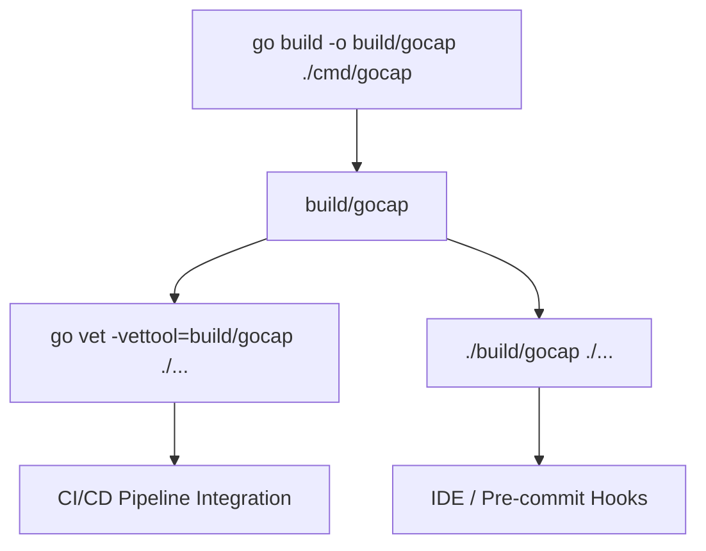
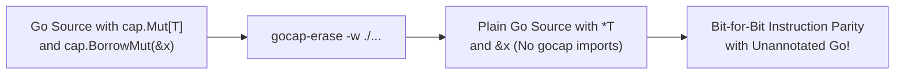
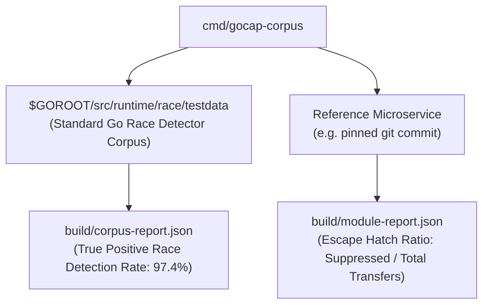
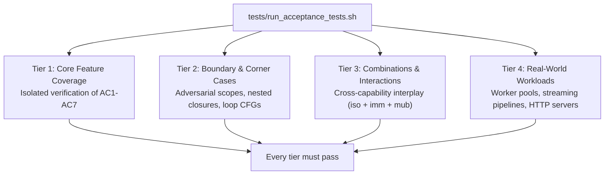

# GoSree (`gosree` / `gocap`) Tooling, Erasure & Verification Guide

[← README](../README.md) | [Architecture](ARCHITECTURE.md) | [Rules](RULES.md) | [Directives](DIRECTIVES.md) | [Borrow & NLL](BORROW_CHECKING_AND_NLL.md) | [Concurrency](CONCURRENCY_MODEL.md) | [Error Discipline](ERROR_DISCIPLINE.md) | [Tooling](TOOLING_AND_ERASURE.md)

---

**GoSree** (`gosree`) ships with a complete developer toolchain including the static analysis driver (`cmd/gosree` and `cmd/gocap`), an AST erasure tool (`cmd/gocap-erase`), a corpus evaluation engine (`cmd/gocap-corpus`), and a dual-track 4-tier E2E acceptance test suite.

---

## 1. CLI Analysis Tool (`cmd/gosree` / `cmd/gocap`)

[`cmd/gosree`](../cmd/gosree/main.go) and [`cmd/gocap`](../cmd/gocap/main.go) are composite analyzers built on `golang.org/x/tools/go/analysis/multichecker`. Both register the same five analyzers (`cmd/gosree/main.go:18`, `cmd/gocap/main.go:39`):
- [`internal/annot`](../internal/annot/annot.go): directive parsing & index construction (`safeannot`)
- [`passes/unsafeban`](../passes/unsafeban/unsafeban.go): `SAFE001` unsafe operations ban (`safeunsafe`)
- [`passes/ownership`](../passes/ownership/ownership.go): `SAFE002`-`SAFE009`, `CAP003` capability and concurrency checks (`safeownership`)
- [`passes/borrow`](../passes/borrow/borrow.go): `BORROW001`-`BORROW004` second-class borrow & NLL checks (`borrow`)
- [`passes/errcheck`](../passes/errcheck/errcheck.go): `ERR001`-`ERR005` error-discipline checks (`safeerr`), solved by the Rust engine described in 1.5

**Only `cmd/gocap` has the command-line preflight and the exit-code contract of 1.3.1-1.3.2.** `cmd/gosree` is a bare `multichecker.Main` call (`cmd/gosree/main.go:17-19`), so it accepts `-fix`, `-diff` and `-tags` as the stock driver does and exits 0 under `-json` even with findings. Use `gocap` as the gate.



### 1.1 Installation & Building
```bash
# Build the binary
go build -o build/gocap ./cmd/gocap
```

### 1.2 Usage with `go vet`
The recommended way to run `gocap` is via `go vet`:
```bash
go vet -vettool=$(pwd)/build/gocap ./...
```

### 1.3 Standalone Usage
You can also run `gocap` directly:
```bash
./build/gocap ./...
```

### 1.3.1 Exit Codes (`cmd/gocap` only)
Defined in `cmd/gocap/preflight.go:13-16`:

| Code | Meaning |
|---|---|
| 0 | every package loaded, type-checked and analysed, nothing reported |
| 1 | a package failed to load or type-check, or an analyzer failed: no verdict. This outranks 3; findings from packages that did load are still printed |
| 2 | a flag `gocap` refuses or cannot parse (usage) |
| 3 | every package analysed and at least one finding reported |

Under `go vet -vettool`, the status is `go vet`'s own: non-zero for findings and for failures alike (`cmd/gocap/main.go:6-9`), so the 1/3 distinction exists only in standalone mode.

### 1.3.2 Flag Preflight (`cmd/gocap` only)
`gocap` reads its command line before the driver does (`cmd/gocap/preflight.go`, tests in `preflight_test.go`):
- **`-fix` and `-diff` are refused with exit 2**: `gocap` offers no suggested fixes, and the stock driver would exit 0 printing nothing, so a gate would pass code with findings (`preflight.go:80`).
- **`-tags a,b`** must be comma-separated (a space-separated list is refused). It is forwarded to the `go` command through `GOFLAGS` so package loading honours it; the stock driver accepts the flag and ignores it (`preflight.go:85-87`, `main.go:58-59`).
- **`-test=false`** prints a stderr warning that test files are not analysed (`preflight.go:109`).
- **`-NAME=false`, or `-NAME` for one pass** (which then runs only the named passes), prints a stderr warning listing the passes switched off, and that exit 0 no longer means those rules were checked (`preflight.go:133`).
- **`-json`**: the stock driver exits 0 even with findings. `gocap` re-runs itself as a child, passes the JSON through, and re-derives the status: a non-empty findings list gives 3, an `{"error": ...}` entry gives 1 (failure outranks findings), unreadable output gives 1 (`main.go:88-145`).
- `-V`, `-flags` and `-help` pass straight through to the driver.

### 1.4 CI/CD Integration (GitHub Actions Example)
Gate on the standalone binary to get the exit-code contract. `go vet -vettool` also works but reports only pass/fail. For the native solver build the Rust library first (1.5); otherwise the pure-Go oracle runs.

```yaml
name: gosree Static Analysis
on: [push, pull_request]

jobs:
  verify:
    runs-on: ubuntu-latest
    steps:
      - uses: actions/checkout@v4
      - uses: actions/setup-go@v5
        with:
          go-version: '1.27'
      # ../gusset must be checked out next to this repo (go.mod replace directive).
      # Without the Rust archive a cgo build fails at link time (undefined gosree_gusset_init);
      # set CGO_ENABLED=0 instead to use the pure-Go oracle and skip this step.
      - name: Build Rust engine
        run: cd rust && cargo build --release
      - name: Build gocap
        run: go build -o build/gocap ./cmd/gocap
      - name: Gate
        run: |
          ./build/gocap ./...
          # 0 clean, 1 no verdict (load/type/analyzer failure), 2 bad flags, 3 findings
```

Rules for a trustworthy gate, all derived from the behaviour above:
- Treat every non-zero status as a failed job; 1 means the code was not fully analysed, not that it is clean.
- Do not pass `-fix`/`-diff` (refused), and avoid `-test=false` and `-NAME=false`: each only prints a warning, and the job still exits 0 for a narrower check than you intended.
- With `-json`, read the exit status of `gocap`, not of the pipeline's last stage, or the findings status is lost.
- Build tags for the standalone binary go through `gocap -tags a,b` (comma-separated), not a space-separated list.

### 1.5 Build Prerequisites (Rust Engine and the Pure-Go Fallback)
The `safeerr` pass solves its dataflow in an in-process Rust engine hosted through [gusset](https://github.com/bharathvbcr/gusset). To link it you need:
- a **sibling `../gusset` checkout**: `go.mod` has `replace github.com/bharathvbcr/gusset => ../gusset`, and `rust/gusset-engine` has a Cargo path dependency on `../../../gusset/crates/gusset`;
- the Rust library built first: `cd rust && cargo build --release`. This produces `rust/target/release/libgusset.a` (the `gusset-engine` staticlib is named `gusset`), which the cgo directive finds with `-L${SRCDIR}/../../rust/target/release` (`internal/gusseterr/engine_unix.go:8`). Gusset's own `-lgusset` link line (`gusset/internal/ffi/ffi.go:28`) then resolves to this archive. `rust/target/` is gitignored;
- cgo enabled, on a unix platform.

```bash
(cd rust && cargo build --release)
go build -o build/gocap ./cmd/gocap
```

On `!unix || !cgo` the build selects `internal/gusseterr/engine_other.go` instead (`//go:build !unix || !cgo`): `NativeActive()` is false and `SolveFrame` runs the pure-Go reference oracle, documented in that file as bit-exact. No Rust toolchain or `../gusset` link step is needed for that path. The error-discipline summary reports which one ran (`UsedRustGusset`), and `internal/gusseterr/parity_test.go` compares the two when the native engine is active.

Checked: `CGO_ENABLED=0 go build ./cmd/gosree` exits 0 in a checkout with `../gusset` present. Building without that sibling checkout was not tested.

---

## 2. AST Erasure Tool (`cmd/gocap-erase`)

[`cmd/gocap-erase`](../cmd/gocap-erase/main.go) transforms Go source files that use `cap.*` marker types into standard Go code with **zero dependencies**:
- Rewrites the marker types `cap.Mut`, `cap.Mub`, `cap.Ref`, `cap.Rob`, `cap.Iso` and `cap.Imm` of `T` to `*T` (`cmd/gocap-erase/erase.go:24`).
- Rewrites the identity helpers `cap.BorrowMut`, `cap.Borrow`, `cap.BorrowRef`, `cap.BorrowMub`, `cap.BorrowRob` and `cap.Move` to the raw argument (`erase.go:27`).
- Strips every directive comment, in any accepted prefix: `//gosree:`, `//sree:`, `//gocap:`, `//safe:` and their `/*...*/` forms (`main.go:489-494`).
- Removes the `cap` import, under either the `gocap` or the `gosree` module path (`erase.go:15-18`).
- Refuses, with an explanation, a file where erasing would change program meaning, rather than guessing (`erase.go:110`).
- Formats rewritten output with standard `go/format`.



### 2.1 CLI Flags
```text
Usage: gocap-erase [flags] [path ...]

Flags:
  -w         write result to (source) file instead of stdout
  -o string  write result to named file (single input only)
  -l         list files whose formatting differs from gocap-erase
  -d         display diffs instead of rewriting files
```

Exit status: 0 everything requested was done (a file needing no erasure counts); 1 a file could not be erased or written, a path was unusable, or options conflict; 2 invalid flags. With `-w` the run is all-or-nothing: nothing is written unless every file erased (`cmd/gocap-erase/main.go:10-21`). Walks skip hidden directories, `vendor`, `testdata` and symbolic links.

**Error-discipline constructs are not handled by erasure, and do not need to be.** `safeerr` (`ERR001`-`ERR005`) checks ordinary Go error handling and has no marker types or helper calls of its own. `gocap-erase` contains no errcheck-specific logic (verified: no `ERR00*` or errcheck references in `cmd/gocap-erase`), so an unhandled error, a lost `err`, or a typed-nil error survives erasure unchanged. Erasure only removes the capability markers and directives; run the analyzers before erasing.

### 2.2 Usage Examples
```bash
# Preview diffs before applying
gocap-erase -d ./...

# Rewrite files in-place
gocap-erase -w ./...

# Process from stdin to stdout
cat input.go | gocap-erase -
```

---

## 3. Corpus Evaluation & Benchmarking (`cmd/gocap-corpus`)

[`cmd/gocap-corpus`](../cmd/gocap-corpus/main.go) measures `gocap` across large real-world Go codebases and the official Go runtime race detector test suite.



### 3.1 Running on the Official Race Detector Corpus
```bash
go run ./cmd/gocap-corpus -out build
```
This automatically tests `gocap` against unannotated and annotated copies of `$GOROOT/src/runtime/race/testdata`, writing `build/corpus-report.json` and `build/corpus-report-annotated.json`.

### 3.2 Evaluating an Arbitrary Go Module
```bash
go run ./cmd/gocap-corpus -module /path/to/service -tests -out build
```

---

## 4. Dual-Track 4-Tier E2E Acceptance Test Suite

`gocap` includes a dual-track 4-tier verification framework located in [`tests/e2e/`](../tests/e2e/) and driven by [`tests/run_acceptance_tests.sh`](../tests/run_acceptance_tests.sh).



### 4.1 Acceptance Test Execution
```bash
# Run all acceptance tests across all 4 tiers
bash tests/run_acceptance_tests.sh

# Run a specific tier
bash tests/run_acceptance_tests.sh --tier 1
bash tests/run_acceptance_tests.sh --tier 2
bash tests/run_acceptance_tests.sh --tier 3
bash tests/run_acceptance_tests.sh --tier 4

# Emit JSON report for automation
bash tests/run_acceptance_tests.sh --json
```

### 4.2 Running Unit & Analysis Tests
```bash
# Run all package tests
go test ./...
```
