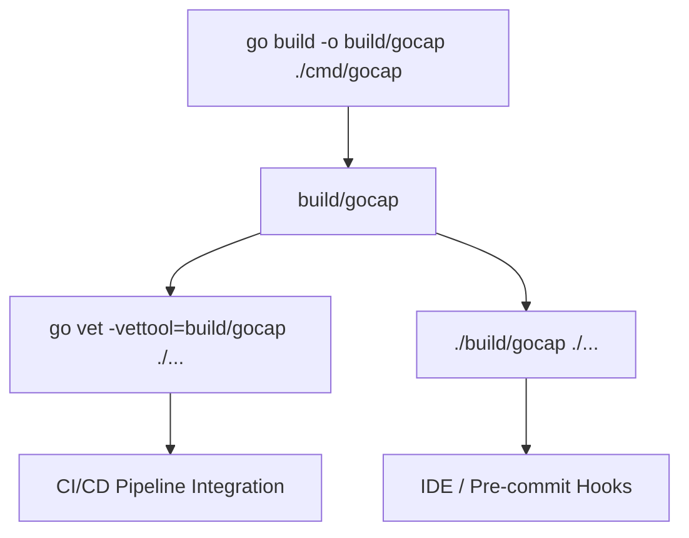
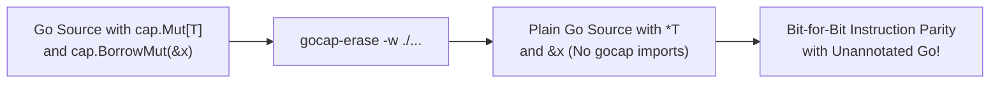
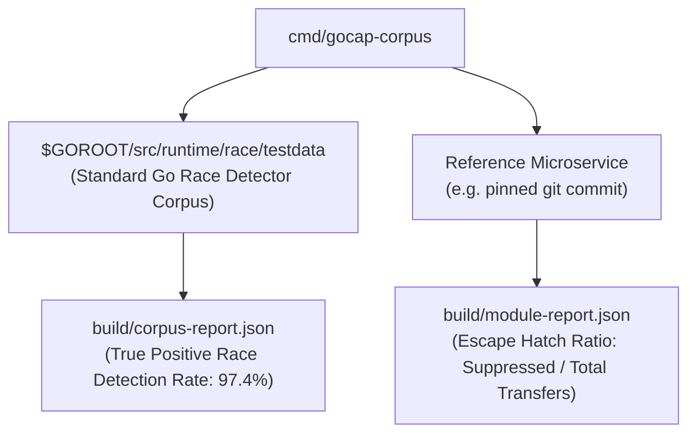
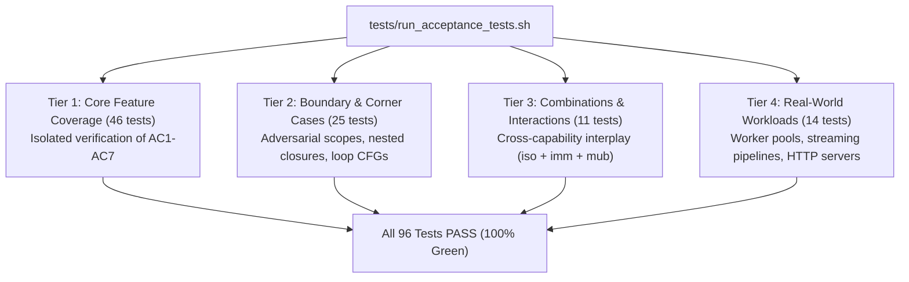

# GoSree (`gosree` / `gocap`) Tooling, Erasure & Verification Guide

[← README](../README.md) | [Architecture](ARCHITECTURE.md) | [Rules](RULES.md) | [Directives](DIRECTIVES.md) | [Borrow & NLL](BORROW_CHECKING_AND_NLL.md) | [Concurrency](CONCURRENCY_MODEL.md) | [Tooling](TOOLING_AND_ERASURE.md)

---

**GoSree** (`gosree`) ships with a complete developer toolchain including the static analysis driver (`cmd/gosree` and `cmd/gocap`), an AST erasure tool (`cmd/gocap-erase`), a corpus evaluation engine (`cmd/gocap-corpus`), and a dual-track 4-tier E2E acceptance test suite.

---

## 1. CLI Analysis Tool (`cmd/gosree` / `cmd/gocap`)

[`cmd/gosree`](file:///Users/bharath/Code/devtools/gocap/cmd/gosree/main.go) (and [`cmd/gocap`](file:///Users/bharath/Code/devtools/gocap/cmd/gocap/main.go)) is a composite analyzer built on `golang.org/x/tools/go/analysis/multichecker`. It runs the following passes in parallel:
- [`internal/annot`](file:///Users/bharath/Code/devtools/gocap/internal/annot/annot.go): Directive parsing & index construction
- [`passes/unsafeban`](file:///Users/bharath/Code/devtools/gocap/passes/unsafeban/unsafeban.go): `SAFE001` unsafe operations ban
- [`passes/borrow`](file:///Users/bharath/Code/devtools/gocap/passes/borrow/borrow.go): `BORROW001`-`BORROW004` second-class borrow & NLL checks
- [`passes/ownership`](file:///Users/bharath/Code/devtools/gocap/passes/ownership/ownership.go): `SAFE002`-`SAFE009`, `CAP003` capability and concurrency checks



### 1.1 Installation & Building
```bash
# Build the binary
go build -o build/gocap ./cmd/gocap
```

### 1.2 Usage with `go vet`
The recommended way to run `gocap` is via `go vet`:
```bash
go vet -vettool=$(pwd)/build/gocap ./...
```

### 1.3 Standalone Usage
You can also run `gocap` directly:
```bash
./build/gocap ./...
```

### 1.4 CI/CD Integration (GitHub Actions Example)
```yaml
name: gocap Static Analysis
on: [push, pull_request]

jobs:
  verify:
    runs-on: ubuntu-latest
    steps:
      - uses: actions/checkout@v4
      - uses: actions/setup-go@v5
        with:
          go-version: '1.27'
      - name: Build gocap
        run: go build -o build/gocap ./cmd/gocap
      - name: Run gocap Verification
        run: go vet -vettool=$(pwd)/build/gocap ./...
```

---

## 2. AST Erasure Tool (`cmd/gocap-erase`)

[`cmd/gocap-erase`](file:///Users/bharath/Code/devtools/gocap/cmd/gocap-erase/main.go) transforms Go source files that use `cap.*` marker types into standard Go code with **zero dependencies**:
- Rewrites `cap.Mut[T]` and `cap.Ref[T]` to `*T`.
- Rewrites `cap.Iso[T]` and `cap.Imm[T]` to `*T`.
- Rewrites `cap.BorrowMut(x)`, `cap.Borrow(x)`, and `cap.Move(x)` to raw `x`.
- Automatically strips unused imports of `github.com/bharathvbcr/gocap/cap`.
- Formats rewritten output with standard `go/format`.



### 2.1 CLI Flags
```text
Usage: gocap-erase [flags] [path ...]

Flags:
  -w         write result to (source) file instead of stdout
  -o string  write result to named file (single input only)
  -l         list files whose formatting differs from gocap-erase
  -d         display diffs instead of rewriting files
```

### 2.2 Usage Examples
```bash
# Preview diffs before applying
gocap-erase -d ./...

# Rewrite files in-place
gocap-erase -w ./...

# Process from stdin to stdout
cat input.go | gocap-erase -
```

---

## 3. Corpus Evaluation & Benchmarking (`cmd/gocap-corpus`)

[`cmd/gocap-corpus`](file:///Users/bharath/Code/devtools/gocap/cmd/gocap-corpus/main.go) measures `gocap` across large real-world Go codebases and the official Go runtime race detector test suite.



### 3.1 Running on the Official Race Detector Corpus
```bash
go run ./cmd/gocap-corpus -out build
```
This automatically tests `gocap` against unannotated and annotated copies of `$GOROOT/src/runtime/race/testdata`, writing `build/corpus-report.json` and `build/corpus-report-annotated.json`.

### 3.2 Evaluating an Arbitrary Go Module
```bash
go run ./cmd/gocap-corpus -module /path/to/service -tests -out build
```

---

## 4. Dual-Track 4-Tier E2E Acceptance Test Suite

`gocap` includes a dual-track 4-tier verification framework located in [`tests/e2e/`](file:///Users/bharath/Code/devtools/gocap/tests/e2e/) and driven by [`tests/run_acceptance_tests.sh`](file:///Users/bharath/Code/devtools/gocap/tests/run_acceptance_tests.sh).



### 4.1 Acceptance Test Execution
```bash
# Run all 96 acceptance tests across all 4 tiers
bash tests/run_acceptance_tests.sh

# Run a specific tier
bash tests/run_acceptance_tests.sh --tier 1
bash tests/run_acceptance_tests.sh --tier 2
bash tests/run_acceptance_tests.sh --tier 3
bash tests/run_acceptance_tests.sh --tier 4

# Emit JSON report for automation
bash tests/run_acceptance_tests.sh --json
```

### 4.2 Running Unit & Analysis Tests
```bash
# Run all package tests
go test ./...
```
