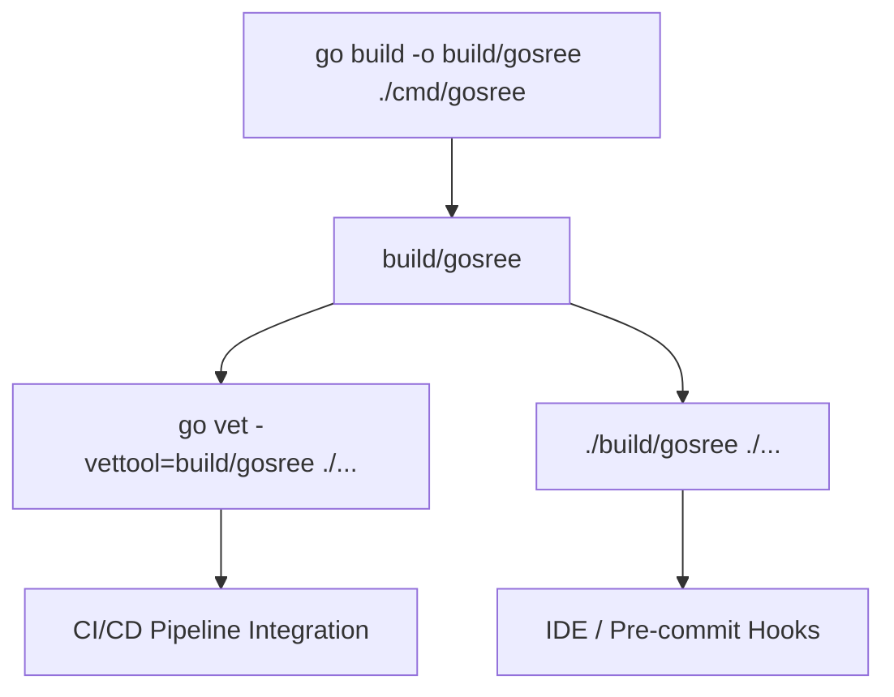
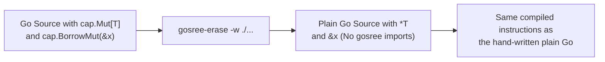
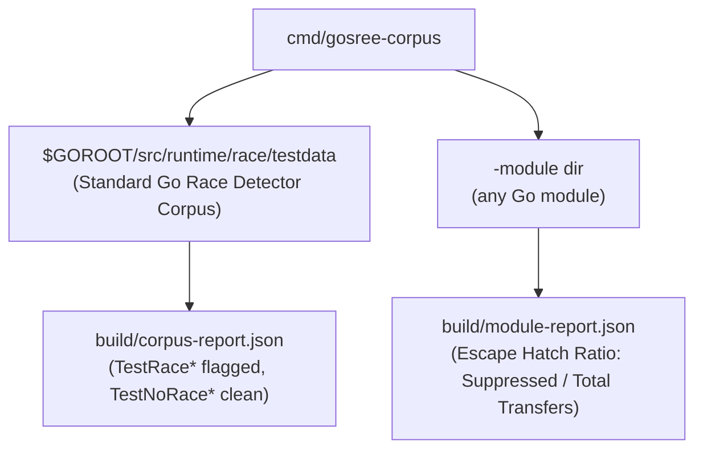
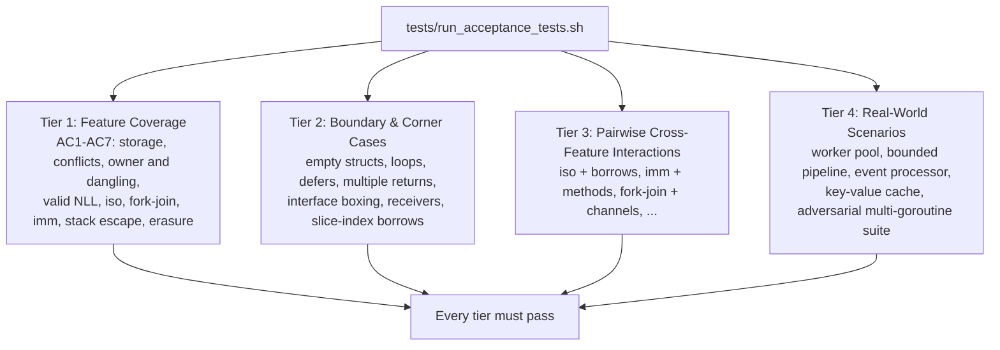

# GoSree Tooling, Erasure & Verification Guide

[← README](../README.md) | [Architecture](ARCHITECTURE.md) | [Rules](RULES.md) | [Directives](DIRECTIVES.md) | [Borrow & NLL](BORROW_CHECKING_AND_NLL.md) | [Concurrency](CONCURRENCY_MODEL.md) | [Error Discipline](ERROR_DISCIPLINE.md) | [Tooling](TOOLING_AND_ERASURE.md)

---

**GoSree** (`gosree`) ships with a static analysis driver (`cmd/gosree`), an AST erasure tool (`cmd/gosree-erase`), a corpus evaluation tool (`cmd/gosree-corpus`), and a 4-tier E2E acceptance test suite.

---

## 1. CLI Analysis Tool (`cmd/gosree`)

[`cmd/gosree`](../cmd/gosree/main.go) is a composite analyzer built on `golang.org/x/tools/go/analysis/multichecker`, with a command-line preflight ([`preflight.go`](../cmd/gosree/preflight.go)) in front of the driver. It registers five analyzers, in this order (the `analyzers` variable in `cmd/gosree/main.go`):
- [`internal/annot`](../internal/annot/annot.go): directive parsing & index construction, and `SAFE007` for malformed directives (`safeannot`)
- [`passes/unsafeban`](../passes/unsafeban/unsafeban.go): `SAFE001` unsafe operations ban (`safeunsafe`)
- [`passes/ownership`](../passes/ownership/ownership.go): `SAFE002`-`SAFE006`, `SAFE008`, `SAFE009` and `CAP003` capability and concurrency checks (`safeownership`)
- [`passes/borrow`](../passes/borrow/borrow.go): `BORROW001`-`BORROW004` second-class borrow & NLL checks (`borrow`)
- [`passes/errcheck`](../passes/errcheck/errcheck.go): `ERR001`-`ERR005` error-discipline checks (`safeerr`), solved by the Rust engine described in 1.5

The stale-escape-hatch analyzer in `internal/annot/stale` is not registered in the driver; only its own tests run it.



### 1.1 Installation & Building
```bash
# Build the binary
go build -o build/gosree ./cmd/gosree
```
This is a local build from a checkout. A cgo build needs the Rust archive and the `../gusset` sibling checkout described in 1.5; `CGO_ENABLED=0 go build -o build/gosree ./cmd/gosree` needs neither. Installing with `go install` from the module path has not been verified, so it is not documented here.

### 1.2 Usage with `go vet`
```bash
go vet -vettool=$(pwd)/build/gosree ./...
```
This works for the pass/fail result: `go vet` exits 0 when nothing is reported and 1 for findings and for a package that fails to type-check alike.

### 1.3 Standalone Usage
```bash
./build/gosree ./...
```
The standalone binary has the exit-code contract of 1.3.1 and the flag preflight of 1.3.2. Use it as the gate.

### 1.3.1 Exit Codes
Defined in the `exit*` constants of `cmd/gosree/preflight.go`. Each code below was produced by a real run on a scratch module:

| Code | Meaning | Produced by |
|---|---|---|
| 0 | every package loaded, type-checked and analysed, nothing reported | `gosree ./clean` |
| 1 | a package failed to load or type-check, or an analyzer failed: no verdict. This outranks 3; findings from packages that did load are still printed | `gosree ./bad` (a package with `return "x"` in an `int` function); `gosree ./find ./bad` also exits 1 and prints the findings of `./find` |
| 2 | a flag `gosree` refuses or cannot parse (usage) | `gosree -fix ./find`; `gosree -diff ./clean`; `gosree -tags 'foo bar' ./tagged`; `gosree -nosuchflag ./clean` |
| 3 | every package analysed and at least one finding reported | `gosree ./find` (a function returning the address of a local, `BORROW004`) |

Under `go vet -vettool`, the status is `go vet`'s own: non-zero for findings and for failures alike (see the package comment of `cmd/gosree/main.go`), so the 1/3 distinction exists only in standalone mode. Observed: `go vet -vettool=gosree ./clean` exits 0, `./find` exits 1, `./bad` exits 1.

### 1.3.2 Flag Preflight
`gosree` reads its command line before the driver does (`parseCommandLine` in `cmd/gosree/preflight.go`, tests in `preflight_test.go`):
- **`-fix` and `-diff` are refused with exit 2**: `gosree` offers no suggested fixes, and the stock driver given `-fix` (or `-fix -diff`) exits 0 and prints nothing, so a gate would pass code with findings. A bare `-diff` is refused too. `-fix=false` is accepted.
- **`-tags a,b`** must be comma-separated (a space-separated list is refused with exit 2). It is forwarded to the `go` command through `GOFLAGS` so package loading honours it; the stock driver accepts the flag and ignores it. Observed: a file guarded by `//go:build foo` is analysed with `gosree -tags foo ./tagged` (exit 3) and skipped without it (exit 0). With `go vet -vettool`, pass `-tags` to `go vet` itself.
- **`-test=false`** prints a stderr warning that test files are not analysed:
  `gosree: WARNING: -test=false: test files are not analysed, so findings in them are not reported`
- **`-NAME=false`, or `-NAME` for one pass** (which then runs only the named passes), prints a stderr warning listing the passes switched off, and that exit 0 no longer means those rules were checked. For example `-borrow=false` prints `gosree: WARNING: analysis passes are switched off by the command line: -borrow (the borrow rules). Exit status 0 then does not mean those rules were checked`, and `gosree -borrow=false ./find` exits 0 although `./find` has a `BORROW004` finding.
- **`-json`**: the stock driver exits 0 even with findings. `gosree` re-runs itself as a child (marked by the `GOSREE_JSON_CHILD` environment variable), passes the JSON through, and re-derives the status in `jsonExit`: a non-empty findings list gives 3, an `{"error": ...}` entry gives 1 (failure outranks findings), unreadable output gives 1. Observed: `-json ./clean` exits 0, `-json ./find` exits 3, `-json ./bad` exits 1, `-json ./find ./bad` exits 1. The unreadable-output case is covered by `TestJSONExit` rather than a command-line run.
- `-V`, `-flags` and `-help` pass straight through to the driver (exit 0).

### 1.4 CI/CD Integration (GitHub Actions Example)
Gate on the standalone binary to get the exit-code contract. `go vet -vettool` also works but reports only pass/fail. For the native solver build the Rust library first (1.5); otherwise the pure-Go oracle runs.

This YAML is an example. It was not executed on GitHub Actions; each `run` command was executed locally (the `cargo` step is subject to the note in 1.5), and whether a workflow can check out the `gusset` repository (access, name) is for you to confirm.

```yaml
name: gosree static analysis
on: [push, pull_request]

jobs:
  verify:
    runs-on: ubuntu-latest
    steps:
      # go.mod replaces github.com/bharathvbcr/gusset with ../gusset, so the two
      # repositories are checked out side by side.
      - uses: actions/checkout@v4
        with:
          path: gosree
      - uses: actions/checkout@v4
        with:
          repository: bharathvbcr/gusset
          path: gusset
      - uses: actions/setup-go@v5
        with:
          go-version: '1.27'
      # Without the Rust archive a cgo build fails at link time (undefined gosree_gusset_init);
      # drop this step and build with CGO_ENABLED=0 to use the pure-Go oracle instead.
      - name: Build Rust engine
        working-directory: gosree
        run: cd rust && cargo build --release
      - name: Build gosree
        working-directory: gosree
        run: go build -o build/gosree ./cmd/gosree
      - name: Gate
        working-directory: gosree
        run: |
          ./build/gosree ./...
          # 0 clean, 1 no verdict (load/type/analyzer failure), 2 bad flags, 3 findings
```

Rules for a trustworthy gate, all derived from the behaviour above:
- Treat every non-zero status as a failed job; 1 means the code was not fully analysed, not that it is clean.
- Do not pass `-fix`/`-diff` (refused), and avoid `-test=false` and `-NAME=false`: each only prints a warning, and the job still exits 0 for a narrower check than you intended.
- With `-json`, read the exit status of `gosree`, not of the pipeline's last stage, or the findings status is lost.
- Build tags go through `gosree -tags a,b` (comma-separated), not a space-separated list.

### 1.5 Build Prerequisites (Rust Engine and the Pure-Go Fallback)
The `safeerr` pass solves its dataflow in an in-process Rust engine hosted through [gusset](https://github.com/bharathvbcr/gusset). To link it you need:
- a **sibling `../gusset` checkout**: `go.mod` has `replace github.com/bharathvbcr/gusset => ../gusset`, and `rust/gusset-engine` has a Cargo path dependency on `../../../gusset/crates/gusset`;
- the Rust library built first: `cd rust && cargo build --release`. This produces `rust/target/release/libgusset.a` (the `gusset-engine` staticlib is named `gusset`), which the cgo directive finds with `-L${SRCDIR}/../../rust/target/release` (`internal/gusseterr/engine_unix.go`). Gusset's own `-lgusset` link line (`internal/ffi/ffi.go` in the gusset checkout) then resolves to this archive. `rust/target/` is gitignored;
- cgo enabled, on a unix platform.

```bash
(cd rust && cargo build --release)
go build -o build/gosree ./cmd/gosree
```

Observed failures when a prerequisite is missing, in a scratch copy of the checkout:
- cgo build, no `../gusset`: `go build` stops while loading packages with `replacement directory ../gusset does not exist`.
- cgo build, `gusset` present, no `rust/target/release/libgusset.a`: the link fails with `Undefined symbols ... gosree_gusset_init`.

On `!unix || !cgo` the build selects `internal/gusseterr/engine_other.go` instead (`//go:build !unix || !cgo`): `NativeActive()` is false and `SolveFrame` runs the pure-Go reference oracle, documented in that file as bit-exact. No Rust toolchain or `../gusset` checkout is needed for that path: `CGO_ENABLED=0 go build ./cmd/gosree` exits 0 in a scratch copy of the checkout with no `../gusset` beside it. The error-discipline summary reports which engine ran (`UsedRustGusset` in the `Summary` of `passes/errcheck`), and `TestDifferentialParityRandomizedCFGs` in `internal/gusseterr/parity_test.go` compares the native engine with the oracle on randomized control-flow graphs when the native engine is active. The same diagnostics come out of the native build and the `CGO_ENABLED=0` build for every example in [Borrow & NLL](BORROW_CHECKING_AND_NLL.md).

---

## 2. AST Erasure Tool (`cmd/gosree-erase`)

[`cmd/gosree-erase`](../cmd/gosree-erase/main.go) transforms Go source files that use `cap.*` marker types into standard Go code with **zero dependencies**:
- Rewrites the marker types `cap.Mut`, `cap.Mub`, `cap.Ref`, `cap.Rob`, `cap.Iso` and `cap.Imm` of `T` to `*T` (`markerTypes` in `cmd/gosree-erase/erase.go`).
- Rewrites the identity helpers `cap.BorrowMut`, `cap.Borrow`, `cap.BorrowRef`, `cap.BorrowMub`, `cap.BorrowRob` and `cap.Move` to the raw argument (`helperFuncs` in `erase.go`).
- Strips every `//gosree:` and `/*gosree:` directive comment (`isDirective` in `main.go`). Nothing else is a directive, so any other comment, such as `//nolint:unused`, is left in place like any ordinary comment.
- Removes the `cap` import (`github.com/bharathvbcr/gosree/cap`) and an import of the module root path (`github.com/bharathvbcr/gosree`) (`collectImports` in `erase.go`).
- Refuses, with an explanation, a file where erasing would change program meaning, rather than guessing: an embedded marker field (`struct{ cap.Mut[int] }`, since erasure would rename the field) or a helper used as a value without type arguments (`var f = cap.Move`) (`reportResidue` and the `problem` calls in `erase.go`).
- Formats rewritten output with standard `go/format`.



The compiled-instructions claim is checked for one function by `TestStressBinaryParity` in `cmd/gosree-erase/stress_erase_test.go`: it builds the annotated and the erased program, compares the disassembly of `main.work` (8 instructions, identical after address normalisation) and checks that neither binary contains a `gosree/cap` symbol. It is a spot check on that function, not a proof for all code.

### 2.1 CLI Flags
```text
Usage: gosree-erase [flags] [path ...]

Flags:
  -d	display diffs instead of rewriting files
  -l	list files whose formatting differs from gosree-erase
  -o string
    	write result to named file (single input only)
  -w	write result to (source) file instead of stdout
```

`-l` lists the files that erasure would change; a file that needs no erasure is neither listed nor written. `-d` prints, per file, `--- path`, `+++ path (erased)` and the removed and added lines. A path is a Go file, a directory (walked recursively) or `dir/...` (the same walk).

Exit status, each observed with a real run: 0 everything requested was done (a file needing no erasure counts; `-d` exits 0 even when it prints a diff); 1 a file could not be erased or written (`gosree-erase bad.go` on an embedded marker field), a path was unusable (`gosree-erase nosuchfile.go`), or options conflict (`-w -o x`, `-o x a.go b.go`, `-w -`); 2 invalid flags (`gosree-erase -zzz a.go`). With `-w` the run is all-or-nothing: nothing is written unless every file erased, and a refused file leaves the others unchanged (`cmd/gosree-erase/main.go`). Walks skip hidden directories, `vendor`, `testdata` and symbolic links (a skipped link is reported on stderr; a link named directly on the command line is followed if it resolves inside the current directory, and is an error, exit 1, if it resolves outside it).

**Error-discipline constructs are not handled by erasure, and do not need to be.** `safeerr` (`ERR001`-`ERR005`) checks ordinary Go error handling and has no marker types or helper calls of its own. `gosree-erase` contains no errcheck-specific logic (verified: no `ERR00*` or errcheck references in `cmd/gosree-erase`), so an unhandled error, a lost `err`, or a typed-nil error survives erasure unchanged. Erasure only removes the capability markers and directives; run the analyzers before erasing.

### 2.2 Usage Examples
```bash
# Preview diffs before applying
gosree-erase -d ./...

# Rewrite files in-place
gosree-erase -w ./...

# Process from stdin to stdout
cat input.go | gosree-erase -
```
With no path argument the tool also reads standard input.

---

## 3. Corpus Evaluation & Benchmarking (`cmd/gosree-corpus`)

[`cmd/gosree-corpus`](../cmd/gosree-corpus/main.go) measures GoSree on large real-world Go codebases and on the Go runtime race detector's own test corpus. It runs the directive, unsafe-ban and ownership passes (`internal/annot`, `passes/unsafeban`, `passes/ownership`); it does not run `borrow` or `safeerr`.



### 3.1 Running on the Official Race Detector Corpus
```bash
go run ./cmd/gosree-corpus -out build
```
This copies `$GOROOT/src/runtime/race/testdata` into `build/racecorpus` (skipping files that cannot build outside GOROOT, and counting them), tests GoSree against it and against an annotated copy in `build/racecorpus-annotated`, and writes `build/corpus-report.json` and `build/corpus-report-annotated.json`. It prints how many `TestRace*` functions were flagged and how many `TestNoRace*` functions came out clean, per diagnostic category, with the missed races listed. The counts depend on the installed Go release, so they are not quoted here.

### 3.2 Evaluating an Arbitrary Go Module
```bash
go run ./cmd/gosree-corpus -module /path/to/service -tests -out build
```
This analyses the module's packages (all of `./...` unless package patterns follow) and prints, per package and in total, the transfers (`go` statements, callbacks on another goroutine, channel sends and `//gosree:iso` arguments), how many needed `//gosree:unsafe`, and the resulting escape-hatch ratio, with the findings that remain. The report goes to `build/module-report.json`. A module that does not type-check is refused with exit 1.

---

## 4. 4-Tier E2E Acceptance Test Suite

GoSree includes a 4-tier verification suite in [`tests/e2e/`](../tests/e2e/) driven by [`tests/run_acceptance_tests.sh`](../tests/run_acceptance_tests.sh). The script runs `go test -v` over the tier tests and prints what it measured on that run: top-level tests passed, failed and skipped per tier (counted from the `go test -v` output) and the `// want` expectation lines in each tier's testdata.



### 4.1 Acceptance Test Execution
```bash
# Run all acceptance tests across all 4 tiers
bash tests/run_acceptance_tests.sh

# Run a specific tier
bash tests/run_acceptance_tests.sh --tier 1
bash tests/run_acceptance_tests.sh --tier 2
bash tests/run_acceptance_tests.sh --tier 3
bash tests/run_acceptance_tests.sh --tier 4

# Emit JSON report for automation
bash tests/run_acceptance_tests.sh --json
```
Other options: `-v`/`--verbose` streams the `go test -v` output; `-h`/`--help` prints the usage. A bad option or tier exits 2.

The summary is a table of passed, failed and skipped tests and `want` lines per tier, with a total row, the duration and a final `PASSED` or `FAILED (go test exit code N)`:

```text
Tier       Passed   Failed  Skipped   want lines
1               9        0        0           40
2               1        0        0            8
3               1        0        0            5
4               1        0        0           11
Total          12        0        0           64
PASSED
```
These counts (12 top-level tests, 64 `want` lines) are a measurement of the current testdata, not a fixed property; the script exits 0 only when `go test` exits 0, no test failed and at least one passed, and otherwise prints the `go test` output and exits 1. With `--json` it prints the same figures as JSON (`status`, `tier`, `go_test_exit_code`, `duration_s`, per-tier and total counts) and uses the same exit status.

### 4.2 Running Unit & Analysis Tests
```bash
# Run all package tests
go test -timeout 30m ./...
```
The `tests/stress` package alone takes several minutes and can exceed `go test`'s default 10 minute timeout on a loaded machine, hence the explicit timeout. (Unverified in this guide: the full `go test ./...` run is a maintainer measurement; only targeted packages and the acceptance tiers were run here.)
